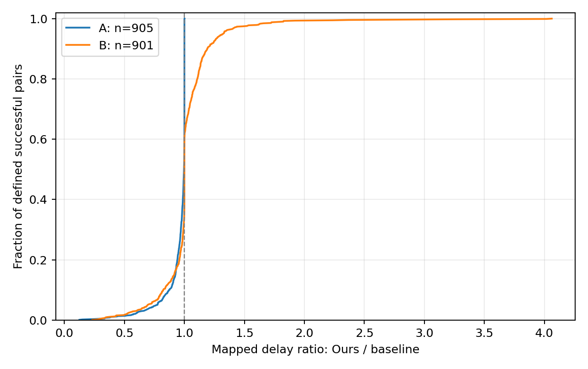
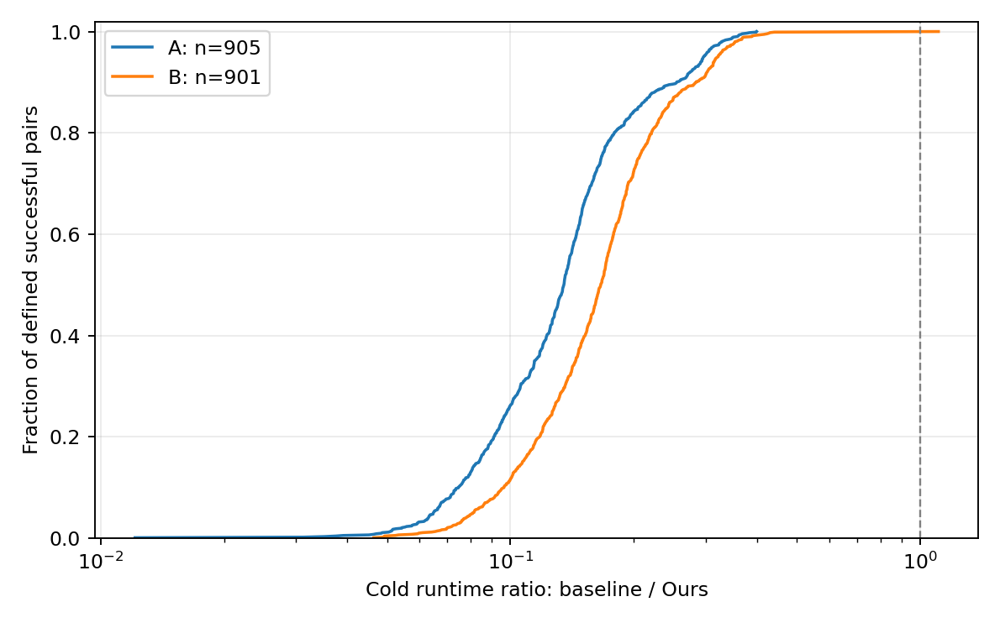
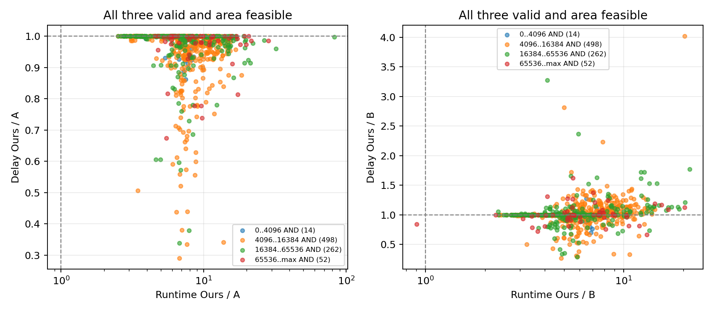

# MFFC 级 GPU 梯度优化：905 电路正式结果

日期：2026-11-14。冻结源 `ecc85e6`；905×3=2715 个终态、5750 份真实测量已审计。**工程与完整评估已完成；本轮没有实现预期的整体 Delay–Runtime 优势。**

| 相对基线 | 成功配对 | Delay 胜/平/负 | 改善中位数 | Ours/基线 Delay 比几何均值 | 配对基线/Ours时间比中位数 |
|---|---:|---|---:|---:|---:|
| A：原图 mapping | 905 | 544/360/1 | 0.3551% | 0.944392 | 0.135011 |
| B：单次 ABC rewrite | 901 | 354/184/363 | 0.0000% | 0.998084 | 0.166129 |

Delay 比几何均值分别低于1约5.56%/0.19%；它不是逐电路改善的算术平均。按逐电路时间比看，Ours典型约慢7.41/6.02倍，未证明对B的稳定质量优势。

| 方法 | PASS/FAIL/TIMEOUT | 冷E2E中位/P90（s） | 全部终态记录时间合计（s） |
|---|---|---:|---:|
| A | 905/0/0 | 2.3225 / 5.8847 | 3063.3171 |
| B | 901/4/0 | 2.8215 / 7.6835 | 4646.0542 |
| Ours | 905/0/0 | 18.7669 / 49.6327 | 25640.7139 |

Ours的905个final均CEC PASS、area≤1.05×自身付费no-op；对A/B的配对area ratio中位均1.0。A/B分别有7/73个成功点超出该面积条件，raw结果仍保留。三者共同成功且面积可行的826例中，对A“delay更好且不更慢”为0例，对B为1例。4项B原生rewrite断言保留缺失指标；Ours另有2个内部CUDA分配失败请求，最终回退成功。

806例实际在RTX4090执行Candidate→Decision→MFFC聚合和完整Region DAG设备队列前/反传播；5例CPU、94例无候选。806例原生CUDA事件合计的逐点中位70.09ms；全方法主要成本仍是多次真实验证与CPU准备，不能据A/B对照宣称纯GPU因果加速。最终来源：梯度415、no-op359、原图回退131。代理下降不保证真实delay下降，当前没有独立证明梯度或LiteCut的因果收益。

以下为完整统计、图表、失败与证据索引。全部真实delay均为固定ABC/ASAP7的`ABC_SCL_LIBERTY`；旧MIO/pair/mode0标签不参与比较。

---

## 全量统计与审计正文

证据范围：905输入、2715终态方法点；原始测量审计5750份，成功replay观察3039份。

| 方法 | 尝试/成功/失败/超时 | 中位冷E2E s | P90 s | 全部终态总记录时间 s | 面积可行成功点 |
|---|---|---:|---:|---:|---:|
| A | 905/905/0/0 | 2.3225 | 5.8847 | 3063.3171 | 898 |
| B | 905/901/4/0 | 2.8215 | 7.6835 | 4646.0542 | 828 |
| Ours | 905/905/0/0 | 18.7669 | 49.6327 | 25640.7139 | 905 |

| 比较 | 成功配对 | Delay胜/平/负 | 改善中位 % | Delay ratio几何均值（分母） | 配对baseline/Ours时间比中位 |
|---|---:|---|---:|---|---:|
| 相对A | 905 | 544/360/1 | 0.3551 | 0.944392 (905) | 0.1350 |
| 相对B | 901 | 354/184/363 | 0.0000 | 0.998084 (901) | 0.1661 |

Delay ratio=Ours/baseline，越低越好；时间比=baseline/Ours，越高越好。全部单方法runtime含失败/超时；配对比只含成功方法。面积单位为固定Liberty的库单位。CEC通过仅指成功测量；失败不给替代delay。

缺少完整冷时钟的方法点数：{'A': 0, 'B': 0, 'Ours': 0}；这类中断保持N/A，不补零，总记录时间仅求和可用时钟。

GPU并行的是Candidate→Decision→MFFC聚合与保留依赖的完整Region DAG前/反传播，最终真实改图仍顺序受控。仅A/B对照不能独立证明GPU或梯度的因果收益；阶段与设备是实现证据。候选预检仍非完整可执行性预测。

原始目录：`/data/wushangge/CULS_LiteCut/runs/20261113T191340Z-mffc-full905-frozen-6a45b8db`；算法源码`ecc85e6ac82571caf9f1a6004098dbe976536256`。所有预测、Student分数与真实ABC_SCL_LIBERTY分列。无候选设计数：94，未知候选数设计：0。

## 完整来源与规模分组

| 分组 | 输入数 | Ours成功/尝试 | 对A Delay比 | 对B Delay比 | A/Ours时间比 | B/Ours时间比 |
|---|---:|---|---:|---:|---:|---:|
| by_source/ACE | 40 | 40/40 | 0.962246 | 1.036525 | 0.1340 | 0.1747 |
| by_source/OpenABC | 47 | 47/47 | 0.915158 | 1.020876 | 0.1280 | 0.1502 |
| by_source/forgeEDA | 805 | 805/805 | 0.945281 | 0.990899 | 0.1369 | 0.1672 |
| by_source/iwls2022 | 5 | 5/5 | 0.965776 | 1.258332 | 0.1103 | 0.1561 |
| by_source/iwls2024 | 8 | 8/8 | 0.927930 | 1.290442 | 0.1015 | 0.1454 |
| by_and_size/0_128 | 0 | 0/0 | N/A | N/A | N/A | N/A |
| by_and_size/128_4096 | 15 | 15/15 | 0.941276 | 0.947970 | 0.1345 | 0.1511 |
| by_and_size/4096_8192 | 241 | 241/241 | 0.945160 | 1.014591 | 0.1287 | 0.1530 |
| by_and_size/8192_16384 | 300 | 300/300 | 0.933537 | 0.976032 | 0.1367 | 0.1670 |
| by_and_size/16384_65536 | 291 | 291/291 | 0.958743 | 1.010853 | 0.1417 | 0.1819 |
| by_and_size/65536_plus | 58 | 58/58 | 0.927176 | 0.994828 | 0.1101 | 0.1652 |

## 面积条件下的质量—时间关系

仅统计A/B/Ours共同成功且均满足本方法付费no-op面积阈值的输入。better/tie/worse分别按冻结delay/runtime容差判断；下表九格关系互斥，未按结果挑子集。

对A，共同有效可行分母826：

```json
{
  "better_delay__worse_time": 479,
  "tie_delay__worse_time": 347
}
```

对B，共同有效可行分母826：

```json
{
  "better_delay__worse_time": 328,
  "worse_delay__worse_time": 313,
  "tie_delay__worse_time": 184,
  "better_delay__better_time": 1
}
```

## 实际设备、调用与主要成本

| 方法 | CEC调用 | Mapping调用 | 原生replay命令 | 失败候选请求 | repair请求 | 梯度设备/最终来源 |
|---|---:|---:|---:|---:|---:|---|
| A | 905 | 905 | 0 | 0 | 0 | {'cpu': 905} / {'original': 905} |
| B | 901 | 901 | 0 | 0 | 0 | {'cpu': 901} / {'abc_single_native_rewrite': 901} |
| Ours | 4284 | 3944 | 2312 | 2 | 0 | {'cuda': 806, 'none': 94, 'cpu': 5} / {'mffc_global_gradient': 415, 'original_fallback': 131, 'replay_noop': 359} |

Ours各inclusive阶段：

| 阶段 | 有记录方法点 | 中位 s | P90 s | 总inclusive s |
|---|---:|---:|---:|---:|
| original_cec_mapping | 905 | 1.8467 | 5.2453 | 2642.9243 |
| mffc_partition | 905 | 0.0661 | 0.2912 | 139.7359 |
| candidate_enumeration | 905 | 1.3981 | 4.6086 | 2088.2577 |
| boolean_validation | 905 | 0.0727 | 1.3311 | 498.9865 |
| real_replay_cec_mapping | 905 | 5.0654 | 14.3137 | 7184.5525 |
| candidate_reuse_preflight | 811 | 0.0974 | 0.5052 | 199.2836 |
| litecut_preparation_inference | 811 | 1.4705 | 12.1419 | 4388.5347 |
| global_model_preparation | 811 | 1.1659 | 1.7647 | 1081.6363 |
| global_gradient_and_joint_blocks | 811 | 0.0522 | 0.1965 | 79.0822 |
| real_batch_replay_cec_mapping | 778 | 6.5294 | 18.2070 | 8351.2348 |
| gpu_or_cpu_proxy_calibration | 777 | 0.0671 | 0.2824 | 105.8436 |

阶段和工具调用可嵌套/并发，不能相加当完整wall或直接换算独占百分比。整批本次driver elapsed为33434.4075s；与单电路cold latency分开。断点多session的总elapsed需结合各Slurm记录。

已中断且无完整观察的内部请求：{'A': 0, 'B': 0, 'Ours': 0}；损坏/不完整的失败命令文件：{'A': 0, 'B': 0, 'Ours': 0}。这些保持显式缺失，不补造成成功或零成本。

## 图与完整数据



[导出PDF](docs/mffc_gpu/figures/delay_relative_A_B.pdf)



[导出PDF](docs/mffc_gpu/figures/runtime_relative_A_B.pdf)



[导出PDF](docs/mffc_gpu/figures/quality_runtime_by_size.pdf)

逐电路长表：`BENCHMARK905_RESULTS.csv`；完整统计与分母：`BENCHMARK905_SUMMARY.json`；逐点核验索引：`audited_records.json`；原始证据hash：`evidence_hashes.json`。

## 解释边界

本轮是固定小预算、一个预定seed和既有905集合的真实结果，不是未见集或最优性证明。可微梯度只属于固定原图代理，不经过Student或真实mapper；保留final best也可能来自repair/no-op/付费original。A/B与Ours的成本不同，不能把整体相对速度当作纯GPU加速。没有布局布线后signoff，也没有在本轮加入random/greedy/旧版或joint扩展。

## 完整安装、修复和实际DAG计算补充

完整安装PASS/FAIL/UNKNOWN为{'PASS': 3039, 'FAIL': 2, 'UNKNOWN': 0}；其中非空完整组合2134个。失败部分安装中确实接受0个rewrite，仅计实际工作量，不给这些部分电路成功timing标签。拒绝状态：{}。

失败请求已有2个时钟，inclusive合计6.5457s；repair已有0个，inclusive合计0.0000s。缺终态观察0个。共享replay/并发验证会重叠，这些不是独占wall占比。

| 比较 | 共同可行分母 | delay更好且不更慢 | 更快且delay不差 | 更快但质量下降 | 更慢但质量改善 |
|---|---:|---:|---:|---:|---:|
| A | 826 | 0 | 0 | 0 | 479 |
| B | 826 | 1 | 1 | 0 | 328 |

前两列可能重叠；原九格关系保持不变。

原始正式作业65245为COMPLETED/0:0，Slurm elapsed=34427s，资源billing=4,cpu=4,gres/gpu=1,mem=64G,node=1；它含套件准备/分析，不是单方法latency，也不等于所有并发阶段之和。

有实际CUDA原生传播的Ours方法点806个。下表仅描述该子集的结构与事件成本；不构成同算法CPU/GPU因果对照。

| 结构字段 / 区间 | 方法点 | MFFC中位数 | DAG层数中位 | 最大同层宽度中位 | 原生GPU内核合计中位ms | 完整E2E中位s |
|---|---:|---:|---:|---:|---:|---:|
| region_dag_layers/0_1 | 0 | N/A | N/A | N/A | N/A | N/A |
| region_dag_layers/1_32 | 449 | 2900.0000 | 8.0000 | 1504.0000 | 51.8769 | 17.0149 |
| region_dag_layers/32_512 | 315 | 3465.0000 | 72.0000 | 509.0000 | 83.2184 | 22.6444 |
| region_dag_layers/512_4096 | 36 | 8356.5000 | 1088.5000 | 255.0000 | 384.6441 | 43.6351 |
| region_dag_layers/4096_plus | 6 | 37383.0000 | 4573.0000 | 2378.0000 | 1583.4394 | 120.2535 |
| max_layer_width/0_32 | 5 | 1437.0000 | 263.0000 | 25.0000 | 87.9073 | 19.6046 |
| max_layer_width/32_512 | 282 | 2174.5000 | 65.5000 | 232.5000 | 53.2347 | 18.2817 |
| max_layer_width/512_8192 | 465 | 4144.0000 | 12.0000 | 1311.0000 | 77.7400 | 20.2567 |
| max_layer_width/8192_plus | 54 | 13585.5000 | 6.5000 | 8951.0000 | 275.0167 | 41.5869 |

原生事件不包括其他Torch聚合、上下文初始化、CPU特征/Student和EDA；不同调用的batch可不同。结构分组为描述性补充，来源/AND主分组与所有胜负/时间容差仍使用冻结协议。完整逐点安装明细见`installation_details.json`，完整设备/结构分组见SUMMARY的`delivery_supplement`。


## CEC、Mapping与Replay的实际记录成本

包含成功、失败及超时方法点内已保存的命令。每点时间为该类命令的inclusive和；有并发验证时会重叠，不能相加当独占wall占比。时间n只统计有记录的点，未出现该工具或时钟缺失不补零。调用数为已保存命令数，损坏命令文件另列。

| 方法 / 工具 | 已记录调用数 | 有时间方法点 | 每点inclusive中位s | P90 s | 总inclusive s | 有调用但无时钟点 |
|---|---:|---:|---:|---:|---:|---:|
| A/cec | 905.0000 | 905 | 0.0641 | 0.1642 | 89.4409 | 0 |
| A/mapping | 905.0000 | 905 | 1.8172 | 5.2026 | 2569.3783 | 0 |
| A/rewrite | 0.0000 | 0 | N/A | N/A | N/A | 0 |
| A/native_rewrite | 0.0000 | 0 | N/A | N/A | N/A | 0 |
| B/cec | 901.0000 | 901 | 0.4647 | 2.2177 | 1694.6541 | 0 |
| B/mapping | 901.0000 | 901 | 1.7165 | 4.5203 | 2320.2538 | 0 |
| B/rewrite | 0.0000 | 0 | N/A | N/A | N/A | 0 |
| B/native_rewrite | 905.0000 | 905 | 0.1642 | 0.4145 | 215.8255 | 0 |
| Ours/cec | 4284.0000 | 905 | 1.0865 | 4.2685 | 2735.9113 | 0 |
| Ours/mapping | 3944.0000 | 905 | 7.9428 | 24.0457 | 11307.9938 | 0 |
| Ours/rewrite | 2312.0000 | 905 | 1.0468 | 2.9723 | 1431.6098 | 0 |
| Ours/native_rewrite | 0.0000 | 0 | N/A | N/A | N/A | 0 |

未读/损坏的命令文件数：{'A': 0, 'B': 0, 'Ours': 0}。完整冷wall使用主表，不以这些重叠分项代替。

## 经实验确认的限制与异常

- 相对B逐电路改善的算术均值为−2.4573%（901对），中位数0%；几何均值略好不能掩盖354胜/363负和明显退化尾部。ACE/OpenABC/iwls2022/iwls2024的对B delay比几何均值分别为1.036525/1.020876/1.258332/1.290442；结果依赖来源，不能用forgeEDA的总体权重替代各来源表现。
- 对A唯一负例为index539 `forgeEDA/intra_s2RefSubsti.aig`：1298.714230→1299.996700ps，退化0.098749%；Ours选no-op，面积7133.935550→6715.897950。原图超过本例no-op1.05倍阈值，不能作为可行回退。这不是梯度候选的真实改善。
- index104 `forgeEDA/BRAM_SSP.aig`两个内部请求共享同一次batch命令，gpuls在`cudaDeviceSetLimit(cudaLimitMallocHeapSize, 2048*1024*1024)`报告out of memory，返回1。两请求没有成功timing标签；inclusive请求时间为3.272750/3.272956s，共享命令实际为3.269543s，不能相加当独占成本。最终no-op为4243.653320ps、area22461.130900、CEC PASS，完整冷wall25.109973s。未据CPU MaxRSS推断显存，也未定位分配失败的更深原因。
- 完整安装PASS/FAIL/UNKNOWN=3039/2/0，其中非空完整组合2134；两个失败均在上述batch启动失败，部分接受计数0、repair请求0。可行性预检不等于动态可执行性或资源保证。本轮保留预算和失败，没有事后重试或换工具。
- 94例无有效Decision；905例final中只有415例来自梯度提案，其他490例是no-op或付费original。全量成功不能等同于所有设计获得梯度收益。单seed、小预算、固定原图DAG代理和候选域，不是最优性或未见集泛化证明。
- 冷wall包含子进程、模型/结构/候选准备、数据传输、选择、所有实际验证与失败。OS页缓存未清空，不能称系统级冷缓存。工具/阶段inclusive存在共享、嵌套和并发，不能从合计值构造独占占比。

## 版本、命令与原始证据

| 证据 | 实际位置 |
|---|---|
| 冻结协议、输入与工具身份 | [协议](BENCHMARK905_PROTOCOL.md)、[905输入](benchmark905_manifest.json)、[机器协议](config/mffc905_protocol.json)、[冻结源码审查](provenance/mffc_gpu_freeze_audit.json) |
| 正式实验、命令与资源 | `/data/wushangge/CULS_LiteCut/runs/20261113T191340Z-mffc-full905-frozen-6a45b8db`，`input/formal-command.json`、`input/submission.json`、`input/mffc905_preflight.json`、`logs/slurm-65245.out` |
| 逐点终态与真实请求 | 正式目录下`output/records/NNNN_METHOD.json`及`output/case_NNNN_METHOD/work/`；CSV的`detail_path`可直接定位 |
| 原始审计与61,067份证据hash索引 | [analysis_completion.json](/data/wushangge/CULS_LiteCut/runs/20261113T191340Z-mffc-full905-frozen-6a45b8db/output/benchmark905_delivery/analysis_completion.json)、[audited_records.json](/data/wushangge/CULS_LiteCut/runs/20261113T191340Z-mffc-full905-frozen-6a45b8db/output/benchmark905_delivery/audited_records.json)、[evidence_hashes.json](/data/wushangge/CULS_LiteCut/runs/20261113T191340Z-mffc-full905-frozen-6a45b8db/output/benchmark905_delivery/evidence_hashes.json) |
| 含完整工具成本的交付 | `/data/wushangge/CULS_LiteCut/runs/20261113T200926Z-mffc-final905-tool-cost-delivery-67ebf285/output/final_mffc905_delivery`；[delivery_completion.json](/data/wushangge/CULS_LiteCut/runs/20261113T200926Z-mffc-final905-tool-cost-delivery-67ebf285/output/final_mffc905_delivery/delivery_completion.json)、[installation_details.json](/data/wushangge/CULS_LiteCut/runs/20261113T200926Z-mffc-final905-tool-cost-delivery-67ebf285/output/final_mffc905_delivery/installation_details.json)、[补充hash索引](/data/wushangge/CULS_LiteCut/runs/20261113T200926Z-mffc-final905-tool-cost-delivery-67ebf285/output/final_mffc905_delivery/supplementary_evidence_hashes.json) |
| 代码与失败说明 | [实现](docs/mffc_gpu/IMPLEMENTATION.md)、[梯度闭环](GRADIENT_OPTIMIZATION_STATUS.md)、[失败与缺失](docs/mffc_gpu/FAILURE_NOTES.md)、[运行记录](docs/mffc_gpu/RUN_LOG.md) |
| 最终发布及复制来源 | [逐项验收](docs/mffc_gpu/DELIVERY_AUDIT.md)、[来源与hash](provenance/mffc905_delivery.json) |

正式算法源为`ecc85e6ac82571caf9f1a6004098dbe976536256`；含成本后处理源为`b1afd3480fedbd978203a73e3168ee1f61b4097b`。65245为COMPLETED/0:0、34427s，包含方法运行和原始分析；driver单session为33434.407486s，两者均不是单电路latency。首次补充65247为20s，最终补充65249为18s，均COMPLETED/0:0，不新增EDA调用。

根目录CSV/JSON与65249产物逐字节一致；本Markdown增加中文一页结论、明确已观察到的限制并调整图路径，原始数据区报告保留原字节。三组PNG逐张检查坐标/图例/尾部，PDF各1页且可读取；没有按图重算结果或剔除异常值。全过程未新增正式方法组或按结果挑最佳重复。
