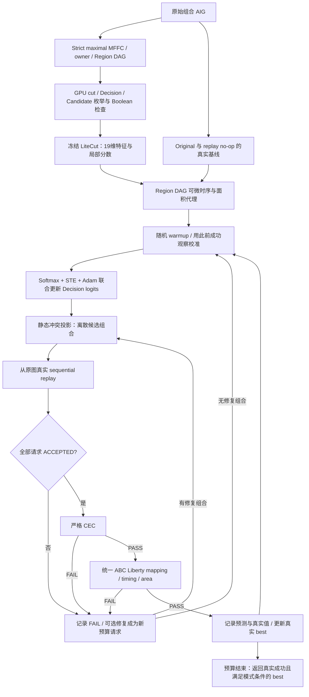

# 当前梯度优化闭环：实现与实验状态

整理日期：2026-11-13（北京时间）。本次核对的源码基线：`5025a6c863f0a7766c41707bcc1828723afce447`；全量 benchmark 源码：`160b2187eee3b47799e58b658e39f13d40064b61`。逐文件比较确认，两者的 pipeline、optimization、surrogate、arrival、LiteCut、candidate、evaluation 和 structure 实现字节相同；后续提交增加了分析、验证、诊断脚本和文档。本文只阅读源码、现有 JSON/CSV、日志和作业完成记录，没有运行模型、优化器、测试或新实验。第 4.5 节补入已经完成的单策略冷进程测量，不将其写成新算法结果。

后续研究另见 [GPU 联合优化当前进度](docs/gpu_joint/STATUS.md)。本文保留上述旧版闭环与 905 主实验的阅读基线；其中“尚无新增 GPU 梯度选择”的判断限于该基线，不替代后来新增提案器的组件和开发验证结果。后续实验不并入本文的旧版统计。

## 0. 当前结论与阅读边界

**已经实现并验证的是：用冻结 LiteCut 分数和结构特征构造一个可校准的全局时序代理，通过 Softmax + STE + Adam 联合提出多个 Decision 的离散选择，再以真实 rewrite、CEC 和 ABC Liberty timing 校验并反馈。尚未证明的是：这个代理的下降能够可靠引导映射后 critical delay 下降，或者梯度搜索稳定优于同预算随机搜索。**

- 全量 905 个组合 AIG 均有真实主运行结果：901 PASS、4 PARTIAL。四例只缺 native ABC 对照，不能写为全部方法通过。
- 两种梯度模式相对原图的 delay 改善中位数为 3.6586% / 3.8708%，但相对同预算随机搜索的胜/平/负为 179/464/262 和 252/379/274，中位目标改善均为 0%。
- `c1355_orig` 的代理目标下降，但实际梯度请求的 mapped delay 变差，最终两模式都返回 no-op。
- `ss_pcm_orig` 的两个 MFFC 联合替换得到真实 delay 改善，但代理的 global delay 预测仍等于 baseline；这验证了安装与测量闭环，不能单凭此例证明准确的 timing gradient。
- 当前 Student 推理、代理校准和 logits 梯度优化均在 CPU 上执行。GPU 用于 CULS 原生候选枚举和 rewrite 的部分计算；尚无新增 GPU 梯度选择方法及其加速对照结果。

本文的正式实验数值统一来自新框架的 `ABC_SCL_LIBERTY` 测量：相同 ABC 二进制、ASAP7、mapping 命令，同一 `SC_Man` 的 global delay、全部 PO rise/fall arrival 和 area。它们不是历史 Gate3F 的 MIO PO arrival，也不是 `print_pair_delay`、初始 mapper mode0 arrival 或已撤回的旧 PI→PO 标签。历史 Gate3F 的 interaction 只作为独立背景，未拼入本报告的梯度性能统计。

证据入口：[全量结果](docs/global_timing/FULL905_SEARCH_RESULTS.md)、[逐项验收](docs/global_timing/REQUIREMENTS_AUDIT.md)、[时序模型契约](docs/global_timing/MODEL_AND_EXECUTION.md)。

## 1. 输入 AIG 到 ABC Timing 的完整流程

| 阶段 | 输入与处理 | 输出和职责 | 实现 |
|---|---|---|---|
| 1. 读取 AIG | 读取组合 AIG，保留 PI/PO 位置顺序、AND 节点和反相 literal | 原始节点空间；原图始终是每次 replay 的起点 | `structure.parse_aig` |
| 2. MFFC 分区 | 按引用计数/dereference 建立互不重叠的 strict maximal MFFC，检查全覆盖 | region root/member、owner、Region DAG、拓扑序、每个边界入口到 root 的最长 AND 距离 | `structure.make_partition`；`partition/partition.json`、`owners.csv` |
| 3. 枚举候选 | GPU 导出保留的 3/4-leaf cut；采用原 rewrite library 的正节点增益 mask | legal cuts、executable Decisions、每 Decision 的 replacements、静态冲突 | `candidates.enumerate_candidates`、`catalogue_from_raw` |
| 4. Boolean 检查 | 检查 cut 真值；必要时保留原始 PI/leaf 关系做上下文 CEC；检查 library candidate 函数/相位 | 只让已证明的 cut 进入优化；未证明项保留并排除 | `cut_validation.validate_catalogue`、`litecut.verify_library_truth` |
| 5. LiteCut 推理 | 物化原 cone/no-op 与候选 DAG，提取标准化 19 维特征，冻结 Student 批量推理 | 每个选择的局部 `predicted_local_abc_delay` 和特征；保存于 `litecut.json` | `litecut.score_catalogue` |
| 6. 测量基线和对照 | 分别测 original 与零选择 replay；另运行 native ABC、贪心、独立 region、随机搜索 | 实际 Liberty delay/area/ADP/PO arrivals、CEC；original 与 replay no-op 分开 | `Experiment.run`、`Evaluator.evaluate` |
| 7. warmup 和代理校准 | 每个梯度模式先执行随机 warmup；仅用此前成功测量拟合代理 | 共享局部、相邻 region 交互和面积系数；保存 calibration loss | `Experiment.gradient_search`、`TimingSurrogate.fit_observations` |
| 8. 联合梯度提案 | 在冻结当前代理参数时优化所有 Decision logits；投影并排序未见过的组合 | 候选向量、梯度、代理目标、预测 PO/area；这一步开始选择变量的梯度优化 | `optimization.gradient_proposals` |
| 9. 真实安装和评价 | 每个组合重新读取原 AIG；按原 root 升序 replay；全部请求必须 ACCEPTED，再做严格 CEC 和统一 mapping/timing | 完整候选 AIG、trace、CEC、mapped.v、真实结果、评估前预测；失败不补造指标 | `candidates.replay`、`Experiment.evaluate_choice` |
| 10. 反馈和返回 | 失败需要时清零被拒绝 Decision，作为新请求；成功结果参与后续校准；按真实目标选 best | best 可来自直接梯度、warmup、修复或 no-op，不能一律称为直接梯度贡献 | `repair_choice`、`rank_actual`、`gradient_search` |

`pipeline.py` 的 `Experiment.__init__`（第 48 行起）、`run`（第 284 行起）串联上述模块。MFFC 是结构分组与传播拓扑，不是一个 replacement；一个 MFFC 内可以选择多个互相兼容的 Decisions。



图中的反馈有明确的请求预算和停止条件；不是无限循环，也不在累积改写后的图上继续随机修改。

## 2. 梯度优化的实际数学实现

### 2.1 变量：每个 Decision 选择一个 Candidate 或 no-op

令 `i=0,…,D−1` 表示经过验证的 `(root, cut_slot)` Decision：

\[
x_i\in\{0,1,\ldots,K_i\},\qquad x_i=0\text{ 表示 no-op}.
\]

`x_i>0` 映射到该 Decision 的 `candidate_subgraph_indices[x_i-1]`。选择序号不是 library 的 subgraph ID。一个 Region 的状态是其所有 Decision 选择组成的子向量，不是一个整数 region candidate ID。

优化器持有 float64 logits 矩阵 \(z\in\mathbb R^{D\times W}\)，\(W=\max_i(K_i+1)\)。补齐的无效候选用 mask 排除。No-op 对每个 Decision 都存在。c1355 为 91 个离散变量、326 个 physical replacements，加上 91 个 no-op 共 417 个可打分选项。

实现：[Catalogue.validate/project/requested](/home/wushangge/CULS_LiteCut/global_timing/candidates.py:16)、[TimingSurrogate.one_hot](/home/wushangge/CULS_LiteCut/global_timing/surrogate.py:314)。

### 2.2 局部特征怎样进入新的全局代理

令 \(\ell_{ik}\) 为 LiteCut 局部预测，\(d_{ik}\) 为第 8 个零基特征 `Weighted_Depth`，\(n_{ik}\) 为第 11 个零基特征 `Node_Count`。相对 no-op 构造：

\[
f_{i0}=0,\quad
f_{ik}=\operatorname{clip}_{[-5,5]}
\left[
\frac{\ell_{ik}-\ell_{i0}}{\max(|\ell_{i0}|,1)},
\frac{d_{ik}-d_{i0}}{\max(|d_{i0}|,1)},
\frac{n_{ik}-n_{i0}}{\max(|n_{i0}|,1)},
1
\right],\quad k>0.
\]

这里只把**代理特征**截断，真实测量不截断。全局代理没有直接使用完整 19 维向量，而是使用 LiteCut 标量、Weighted_Depth、Node_Count 的相对变化及激活标志。No-op 特征是零向量，不是把 LiteCut 原始 delay 置零。对选择张量 \(v\)：

\[
e_i(v)=\sum_k v_{ik}f_{ik},\qquad
F_r(v)=\sum_{i:\operatorname{owner}(i)=r}e_i(v).
\]

对进入 region \(r\) 的边界入口 \(p\)，\(I_{rp}\) 只包含从该入口在原 region 内能到达 decision root 的 Decisions。令 \(u(p)\) 为入口所属的前驱 region；PI/常量入口的前驱特征为 0：

\[
B_{rp}=\sum_{i\in I_{rp}}e_i,\quad
b_{rp}=w_\ell^\top B_{rp}
+w_{\rm int}^\top(F_r\odot F_{u(p)}).
\]

\[
c_{rp}=h_{rp}\,\kappa\,
\exp\!\left(2\tanh(b_{rp}/2)\right).
\]

\(h_{rp}\) 是原图入口到 root 的最长 AND 距离，\(H_{\max}\) 为原图最大结构深度。令 \(D_0,A_0\) 分别为 replay no-op 的真实 global delay 和 area，代码使用归一化参考 \(D_{\rm ref}=\max(D_0,10^{-6})\)、\(A_{\rm ref}=\max(A_0,10^{-6})\)，所以 \(\kappa=D_{\rm ref}/\max(H_{\max},1)\)。下文保留这些零值保护；\(c_{rp}\) 是有界校正后的**代理传递成本**，不是对该 MFFC 做独立技术映射得到的真实 delay。

实现：[TimingSurrogate.__init__](/home/wushangge/CULS_LiteCut/global_timing/surrogate.py:102) 的特征、port incidence、结构尺度；[_propagate](/home/wushangge/CULS_LiteCut/global_timing/surrogate.py:321)。

### 2.3 多 PO 传播和跨 MFFC 交互

按 Region DAG 拓扑序传播全部入口：

\[
a_r(v)=\tau_g\log\sum_{p\in P_r}
\exp\!\left(\frac{a_{u(p)}(v)+c_{rp}(v)}{\tau_g}\right),
\quad a_{\rm PI/const}=0,\quad
\tau_g=\max(0.005D_{\rm ref},10^{-8}).
\]

令 \(q_o(v)\) 为 PO \(o\) 所属 region 的传播 arrival；直接 PI/常量 PO 的传播项为 0。使用真实 no-op 的每 PO arrival \(T_o^0\) 锚定：

\[
\widehat T_o(v)=\max\bigl(0,T_o^0+q_o(v)-q_o(0)\bigr).
\]

因此 no-op 端点预测按构造精确等于基线，**这种精确锚定不计为预测准确性的证据**。任一新组合的 global 预测为 \(\widehat D=\max_o\widehat T_o\)。

显式交互是相邻 region 四维聚合特征的逐元素乘积，并非完整 candidate-pair 表。拓扑传播还把影响送往下游和多个 PO；非线性聚合也使同 region 的多个 Decisions 耦合。原图 DAG、port incidence 和结构深度在搜索期间固定，实际重写后的新结构不重新进入这张代理 DAG。

默认 `arrival.smooth_arrivals` 用自定义逆拓扑一阶反传；每条入口分支的局部导数是对应 LSE 的 Softmax 权重：

\[
\frac{\partial a_r}{\partial(a_{u(p)}+c_{rp})}
=\frac{\exp((a_{u(p)}+c_{rp})/\tau_g)}
{\sum_{p'}\exp((a_{u(p')}+c_{rp'})/\tau_g)}.
\]

其 `bounded_tape` 后端只支持一阶导数；[reference_arrivals](/home/wushangge/CULS_LiteCut/global_timing/arrival.py:35) 保留普通 Torch 数值参照，[backward](/home/wushangge/CULS_LiteCut/global_timing/arrival.py:76) 实现实际反向传播。

**“多路径”的现有含义**是：所有 Region DAG 入口的平滑传播，加上全部 PO 的平滑聚合。它没有为每条原 AIG PI→PO 路径建立独立目标，也没有建立跨映射网表的唯一逻辑路径身份。

### 2.4 面积代理和两种目标

面积另用结构特征拟合，而非 LiteCut 输出：

\[
\bar e=\frac{\sum_i\max(n_{i0},1)e_i}{\max(N_{\rm AND},1)},\qquad
\widehat A=A_0\exp\!\left(2\tanh(w_A^\top\bar e/2)\right).
\]

这里 \(A_0\) 为真实 replay no-op area。共享可校准参数只有 \(w_\ell,w_{\rm int},w_A\) 三个四维向量，合计 **12 个标量**；初值分别是 \((0.08,0.15,0,0)\)、\((0,0,0,0)\)、\((0,0,1,0)\)，不是每个 Region 单独训练一个网络。

定义全部 PO 的归一化平滑 delay 成本：

\[
S_T=\tau_s\log\sum_o
\omega_o\exp\!\left(\frac{\widehat T_o/D_{\rm ref}}{\tau_s}\right),
\quad S_A=\widehat A/A_{\rm ref},\quad \tau_s=0.02.
\]

所有 \(\omega_o>0\)，实际主实验取全 1；代码没有减去 \(\tau_s\log N_{\rm PO}\)。API 支持正的 `path_weights`，主实验没有使用自定义路径权重。**优化的是平滑多 PO 代理，不是直接反传真实 ABC critical delay。**

面积约束模式：

\[
J_{\rm area}=S_T+20\,[\max(0,S_A-1.05)]^2.
\]

Delay–area 联合模式（固定零参考的 Smooth Tchebycheff）：

\[
J_{\rm joint}=\tau_s\log\left[
\exp\!\left(\frac{(1-\lambda)S_T}{\tau_s}\right)
+\exp\!\left(\frac{\lambda S_A}{\tau_s}\right)
\right],\quad \lambda=0.5\text{（主实验）}.
\]

Smooth Tchebycheff 的两个维度是 delay 成本与 area 成本，不是每条 PI→PO 路径一个 Tchebycheff 维度。ADP 作为真实结果记录，不是当前直接优化目标。

最终选择再次用真实值排名：`area_constraint` 丢弃 \(A>1.05A_0\) 的成功点，再最小化真实硬最大 global delay；`joint` 将真实 PO arrivals/area 代入同一标量函数，**不额外加 1.05 硬面积约束**。实现：[forward/scalar_objective](/home/wushangge/CULS_LiteCut/global_timing/surrogate.py:340)、[rank_actual](/home/wushangge/CULS_LiteCut/global_timing/pipeline.py:147)。

### 2.5 Softmax、STE、梯度和更新规则

每次 proposal 调用重新初始化 logits：高斯噪声标准差 0.2；第一次 restart 给当前真实 incumbent 的 one-hot 加 1.0，其他 restart 使用噪声初始化。温度随每次内部迭代从 1.0 线性降至 0.3：

\[
p_{ik}=\operatorname{Softmax}_k(z_i/T_t),\quad
x=\Pi_{\rm static}(z),\quad h=\operatorname{OneHot}(x),
\quad v=h-\operatorname{stopgrad}(p)+p.
\]

前向使用**已经过静态冲突投影的 hard one-hot**；反向用 Softmax 的导数，投影与 argmax 本身不求导。没有使用 Gumbel-Softmax，也不对 Candidate ID 直接做减法更新。

对静态冲突集合 \(\mathcal C\)，设 \(\alpha_i=1-p_{i0}\)：

\[
P_{\rm conflict}=
\begin{cases}
|\mathcal C|^{-1}\sum_{(i,j)\in\mathcal C}\alpha_i\alpha_j,&\mathcal C\ne\varnothing,\\
0,&\text{否则},
\end{cases}
\quad L_{\rm select}=J+0.1P_{\rm conflict}.
\]

模型参数在这一步 `requires_grad_(False)`，但输入 logits 仍有梯度：

\[
\nabla_zL_{\rm select}\approx
\left(\frac{\partial p}{\partial z}\right)^\top
\left.\frac{\partial J}{\partial v}\right|_{v=h}
+0.1\nabla_zP_{\rm conflict},
\qquad
z\leftarrow\operatorname{Adam}_{0.12}(z,\operatorname{clipnorm}_5(\nabla_zL)).
\]

反传链是：目标 → PO 聚合/面积 → 锚定 arrival → Region DAG LSE → 入口成本/交互 → 选择特征 → STE/Softmax → logits。LiteCut 推理、离散投影、GPU replay、CEC、ABC mapping 和 timing 均不在此反传链中。STE 是启发式导数近似，有限差分通过不代表获得真实离散 mapped timing 的精确梯度。

每个内部 step 的离散点加入 proposal 池，去掉已实际请求过的组合；按代理 objective 排序，批量提交最多 4 个。被选中点可能来自中间 step，**不等于最后一次 argmax**。logits/Adam 状态不跨 proposal 调用延续；真实反馈后重新生成 proposals。

实现：[gradient_proposals](/home/wushangge/CULS_LiteCut/global_timing/optimization.py:9)，记录的 `objective` 不含冲突惩罚；报告中的反向 Loss 若展示为 \(J+0.1P\)，是由这两个真实字段按源码公式重建。每 10 步及最后一步保存梯度；\(D\le128\) 保存完整逐候选梯度，否则保存每 Decision 的范数和下降方向候选，不能声称所有大设计都保存了完整梯度矩阵。

### 2.6 代理校准与请求预算

每个 mode 独立创建代理；只使用此前 `status=PASS` 的实际观察：

\[
L_{\rm fit}=
\operatorname{MSE}\!\left(\frac{\widehat T-T^{\rm ABC}}{D_{\rm ref}}\right)
+\operatorname{MSE}\!\left(\frac{\widehat A-A^{\rm ABC}}{A_{\rm ref}}\right)
+0.002\!\left[
\operatorname{mean}[(w_\ell-w_\ell^{\rm prior})^2]+
\operatorname{mean}[w_{\rm int}^2]+
\operatorname{mean}[(w_A-w_A^{\rm prior})^2]
\right].
\]

使用 Adam，学习率 0.025，梯度范数上限 5；主实验每轮拟合 30 步。仅更新 12 个代理系数，不更新 LiteCut，也不更新真实电路。新组合的预测及其训练观察索引保存在真实评价之前；这是自适应、按时间顺序的预测误差，不是独立留出集泛化测试。

每种搜索最多 8 个请求，**包含复用的 no-op、warmup、失败、显式修复与探索**，不是 8 次成功梯度安装。warmup 上限参数为 2，但失败/修复也占请求位，实际随机 warmup 数不一定相同。每轮最多 4 个新 proposals，共享该轮校准模型，不在每个请求后立即拟合。

当前默认 API 配置是 24 次请求、warmup 6、梯度 60 步、拟合 80 步；**这些不是本次全 905 主实验参数**。实际参数见第 8 节。

实现：[fit_observations](/home/wushangge/CULS_LiteCut/global_timing/surrogate.py:356)、[Experiment.gradient_search](/home/wushangge/CULS_LiteCut/global_timing/pipeline.py:160)。

### 2.7 静态投影与动态失败处理

`Catalogue.project` 先在每个 Decision 选最大 logit（平局选较小索引），按相对 no-op 的 logit 优势降序贪心保留，不兼容项清零。冲突包括同 root、初始 removable cone 重叠、任一方删除对方 cut leaf。共享 leaf 本身不构成冲突。它不是精确求解所有离散组合，也可能排除特定顺序其实可执行的选择。

静态投影不能保证顺序执行成功。真实 `replay` 要求“请求集合 = preselected 集合”，且每个请求最终都是 ACCEPTED；任何 COMPROMISED、REVERTED、CYCLE_REJECT 等都让**整个请求**失败，不能拿部分安装的电路给该请求贴成功标签。原生 [CPUSolver::Rewrite](/home/wushangge/CULS_LiteCut/projects/culs/src/algorithms/rewrite.cu:1067) 实施顺序安装与环/leaf 等检查。

`repair_choice` 仅针对有拒绝明细的请求，把被拒绝 Decisions 清零，再从原图提交一个新组合，继续占预算。不能修复的工具/CEC/mapping 失败原样记录。最终 best 来自真正成功的实际观察；真实可行域实际由静态规则、完整安装和 CEC 共同定义。

## 3. LiteCut 的作用与三种 Delay

| 项目 | 当前实现与边界 |
|---|---|
| 输入 | 每个原 cone/no-op 或物化 replacement DAG 的 19 维特征；不是整条 PI→PO 路径张量 |
| 特征顺序 | 8 个 context 特征；Weighted_Depth、Topo_Depth、Inv_Penalty；Node_Count、Avg_Width、Max_Internal_Fanout；Inv_Ratio、Root_Inv_Count、Chain_Density、Fork_Density、Avg_Curvature |
| 标准化 | \(u=(f_{19}-\mu_x)\odot{\rm inv}\sigma_x\)，统计量来自原 checkpoint |
| 输出还原 | \(\ell=\operatorname{expm1}(\operatorname{clip}(\hat y/{\rm inv}\sigma_y+\mu_y,-10,10))\) |
| Student 参数 | 加载原 checkpoint，`eval()` + `torch.inference_mode()`；未参加任何优化器更新。输出转 NumPy/常量特征，梯度不穿过 Student |
| 新增模块 | `TimingSurrogate` 将局部分数与结构变化转换为 port cost、region arrival、PO arrival 和面积；它是独立的可校准近似 |
| 缓存 | 输入、checkpoint、rewrite library、特征/模型/验证代码、候选列表、环境和 batch size 共同决定 cache key |
| 已有一致性证据 | 原 25 维提取的前 19 维与新 Student-only 路径比较 123,286 条，特征与分数一致；417 条来自 c1355，122,869 条来自 div |

候选和 LiteCut 特征只在原图初始化时提取一次；反馈阶段更新代理系数，不会在每次组合重写后重新推理 LiteCut。

现有 LiteCut 数据流水线的局部标签定义见 [Parser.stimeDelayProcess](/home/wushangge/CULS_LiteCut/projects/litecut/src/subutils/Parser.py:673)：在被提取的 mapped-supergate 局部 gate 集合内，依据保存的 `abc_gate_delay` 枚举/累加局部路径并取最大值。它不是“某个 replacement 独立映射后必定贡献给全局 critical delay 的数量”，也不保证是可相加的 MFFC delay。这里核对的是保留代码中的标签语义，没有精确恢复该 checkpoint 的全部历史训练样本。

三个量必须分开：

1. **LiteCut local abc_delay**：冻结模型对局部训练标签的预测，作为常量特征。
2. **可微代理的 PO/global delay 与目标**：结构 DAG 加共享校准系数计算的 \(\widehat T,\widehat D,J\)，对选择张量可微。
3. **真实 ABC Mapping Delay**：每个完整 rewritten AIG 技术映射后，由 Liberty timing manager 重新测得 \(D^{\rm ABC}=\max_o T_o^{\rm ABC}\)，作为校准标签及最终评价。

源码：[特征定义](/home/wushangge/CULS_LiteCut/projects/litecut/src/data_preprocess/feat_extraction_v3.py:398)、[StudentModel](/home/wushangge/CULS_LiteCut/projects/litecut/src/extract_cutlib_student/modeling.py:79)、[模型加载](/home/wushangge/CULS_LiteCut/projects/litecut/src/validate/eval_prediction_accuracy.py:152)、[score_catalogue](/home/wushangge/CULS_LiteCut/global_timing/litecut.py:85)、[LiteCutPredictor](/home/wushangge/CULS_LiteCut/projects/culs/tools/gate3e_run.py:57)。模型为 `/data/wushangge/CULS_LiteCut/assets/models/litecut_student_best.pt`，SHA256 `b3f499d2973bdb36fb42690794e9838d4c8359f05d6e141aa8cbe2b9fe3ae64d`。


## 4. 已执行测试：哪些是人工 fixture，哪些是真实 EDA 流程

### 4.1 实际证据目录

下文用这些别名缩短路径；它们都是已经存在的运行，不是待执行计划：

| 别名 | 服务器绝对路径 |
|---|---|
| E：偶数主分片，Slurm 64399 | `/data/wushangge/CULS_LiteCut/runs/20261111T184752Z-consistent-full-shard0-1568c1b9` |
| O：奇数主分片，Slurm 64397 | `/data/wushangge/CULS_LiteCut/runs/20261111T184753Z-consistent-full-shard1-175169c2` |
| Q：搜索、预算和安装审计，Slurm 64854 | `/data/wushangge/CULS_LiteCut/runs/20261112T103045Z-final905-search-analysis-v2-32c72d46` |
| P：最终 timing/路径分析，Slurm 64905 | `/data/wushangge/CULS_LiteCut/runs/20261112T122920Z-final905-path-analysis-61f92cbb` |
| T：CPU 全程序矩阵与分区证书，Slurm 64395 | `/data/wushangge/CULS_LiteCut/runs/20261111T191749Z-full905-partition-certificates-f9e48d3a` |
| R：c1355 独立同参数重复，Slurm 64397.0 | `/data/wushangge/CULS_LiteCut/runs/20261111T214331Z-consistent-c1355-exact-repeat-0e387139` |
| B：单策略冷进程基线，Slurm 64921 | `/data/wushangge/CULS_LiteCut/runs/20261113T031523Z-gpu-joint-cold-baseline-934606e2` |
| D：历史样例文件诊断，Slurm 64920 | `/data/wushangge/CULS_LiteCut/runs/20261113T031521Z-gpu-joint-saved-diagnostics-63af3c1f` |

### 4.2 分层测试结果

| 类型 | 已有实际执行 | 能证明什么 / 不能证明什么 |
|---|---|---|
| 人工 AIG/特征和 mock 单元测试 | `test_surrogate`、`test_candidates`、`test_pipeline` 等；`test_surrogate.py` 明确标为 analytical fixtures | 检查数学、接口、冲突投影、异常路径；其中人为设定的 100 ps 等数值不是实验标签 |
| 可微代理数值测试 | `test_gradient_matches_finite_differences`、arrival 深链及 reference 对照、双目标与合法投影测试已 PASS | 验证所实现平滑代理的一阶导数及数值一致性；不是对 STE 或 ABC 真实离散目标做精确有限差分证明 |
| 真实工具集成/回归 | E、O 各 `output/tests.json` 为 75/75 PASS，含 GPU 候选、实际 replay、严格 CEC、Liberty timing、Student 缓存、负向工具失败等 | 使用实际 CULS/ABC；故障注入 fixture 用于错误处理验证，不混作性能 benchmark |
| 全量独立结构证书 | T 的 `output/partition_validation/summary.json`：905/905 PASS；80 个小图与历史全-root oracle 对照 | 覆盖、owner、fanout 闭合、边界不可吸收、精确 DAG 与全部 port 深度；不把结构深度当 mapped timing |
| 真实全量优化比较 | E/O 的 905 输入、原图/no-op/native/greedy/independent/random/两梯度模式 | 每个成功请求真实安装与 CEC/mapping；整体 901 PASS/4 PARTIAL，不把 native 缺失填成 no-op |
| 保存搜索与安装复核 | Q 的 `output/search_quality/summary.json` 审计错误 0；`output/execution_audit/summary.json` 为 905 PASS | 核对预测先于标签、实际预算、候选域、cut 证明、请求/trace 全 ACCEPTED、顺序、AIG hash 与原 CEC |
| 真实测量/arrival 链补充验证 | 十三批覆盖 905 设计有效测量：13,981 份映射、16,696 个成功引用；fresh CEC 和 mapping/全部 PO/area/global/网表正文一致 | 重新测量支持既有测量完整性；计数按逐例去重后相加，不是全库全局去重，也不补出失败 native 的标签 |
| 原始 timing/路径只读分析 | P 最终 905 ANALYZED、audit failure=0、`final_validation.json` PASS | 重新解析保存的 CEC、Liberty 日志、网表与逐 arc arrival 链；P 本身没有产生新的优化结果 |
| 独立搜索重复 | R 的 `output/verification.json` PASS；配置、全部数值、选择和 25 项精确图结构相同 | 只证明 c1355 的同参数独立重复；native AIG 的时间注释导致原始字节不同，未把该差异抹除 |
| Student 特征/预测回归 | `20261111T132425Z-student-feature-regression-9184e32c`：123,286 条精确一致；真实工具测试另有 326 个历史候选函数/预测检查 | 验证接口复用与数值一致，不是全局预测准确率测试 |
| 历史流程/原生工具复现 | `20261111T103029Z-historical-baseline-51d97b14` 复跑 Gate3A–F；Gate1 多请求与五个 ABC 变体另有实际通过证据 | 各自输入、标签和源码范围独立，不能视为新梯度方法的正结果；完整列表见 TEST_COVERAGE/RUN_LOG |

没有将模拟测试的 loss、人工特征或 mock timing 填进后面的真实结果表。旧开发阶段的失败、超时、补验和源版本仍在 [完整测试历史](docs/global_timing/TEST_COVERAGE.md) 与 [运行记录](docs/global_timing/RUN_LOG.md) 中；全量性能只采用 E/O 固定 cohort，不按结果选择旧重跑。

### 4.3 最新核心测试模块的实际记录

下表从 T 和 O 已有 `tests.json` 按测试名汇总。T 是最新 86 项 CPU 矩阵；O 是实际执行的 75 项核心矩阵；失败分析与分区证书两个模块的 11 项测试在 O 之后新增。T/O 中共有的 16 份测试模块字节一致，且核心算法未变化，可以按名称和来源匹配证据。

| 测试模块 | T：CPU PASS | T：SKIP | O：实际矩阵 PASS |
|---|---:|---:|---:|
| `test_arrival` | 3 | 0 | 3 |
| `test_candidates` | 4 | 0 | 4 |
| `test_cohort` | 8 | 0 | 8 |
| `test_evaluation` | 5 | 0 | 5 |
| `test_failure_analysis` | 6 | 0 | 0 |
| `test_partition_validation` | 5 | 0 | 0 |
| `test_path_artifacts` | 1 | 0 | 1 |
| `test_path_changes` | 9 | 0 | 9 |
| `test_paths` | 2 | 0 | 2 |
| `test_pipeline` | 4 | 0 | 4 |
| `test_processes` | 2 | 0 | 2 |
| `test_real_tools` | 0 | 12 | 12 |
| `test_reporting` | 3 | 0 | 3 |
| `test_search_analysis` | 4 | 0 | 4 |
| `test_structure` | 5 | 0 | 5 |
| `test_student_features` | 1 | 0 | 1 |
| `test_surrogate` | 9 | 0 | 9 |
| `test_truth` | 3 | 0 | 3 |

合计 T 为 **74 PASS/12 SKIP**，O 为 **75 PASS**；两份实际 PASS 的测试名并集覆盖最新 86 个测试名。不能把 T 的 12 个 SKIP 说成本次 CPU 做了 GPU 验证，也不能称作一个作业执行了 86 项实际 GPU 测试。

### 4.4 全仓库覆盖与未通过项

T 的 `output/repository_tests/matrix_summary.json` 记录 2,515 项源码/入口、177 个入口，1,618 语法 PASS、1,395 个编译 translation units、147 import PASS、17 FAIL、1 SKIP、59 CLI smoke PASS。2,456 项 runtime smoke 明确 SKIP；113 个文件有来源匹配的命名功能证据，2,402 项未测逐文件功能。这不是全仓库行覆盖率。

17 项 import FAIL 包含：缺参数或相对输入的 6 个命令式入口、缺 DGL 的 8 项、缺 einops/DeepGate 的 2 项、原训练数据 PermissionError 的 1 项；部分命令式入口在指定真实参数后已有单独 CLI PASS。另 1 项 import SKIP 是阻止旧脚本向历史路径写入。Teacher 训练恢复和这些缺依赖入口的完整功能为**未验证**，没有用 Student 推理成功替代它们。

### 4.5 已完成的单策略冷进程测量与文件诊断

B 使用 `scripts/profile_single_method.py`，在同一次 `Compute/eda` 分配中顺序启动三个独立子进程。每例只执行现有面积约束梯度方法及其必需的 original/no-op 测量，不执行 native、greedy、random 或 joint 对照；核心算法没有改变。种子 20261111，每例 8 个请求、warmup 上限 2、20 步梯度、2 restarts、30 步校准、反馈批量 4，固定使用第 8.3 节的模型、工具和库。作业申请 4 CPU、32 GiB、1 GPU，OMP/OpenBLAS/MKL 各 1 线程；已完成，`COMPLETED / 0:0`。

| 输入（索引） | 完整子进程 wall s | 梯度提案累计 s | 校准累计 s | CEC+mapping 累计 s（调用数） | 最终真实 delay ps | 实际 area | 接受 rewrite | 请求/失败 | 最终 CEC |
|---|---:|---:|---:|---|---:|---:|---:|---|---|
| DMA_comb（0） | 24.109 | 0.352 | 0.252 | 10.230（5） | 2380.250980 | 5196.078610 | 23 | 8/4 | PASS |
| c1355_orig（47） | 14.457 | 0.139 | 0.115 | 7.072（8） | 360.111877 | 513.216003 | 0 | 8/1 | PASS |
| ss_pcm_orig（80） | 12.641 | 0.202 | 0.181 | 7.257（9） | 323.908447 | 211.351685 | 2 | 8/0 | PASS |

完整子进程 wall 包含解释器启动/退出、模块导入、分区/候选/特征准备、搜索、真实工具调用及保存记录；不含 Slurm 排队、外层运行目录准备和父进程的输入复制。各阶段为包含子调用的累计计时，**存在嵌套，不能相加**；CEC+mapping 列也包含 original/no-op。请求数包含复用 no-op 和失败，并不等于实际 CEC 或 mapping 次数。

三个最终 delay、area 和离散选择与 E/O 的对应面积模式一致。该记录支持这三个小中型样例的冷进程成本分解；没有测量新的 CPU/GPU 方法对照、重复计时分布或公平端到端加速比。第 6 节的历史总时间包含所有 baseline，不能与这里单策略时间相除来声称加速，也不能把三个样例的瓶颈推广到所有深图或 CEC 困难图。

证据为 `B/output/profile_summary.json`（SHA256 `a847fc085cef16d873bf249b4e71816145e9ff580eb8ab8178a2c1eb94dfbf02`）、`B/output/case_{0000,0047,0080}_profile.json`、各例 `gradient_area_constraint/summary.json`、原始 `evaluation/{cec.log,mapping.log,result.json}`、`B/job.slurm` 和 `B/run.json`。

D 则只解析 12 个固定历史样例的保存文件，包括工具耗时、失败请求、重复 AIG 字节哈希及 trace 体积；没有执行新的搜索或 EDA。`D/output/gpu_joint_diagnostics/summary.json` 为 PASS，SHA256 `9839e543086462261e0ca33526fa3b4e2d0cae828a55134501d0e4d7d507e0bf`。这是历史证据诊断，不是新增优化效果或 GPU 加速验证。`docs/gpu_joint/PLAN_AND_EVALUATION.md` 中的比较方案与阈值属于计划，不能作为已经实现或达标的结果。

## 5. 全 905 设计真实实验与对照

### 5.1 输入、候选规模和分组

统一数据集位于 `/home/wushangge/CULS_LiteCut/open-sourceDataset`。冻结清单为：

`/data/wushangge/CULS_LiteCut/runs/20261111T105821Z-benchmark-inventory-114a3573/output/benchmark_manifest.json`

其中 905 个输入 hash 唯一、均为声明的可运行组合 AIG：ACE 40、OpenABC 47、forgeEDA 805、iwls2022 5、iwls2024 8。E 覆盖偶数索引 453 例，O 覆盖奇数索引 452 例。四例 PARTIAL 是 `forgeEDA/codec.aig`（392）、`loco_top.aig`（562）、`mrc3.aig`（610）、`mrc4.aig`（611）：native ABC 在 `Abc_AigUpdateLevelR_int` 断言退出，缺 native CEC/mapping 指标；相同断言文本不足以证明四例深层根因相同。

每个设计的 region/Decision/Candidate 数来自其 `partition/partition.json`、`candidates/catalogue.json` 和 `cut_validation/verified_catalogue.json`，不能用 c1355 的 62/91/326 代表其他电路。本报告详细核对的三个实例：

| 设计（冻结索引） | PI / PO / AND | strict MFFC | 有 Decision 的 MFFC | verified Decisions | physical Candidates（不含 no-op） |
|---|---|---:|---:|---:|---:|
| OpenABC/c1355_orig.aig（47） | 41 / 32 / 512 | 62 | 54 | 91 | 326 |
| OpenABC/ss_pcm_orig.aig（80） | 104 / 90 / 403 | 97 | 3 | 11 | 31 |
| ACE/DMA_comb.aig（0） | 2,227 / 1,084 / 11,249 | 1,801 | 163 | 632 | 1,745 |

c1355 有 1,815 个 raw legal cuts、128 条 Region DAG edges、244 对静态冲突；ss_pcm 有 1,163 个 raw legal cuts、73 条 edges、16 对冲突。两个例子的 raw executable Decisions 均全部经过 cut 验证，没有被排除。

### 5.2 所有 baseline 的真实 global-delay 比较

来源为 Q 的 `comparison/comparison_all.csv` 和 P 的 `performance_overview/summary.json`。胜/平/负只比较同一输入的 global delay，数值越小越好，不等于 joint 目标胜负。确定性方法实际调用次数较少，不能称这些方法都消耗了 8 次搜索预算。

| 方法 | 有测量 / 缺失 | 满足真实 no-op 面积 1.05 倍 | vs original：胜/平/负 | vs no-op：胜/平/负 |
|---|---:|---:|---|---|
| Native ABC rewrite | 901/4 | 828 | 471/210/220 | 483/167/251 |
| Original AIG | 905/0 | 898 | 0/905/0 | 266/319/320 |
| Replay no-op | 905/0 | 905 | 320/319/266 | 0/905/0 |
| 面积约束梯度 | 905/0 | 905 | 658/158/89 | 608/297/0 |
| joint 梯度 | 905/0 | 900 | 656/150/99 | 583/304/18 |
| LiteCut 贪心 | 905/0 | 836 | 510/139/256 | 481/185/239 |
| 独立 region | 905/0 | 816 | 499/167/239 | 453/213/239 |
| 面积约束随机 | 905/0 | 905 | 658/161/86 | 585/320/0 |
| joint 随机 | 905/0 | 891 | 647/158/100 | 568/319/18 |

两种梯度模式相对 original 的逐设计 delay 改善中位数为 **3.6586% / 3.8708%**，相对 no-op 为 **2.1724% / 2.5425%**；这些不是“平均节省的 ps”，也不能据此把改善归因于梯度。

面积模式 905 个最终点均满足真实约束；joint 没有这个硬约束，5 个点超过另一模式的 1.05 上限。Original 只有 898 点满足相对 no-op 的面积阈值，原因是比较基准是序列化后 no-op，不能把 original 和 no-op 当成相同测量。

同输入、同**已消耗请求预算**的随机对照：

| 梯度模式 | 配对数 | 胜 / 平 / 负 | 中位目标改善 | delay 几何平均比（梯度/随机） |
|---|---:|---|---:|---:|
| 面积约束梯度 | 905 | 179/464/262 | 0.0% | 1.009048 |
| joint 梯度 | 905 | 252/379/274 | 0.0% | 1.001853 |

面积模式按真实面积可行的硬最大 delay 比较；joint 按真实平滑 delay–area 联合目标比较。两个模式都没有建立稳定优于随机搜索的优势。单种子、小预算、同族设计变体和自适应采样不能作为统计显著性或未见设计泛化证明。

### 5.3 评估前预测、梯度轨迹与最终来源

Q 的 `output/search_quality/summary.json`、`methods.csv`、`predictions.csv`、`gradient_diagnostics.csv` 保留逐例分母和训练索引：

| 指标 | 面积约束 | joint |
|---|---:|---:|
| 评估前预测样本 | 3128 | 3197 |
| 有可归一化预测的设计 | 811 | 811 |
| 按设计平均的归一化 Δdelay MAE | 0.117150 | 0.121337 |
| 实际变化样本的按设计平均方向正确率 | 0.436117 | 0.450463 |
| 直接梯度请求：成功 / 总数 | 1567/3339 | 1685/3390 |
| 全部失败请求 | 2418 | 2349 |
| 最终直接梯度点 | 153 | 207 |
| 最终显式修复点 | 397 | 388 |
| 最终 no-op | 297 | 243 |
| 最终 warmup 点 | 57 | 66 |
| 最终重复投影后随机探索点 | 1 | 1 |

归一化误差为 \(|\widehat\Delta D-\Delta D^{\rm ABC}|/D_{\rm noop}\)，先在每个设计内部平均，再跨设计等权。它不是相对于每个实际 delta 的百分比误差。no-op 自身的精确锚定结果和失败请求不计准确性；对新组合使用基线锚定代理所作的预测仍正常计误差。方向统计只对实际发生变化的观察。训练拟合 loss 与评估前预测误差分开。

每种模式有 **799/905** 个设计留下梯度轨迹：面积约束共 6,954 个记录点、joint 共 6,978 个记录点，保存点的 zero gradient norm 均为 0；799 例均出现非零范数。其余 106 例没有该汇总中的梯度轨迹，不能称 905 例全部执行了非平凡梯度更新。轨迹按源码每 10 步/最后一步采样，也不等于记录了每个内部 step。

`projected_argmax_changes` 分别为 3,063/3,296，含义是记录点的“静态投影结果不同于独立 argmax”，**不是**相邻迭代候选改变了这么多次。候选实际改变由下节逐例的 choices 证实。

最终点大量来自显式修复（397/388）或 no-op（297/243）。修复可能继承梯度父请求，但不能把修复成功或随机 warmup 的收益全部称为直接梯度贡献。真实失败率与代理误差是当前闭环的主要限制。


## 6. 可逐项复核的真实案例

以下案例不是新增实验，也不作为总体优势的独立统计样本。c1355 是既定核心输入；ss_pcm 因 Decision 域小而完整列出组合；DMA 是冻结清单 index 0，用于展示较大规模的跨 MFFC 安装。三个例子都服从第 5 节固定全量 cohort。“总运行时间”采用 `summary.json` 的 `total_runtime_including_preparation_s`，不含外层 report 生成与 Slurm 排队。

### 6.1 c1355_orig：代理下降，真实 delay 恶化，最终保留 no-op

输入原路径：`/home/wushangge/CULS_LiteCut/open-sourceDataset/OpenABC/c1355_orig.aig`。冻结输入位于清单的 `input/benchmarks/0047.aig`，SHA256 `2602b10f131a6ba5996521036ba130aab128a4aa15e3ab49ce44f2f02047f0b0`。

结果目录为 `O/output/suite/case_0047/`。总运行时间（含准备）28.649 s，其中准备 1.187 s。所有下表有数值的方法都实际 CEC PASS。

| 方法 | 实际 Delay ps | 实际 Area（库单位） | ADP | 接受 rewrite 数 | 请求/失败 | 方法记账秒 | CEC |
|---|---:|---:|---:|---:|---:|---:|---|
| Original | 360.111877 | 513.216003 | 184815.178 | 0 | 1/0 | 0.649 | PASS |
| Replay no-op | 360.111877 | 513.216003 | 184815.178 | 0 | 1/0 | 1.255 | PASS |
| Native ABC rewrite | 359.501831 | 529.778870 | 190456.474 | 未单列 | 1/0 | 0.747 | PASS |
| LiteCut 贪心 | 359.873505 | 533.511353 | 191996.601 | 44 | 2/1 | 1.332 | PASS |
| 独立 region | 399.386475 | 523.013794 | 208884.636 | 34 | 2/1 | 1.515 | PASS |
| 随机（area 排名） | 360.111877 | 513.216003 | 184815.178 | 0 | 8/2 | 5.799 | PASS |
| 随机（joint 排名） | 360.111877 | 513.216003 | 184815.178 | 0 | 8/2 | 5.799 | PASS |
| 梯度 area | 360.111877 | 513.216003 | 184815.178 | 0 | 8/1 | 7.739 | PASS |
| 梯度 joint | 360.111877 | 513.216003 | 184815.178 | 0 | 8/1 | 8.410 | PASS |

“方法记账秒”对 no-op 使用其单次测量时间；其他方法使用保存的 exclusive-method 记账字段，搜索时间不含共享 no-op 的再次计费，也不代表独占硬件。random 的两行来自**同一随机序列**按两种目标排名，不是另跑两套序列。

两种梯度模式最终均为 `[0,…,0]`（长度 91），实际 delay/area 与 no-op 完全相同。Greedy 和 native 对照略低，说明当前梯度返回点不保证优于其他 baseline；这些 baseline 的点也没有被冒充为梯度结果。

面积约束模式的完整 8 请求记录如下。预测是**该请求真实评价前**保存的代理 global delay；失败无实际数值：

| 请求 index | 来源 | 状态 | 选择数 / 涉及 MFFC | 预测 Delay ps | 真实 Delay ps | 真实 Area |
|---|---|---|---:|---:|---:|---:|
| 0 | no-op | PASS | 0/0 | — | 360.111877 | 513.216003 |
| 1 | 随机 warmup | PASS | 24/24 | 364.436318 | 374.295197 | 510.883209 |
| 2 | 随机 warmup | FAIL | 27/26 | 357.776104 | — | — |
| 3 | 显式修复 | PASS | 26/25 | 357.776104 | 414.142517 | 505.051208 |
| 4 | 直接梯度 | PASS | 10/10 | 314.593493 | 411.157806 | 542.609253 |
| 5 | 直接梯度 | PASS | 8/8 | 317.969741 | 411.157806 | 542.609253 |
| 6 | 直接梯度 | PASS | 7/7 | 318.281110 | 413.100433 | 533.744629 |
| 7 | 直接梯度 | PASS | 7/7 | 341.158647 | 405.519714 | 531.178589 |

直接梯度请求 4 预测 314.593493 ps，实际却为 411.157806 ps；相对 baseline 360.111877 ps 变差。其 area 542.609253 还超过真实面积上限约 538.876803，不能被面积模式选作 best。Joint 的四个直接梯度请求真实 delay 都是 410.571381 ps，同样劣于基线。

对应该模式 `gradient_area_constraint/gradients_0003.json` 的 restart 1：

| 内部 step | 记录的 J | 冲突惩罚 P | 反向 Loss=J+0.1P（按公式重建） | 梯度范数 | hard 选择数 |
|---|---:|---:|---:|---:|---:|
| 0 | 1.096369790 | 0.606305909 | 1.157000381 | 0.038162954 | 35 |
| 10 | 1.015178284 | 0.109438750 | 1.026122159 | 0.024719854 | 8 |
| 19 | 0.937058787 | 0.053249351 | 0.942383722 | 0.002417918 | 10 |

同轮代理拟合 `calibration_0003.json` 使用成功请求 `[0,1,3]`，30 步训练 loss 从 0.007882506 降到 0.002957139。**拟合 loss 下降、选择 loss 下降、非零梯度与候选改变都发生了，但没有带来该例真实 mapped delay 改善。**

已保存的核查入口：

- `O/output/suite/case_0047/summary.json`、`config.json`。
- `gradient_area_constraint/{summary.json,calibration_0003.json,gradients_0003.json}`。
- `gradient_area_constraint/eval_0004/observation.json`、`evaluation/{result.json,mapping.log,cec.log}`。
- `gradient_joint/` 的对应轨迹，以及 `report/{comparison.csv,observations.csv,gradients.csv,convergence_and_prediction.png}`。
- R 的 `output/verification.json` 证明同配置搜索重复；不把一次 c1355 重复扩大为全 905 搜索轨迹重复。

### 6.2 ss_pcm_orig：两个 MFFC 的真实联合改写，有收益但不是准确的 delay 预测

输入：`/home/wushangge/CULS_LiteCut/open-sourceDataset/OpenABC/ss_pcm_orig.aig`，冻结清单 `input/benchmarks/0080.aig`。SHA256 `1fb189ce8e50345453be2c15c754d99fac13900d2c0e24652e860f4be97faab8`。

该例 97 个 MFFC、11 个 verified Decisions、31 个 physical Candidates，涉及 R48/R52/R96；加上 no-op 共 42 个可打分选项。目录 `E/output/suite/case_0080/`，总时间（含准备）38.308 s，准备 1.753 s。

| 方法 | 实际 Delay ps | 实际 Area（库单位） | ADP | 接受 rewrite 数 | 请求/失败 | 方法记账秒 | CEC |
|---|---:|---:|---:|---:|---:|---:|---|
| Original | 350.016113 | 213.217926 | 74629.710 | 0 | 1/0 | 0.894 | PASS |
| Replay no-op | 350.016113 | 213.217926 | 74629.710 | 0 | 1/0 | 1.339 | PASS |
| Native ABC rewrite | 319.565643 | 212.051514 | 67764.378 | 未单列 | 1/0 | 1.144 | PASS |
| LiteCut 贪心 | 338.486664 | 215.550720 | 72961.044 | 3 | 1/0 | 1.345 | PASS |
| 独立 region | 338.486664 | 215.550720 | 72961.044 | 3 | 1/0 | 1.473 | PASS |
| 随机（area 排名） | 319.488068 | 211.584961 | 67598.870 | 3 | 8/0 | 9.469 | PASS |
| 随机（joint 排名） | 319.488068 | 211.584961 | 67598.870 | 3 | 8/0 | 9.469 | PASS |
| 梯度 area | 323.908447 | 211.351685 | 68458.596 | 2 | 8/0 | 9.863 | PASS |
| 梯度 joint | 323.937927 | 208.785599 | 67633.574 | 2 | 8/0 | 10.963 | PASS |

两种梯度模式都没有失败请求；每种为 no-op + 2 次 warmup + 5 次真实直接梯度请求。最终组合均来自直接梯度请求 `eval_0003`，但**同预算随机和 native ABC 的 delay 更低**。joint 选择的 delay 比面积模式略高，是其真实 delay–area 联合目标的结果，不应只按 delay 单项替它判胜。

以验证后 catalogue 的 0-based Decision 顺序列出全部选择。搜索基线为 11 个 0；实际梯度 restart 的初始化遵循第 2.5 节，从当时真实 incumbent 加噪或随机 logits 开始，不是每次都从全 0 开始：

```text
area 最终：[0, 0, 0, 0, 3, 3, 0, 0, 0, 0, 0]
joint最终：[0, 0, 0, 0, 3, 0, 0, 4, 0, 0, 0]
```

| 模式 | Decision index | owner MFFC | Decision root / cut_slot | choice index | 实际 subgraph_index | 原始 trace |
|---|---:|---:|---|---:|---:|---|
| area | 4 | R48 | 279 / 3 | 3 | 2 | ACCEPTED，order 0 |
| area | 5 | R52 | 293 / 2 | 3 | 3 | ACCEPTED，order 1 |
| joint | 4 | R48 | 279 / 3 | 3 | 2 | ACCEPTED，order 0 |
| joint | 7 | R52 | 294 / 3 | 4 | 3 | ACCEPTED，order 1 |

这些是原 AIG 的 Decision IDs，不是 mapper/netlist IDs。对应两个原始 `choices.txt`：

```text
# area / eval_0003
choice 279 3 2
choice 293 2 3

# joint / eval_0003
choice 279 3 2
choice 294 3 3
```

两个 `rewrite/replay.json` 均 `applied_rewrites=2`、`rejected={}`；原始 `rewrite/raw/traces/choice.jsonl` 逐项 ACCEPTED，两个 `evaluation/cec.log` 均明确 `Networks are equivalent`。从 350.016113 ps 降到 323.908447 / 323.937927 ps，是确实测得的跨两个 MFFC 完整安装后的收益，不是模拟数据。

但该例所有成功梯度请求保存的**预测 global delay 仍为 350.016113 ps**。模型改变了部分 PO/面积估计，但预测最大值保持基线，未预测出 measured global 的变化。不能把真实收益直接解释成“global timing surrogate 成功预测了 26 ps 改善”。

第一轮 `gradient_joint/gradients_0002.json` 的 restart 1，轨迹为：

| step | 记录的 J | 冲突 P | 梯度范数 | hard choices |
|---|---:|---:|---:|---|
| 0 | 0.516347280 | 0.479562590 | 0.011340865 | `[3, 0, 0, 0, 0, 0, 0, 3, 1, 0, 0]` |
| 10 | 0.515995544 | 0.286103788 | 0.010658800 | `[0, 0, 0, 0, 3, 3, 0, 0, 0, 0, 0]` |
| 19 | 0.515995544 | 0.059742733 | 0.010396712 | `[0, 0, 0, 0, 3, 3, 0, 0, 0, 0, 0]` |

area 的选中 proposal 来自 restart 1 / step 19；joint 的选中 proposal 来自 restart 1 / **step 8**，保存在 `eval_0003/observation.json` 中，说明“最终真实 best”不是 trace 最后一行。第 8 步没有单独出现在每 10 步采样的梯度表里，不能用最后采样点替代它。

两模式第一轮校准都只用 `[0,1,2]`，30 步训练 loss 从 0.004104818 到 0.001765475。第二轮 area/joint 分别使用 7 个成功观察，训练 loss 为 0.006516874→0.006158326 和 0.004694002→0.004593780。不同校准轮训练样本不同，不能把这些 loss 连起来当同一固定数据集的单调收敛曲线。

证据：`E/output/suite/case_0080/cut_validation/verified_catalogue.json`、两个 `gradient_*/eval_0003/{observation.json,rewrite/choices.txt,rewrite/replay.json,evaluation/result.json}` 及原始 trace/CEC；全方法数值在该例 `report/comparison.csv`。未对这些最终组合执行完整单变量/双变量消融，因此联合收益不证明其交互项建模产生了因果增益。

### 6.3 DMA_comb：较大规模跨 MFFC 安装的补充实例

`ACE/DMA_comb.aig` 是固定 cohort 的 index 0，原图 2,227 PI、1,084 PO、11,249 AND，1,801 regions、632 Decisions、1,745 Candidates；目录 `E/output/suite/case_0000/`。总时间（含准备）130.146 s。

| 方案 | 真实 delay ps | 真实 area | 接受 rewrite 数 | 涉及 MFFC 数 | 最终来源 |
|---|---:|---:|---:|---:|---|
| Original | 2463.366460 | 5162.719730 | 0 | — | 基线 |
| Replay no-op | 2450.765380 | 5154.321780 | 0 | — | 基线 |
| 梯度 area | 2380.250980 | 5196.078610 | 23 | 13 | joint_selection_gradient |
| 梯度 joint | 2322.102780 | 5156.887700 | 72 | 56 | joint_selection_gradient |
| 随机（area 排名） | 2287.624760 | 5133.559570 | 169 | — | 随机序列最优 |

两梯度模式的最终点都是 `eval_0003`、完整 ACCEPTED 且 CEC PASS；分别跨 13/56 个原始 MFFC。它证明当前框架可以进行跨多个 MFFC 的真实联合安装，且这些点的 delay 低于 original/no-op；随机对照依然更好。单次联合成功不等于显式 interaction 系数或梯度的独立贡献已被验证。


## 7. 当前闭环是否有效：分开回答工程与研究结论

| 问题 | 证据判断 |
|---|---|
| 梯度能否计算和更新？ | **已实现、已验证。** 有限差分/arrival 对照通过；真实主运行两模式各 799 设计有非零梯度记录；c1355/ss_pcm 的 logits 经 Adam 后 hard 选择改变。不是每个设计都执行了非平凡梯度搜索 |
| 是否真正联合多个 MFFC？ | **已验证安装能力和部分真实收益。** ss_pcm 同一请求跨 R48/R52，DMA 跨 13/56 个 regions；全部选择完整 ACCEPTED、CEC PASS，再测得真实收益 |
| 代理下降是否可靠对应 mapped delay 下降？ | **未得到支持，已有反例。** c1355 代理显著下降但实际恶化；ss_pcm 代理 global 值不变却有真实收益。总体方向正确率约 0.44/0.45、归一化误差约 0.12 |
| 实际最终 delay 是否有改善？ | **部分设计有。** 905 cohort 的真实结果和具体案例支持相对原图/no-op 的收益；不是每个设计都有，也不能将所有来源都归因于梯度 |
| 是否证明显式交互项有用？ | **未验证独立贡献。** 存在相邻 region 交互实现和联合安装证据，但没有本版代理去交互/去 LiteCut/去梯度等受控消融；历史 Gate3F 的 ranking reversal 不能替代该检验 |
| 是否稳定优于随机/greedy/native？ | **未建立。** 同预算随机对照无稳定优势；c1355、ss_pcm、DMA 的 baseline 对照均显示不能保证胜出 |
| 曲线是否证明收敛到最优？ | **未验证。** best-so-far 的单调性来自“保留已测最优”规则；拟合 loss 和选择 loss 不保证单调，更没有离散最优性证明 |

### 7.1 已观察到的 timing 变化及其解释限度

P 的 `output/path_changes/summary.json` 是对现有数据的后验分析，不在代理反传或候选生成环中。近关键 observer 保存达到 global arrival 95% 的 PO 的代表最大链，不是枚举每个逻辑路径。

- Original→no-op 序列化本身已让 **237/905** 设计改变代表 PI/PO 对，不能把这部分都记为候选优化效果。
- 两种梯度模式各有 **430/905** 个最终点相对 no-op 改变代表 PI/PO 对；两个集合可能重叠，不相加成独立设计数。
- 成功非锚点观察中，面积约束/joint 分别有 1,491/1,539 次 critical PO 集合变化；245/275 次在 PO 集合不变时改变代表 PI。
- Critical PO 变化组的按设计平均归一化 Δdelay MAE 约 0.1764/0.1795，代表端点对集合相同组约 0.0445/0.0542。类别包含相关观察且组成不同，这是描述性关联，不证明路径变化导致误差。

没有建立跨映射网表的内部节点对应关系，也没有证明唯一逻辑 critical-path switching、布尔可敏化性或物理 signoff 路径。端点相同也不证明内部链完全相同。实际源/PO/phase 的审计结果与“准确建模每条 PI→PO 路径”的研究目标仍有距离。

## 8. 源码入口、实际命令和证据索引

### 8.1 代码职责

| 文件 | 关键函数/用途 |
|---|---|
| [global_timing/__main__.py](global_timing/__main__.py) | 统一 CLI、Slurm/output 限制、SearchConfig |
| [pipeline.py](global_timing/pipeline.py) | `Experiment`、`gradient_search`、`evaluate_choice`、`repair_choice`、`rank_actual`；真实反馈和各 baseline |
| [structure.py](global_timing/structure.py) | 当前 driver 的 CPU strict maximal MFFC、owner、DAG、port 深度；不是直接把历史 GPU discovery cone 当 strict 分区 |
| [candidates.py](global_timing/candidates.py) | `Catalogue`、GPU 枚举、Decision 域、保守冲突、合法投影和严格 replay 接口 |
| [cut_validation.py](global_timing/cut_validation.py)、[truth.py](global_timing/truth.py) | cut/候选 Boolean 检查、原上下文 CEC、排除未证明项 |
| [litecut.py](global_timing/litecut.py) | 19D 特征、冻结 Student 批量推理、no-op 分数、cache identity |
| [surrogate.py](global_timing/surrogate.py) | `TimingSurrogate`、12 个校准系数、all-PO/area 预测、fit 和 scalar objective |
| [arrival.py](global_timing/arrival.py) | DAG LSE 的 reference / 显式一阶 backward |
| [optimization.py](global_timing/optimization.py) | Softmax/STE/Adam、静态投影、冲突 penalty、未见 proposal 池与梯度记录 |
| [evaluation.py](global_timing/evaluation.py) | 严格 CEC；同一 Liberty timing manager 的全部 PO/area/global 一致性检查 |
| [projects/culs/src/algorithms/rewrite.cu](projects/culs/src/algorithms/rewrite.cu)、[gate3e.h](projects/culs/src/algorithms/gate3e.h) | 原生库候选、顺序真实安装、leaf/增益重新检查、引用环拒绝、trace 与 AIG 输出 |
| [framework/abc/endpoint_report.c.inc](framework/abc/endpoint_report.c.inc) | 从同一个 `SC_Man` 只读输出 `GT_META/GT_PO`，不改 mapping 决策 |
| [framework/abc/path_report.c.inc](framework/abc/path_report.c.inc) | 可选的最大 arrival 链 observer；后验审计使用，不是可微映射器 |
| [reporting.py](global_timing/reporting.py)、[search_analysis.py](global_timing/search_analysis.py)、[path_changes.py](global_timing/path_changes.py) | 比较表、预测/梯度/来源审计、后验端点变化分析 |
| [scripts/run_benchmark_suite.py](scripts/run_benchmark_suite.py) | 冻结清单分片、逐例独立进程、时间限制、PASS/FAIL/PARTIAL 保存 |
| [scripts/run_framework_experiment.py](scripts/run_framework_experiment.py)、[build_framework_tools.py](scripts/build_framework_tools.py)、[ci.py](scripts/ci.py) | 已有构建、单例运行和自动化验证入口；本次未调用 |
| [scripts/profile_single_method.py](scripts/profile_single_method.py)、[diagnose_gpu_joint.py](scripts/diagnose_gpu_joint.py) | 已完成的现有方法冷进程测量与保存文件诊断；未改动梯度选择算法，结果见第 4.5 节 |

### 8.2 全量主实验的实际配置

| 项目 | 保存的实际值 |
|---|---|
| 随机种子 | 20261111；每次 proposal 使用 seed + 外层 iteration；两个 mode 的 warmup 各用同种子的独立 RNG |
| 模式 | `area_constraint` 与 `joint`；各自搜索、各自校准 |
| 每模式请求预算 | 8，包含复用 baseline、失败和修复 |
| warmup 参数 | 2；不保证发生 2 次成功随机测量 |
| 每次 proposal 的梯度迭代 / restarts | 20 / 2；每个 restart 是独立 logits/Adam 状态 |
| 代理拟合 | 每轮 30 步，Adam lr=0.025 |
| 候选选择 | Adam lr=0.12，温度 1→0.3，梯度 clip norm=5，CPU float64 |
| 每批反馈候选上限 | 4 |
| 面积阈值 / joint 权重 | 1.05 / 0.5 |
| 每条工具 / 每个完整案例 timeout | 900 s / 7200 s |
| 分片 | 2；shard-index 0/1，各 4 个 case workers |
| 每分片资源 | 8 CPU、64 GiB、1 GPU；主作业分别 5h23m44s / 5h32m38s，COMPLETED/0:0 |
| 实际硬件差异 | E：eda2/A40/driver 550.127.05/glibc 2.30；O：eda/RTX4090/driver 550.100/glibc 2.31 |
| 环境 | 现有 Python 3.11、Torch/NumPy 等及 CUDA 11.8 工具链；完整版本在各 run.json/environment 与 T/output/repository_tests/environment_packages.json |

同一输入的所有方法共享其分片环境；跨分片时间不是同硬件速度比较，固定超时也可能受共享负载影响。没有重新安装依赖或恢复完整 Teacher 训练环境。

以下是 **E 已经执行过的 job.slurm 命令的等价变量展开**，用于解释记录，本文没有执行。O 使用其自身 RUN、`--shard-index 1`，其余参数相同。现有输出目录不可作为新实验目录直接重用。

```bash
RUN=/data/wushangge/CULS_LiteCut/runs/20261111T184752Z-consistent-full-shard0-1568c1b9
TOOLS=/data/wushangge/CULS_LiteCut/runs/20261111T173355Z-acyclic-replay-tool-build-64cf764e
INVENTORY=/data/wushangge/CULS_LiteCut/runs/20261111T105821Z-benchmark-inventory-114a3573/output/benchmark_manifest.json

/home/share/process/anaconda3/bin/python -B "$RUN/src/scripts/run_benchmark_suite.py" \
  --run "$RUN" --tool-run "$TOOLS" --manifest "$INVENTORY" \
  --shard-count 2 --shard-index 0 --workers 4 \
  --evaluations 8 --warmup 2 --gradient-steps 20 --calibration-steps 30 \
  --case-timeout 7200 --tool-timeout 900
```

底层入口是 `python -B -m global_timing --input … --gpuls … --abc … --library … --checkpoint … --output … --mode both`。主分片实际调用命令逐例保存在 `records.jsonl` 和 `logs/case_NNNN.log`；Slurm 环境、线程变量与资源参数在 E/O 的 `job.slurm`。未来若复现，已有 [USAGE](docs/global_timing/USAGE.md) 要求新建 /data committed-source 快照并通过 Slurm；本报告不创建或提交该任务。

B 已执行的命令记录为：下列 `RUN` 指第 4.1 节的 B，`TOOLS` 和 `INVENTORY` 与上例相同。未传入的参数由入口默认值和子进程记录确认，包括 `--seed 20261111 --evaluations 8 --tool-timeout 900`。该命令仅作现有记录说明，本次未执行。

```bash
/home/share/process/anaconda3/bin/python -B "$RUN/src/scripts/profile_single_method.py" \
  --run "$RUN" --tool-run "$TOOLS" --manifest "$INVENTORY" --indices 0,47,80
```

### 8.3 固定工具、库与日志

- 模型：`/data/wushangge/CULS_LiteCut/assets/models/litecut_student_best.pt`，SHA256 见第 3 节。
- ASAP7：`/data/wushangge/CULS_LiteCut/assets/libraries/asap7.lib`，SHA256 `819ecfc2609a1f53b9d298bf0cba75af0f1a8c737f33d4bbc5c9fb1156e8fa55`。
- 工具构建根为 `/data/wushangge/CULS_LiteCut/runs/20261111T173355Z-acyclic-replay-tool-build-64cf764e/build/framework_tools/`：
  - `culs/gpuls`：`741990f3e8a9f270c0a9b3fa3a8889296f5c153749ad09bb91c83aeda59dda2e`。
  - `abc/abc`：`5327dacd8df3b98caf6cea3ab4f01134413c0a8dc8dcda6a181a59e2c83f2bbb`。
- 实际真实测量命令：`cec -n original.aig candidate.aig`；随后 `read_lib asap7.lib; read_aiger candidate.aig; map; topo; stime -p; write_verilog mapped.v`，启用 `CULS_GLOBAL_TIMING_REPORT=1`。CEC 按 PI/PO 位置契约，不靠 replay 未保留的符号名匹配。
- 每次请求的 `rewrite/rewrite.command.json`、`evaluation/mapping.command.json`、`cec.command.json`、对应日志及 `result.json` 保留完整实际路径、耗时与结果；末项 cec 命令记录也在 evaluation 目录中。
- 每例 `report/observations.csv`、`gradients.csv`、`convergence_and_prediction.png/.pdf` 是原始轨迹的可视化；`gradient_*/progress_*.json` 是真实 best-so-far，`calibration_*.json` 是训练 fit，二者不可混称同一种 loss。

### 8.4 全量数据文件与有效性入口

| 已有文件（使用第 4.1 节的别名） | 用途 |
|---|---|
| `Q/output/cohort/cohort.json` | 905 个精确输入、来源版本、终态；SHA256 `fd01816690ea817d250a78a4661a4949adf2bae15e4c77d62f672f0a0406a044` |
| `Q/output/comparison/comparison_all.csv` | 所有设计/方法的真实 delay、area、ADP、请求数、rewrite 数、CEC 和时间；不在正文重复数千行 |
| `Q/output/comparison/paired_statistics.json` | 同消耗预算随机配对；不是筛选最佳旧重跑 |
| `Q/output/search_quality/{summary.json,methods.csv,predictions.csv,gradient_diagnostics.csv}` | 评估前预测、误差、梯度范数、来源、失败与有效分母 |
| `Q/output/search_quality/case_NNNN.json` | 单设计的来源、summary hash、各模式逐请求分析 |
| `Q/output/execution_audit/{summary.json,evidence_hashes.json}` | 全 905 原始 cut/choices/trace/CEC/AIG 安装核验 |
| `P/output/performance_overview/{summary.json,method_summary.csv}` | 全 baseline 的 original/no-op/area/ADP 统计 |
| `P/output/path_changes/{summary.json,coverage.json,observations.csv,transitions.csv,prediction_error_by_endpoint_change.csv}` | 当前 Liberty 模型下的端点/phase/近关键变化与误差关联 |
| `P/output/final_validation.json`、`slurm_completion.json`、`final_delivery_manifest.json` | 最终完成状态、作业 accounting、八项工程交付的哈希入口 |
| `T/output/{tests.json,repository_tests/test_matrix.json,partition_validation/summary.json}` | 测试 PASS/FAIL/SKIP 与 905 结构证书 |
| `R/output/verification.json` | c1355 同配置独立搜索重复 |

`P/output/final_validation.json` 的 SHA256 为 `67c346b78f3415017830be96939cbb0cd7c976c65b18990311e6260b62f2db66`，status=PASS；这指保存证据的审计通过，不表示方法优于 baseline 或代理已准确。

2026-11-13 已按用户要求清理重复 LiteCut cache 和旧编译中间文件。`cache.path` 可能有意缺失，**完整候选分数仍在各例 litecut.json/scores**；上表的结果、原始 trace、CEC、timing 和当前工具均保留。清理后的分数文件与交付根文件再次 hash 核对通过，见 [清理记录](docs/GENERATED_ARTIFACT_CLEANUP.md)。本报告没有把被清掉的 cache 当成仍可读取的必要证据。

## 9. 已知问题、尚未实现与尚未验证的部分

本节列当前缺口，不提出新的研究框架或声称已经完成未来工作。

| 项目 | 实现/验证状态与对论文目标的影响 |
|---|---|
| 精确的 local→mapped path/global 联系 | **未实现精确模型；现有近似已测但不准确。** 12 个共享系数、固定原图 DAG 无法表达完整 cover、phase、pin 排列、load/slew 和重映射上下文 |
| 真正的映射内部可微化 | **未实现。** ABC/CEC/rewrite 是黑盒实际评价；当前是一阶代理 + STE 的离散搜索 |
| 每条 PI→PO 路径的独立多目标建模 | **未实现。** 已有 all-PO LSE 和 delay/area Tchebycheff；未建立每条原始逻辑路径的映射身份与独立目标 |
| 自定义 path weight 的实际效果 | API 有正权重参数；本次主实验全 1，**收益未验证** |
| 完整的动态可执行性预测 | **未实现。** 静态投影有较高运行时失败率；成功最终点靠完整 ACCEPTED/CEC 保证。修复是有成本的新请求 |
| 搜索域完整性 | **未实现全 AIG 可行 rewrite 的穷尽搜索。** 受 GPU 正节点增益 mask、3/4-leaf cuts、可证明 cut 和静态冲突策略限制；跨 owner 的单个 removable cone 没有支持策略 |
| 梯度/LiteCut/交互各自贡献 | **未验证独立因果贡献。** 无本版受控消融；warmup、随机 restart、soft 冲突惩罚、面积项和修复都可能影响选择 |
| 稳定优化优势与泛化 | **未建立。** 单种子、小预算及相关设计变体；同预算随机胜负和误差不支持稳定优势，不是未见设计留出测试 |
| 唯一逻辑 critical-path switching | **未验证。** 有代表 PI/PO/phase 变化证据，没有跨网表内部逻辑路径身份或布尔可敏化证明 |
| 二阶优化 | `bounded_tape` 只支持一阶；**未实现其二阶反传** |
| AGD / GradMap 严格复现 | **未实现相应论文的完整复现。** 当前可运行的是本仓库 Softmax/STE/Adam 机制，不能直接称为 AGD 算法复现 |
| 外部 native ABC 四例断言 | 问题和缺项保留，**深层原因未修复/未证实**；不替代缺失指标 |
| Teacher 训练与所有历史依赖 | **未完整恢复。** 17 import FAIL/1 SKIP 等仍有明确记录；不是所有历史程序功能 PASS |
| 物理实现与 signoff STA | **未验证。** 当前为固定 ABC + ASAP7 的逻辑映射/Liberty timing，没有布局布线寄生或物理签核结论 |
| 全 905 搜索轨迹独立重复 | **未验证。** c1355 完整搜索独立重复已做；全 905 的保存测量再 CEC/mapping 与证据审计另有完成证据，二者不是同一件事 |
| 新增 GPU 梯度联合选择及加速 | **尚未实现/未验证。** 当前 logits 和代理为 CPU float64，Student 为 CPU 推理；B 是原有方法基线，D 是文件诊断。原生 CULS 使用 GPU 不等于梯度优化已 GPU 化，也没有新的同工作量加速证据 |

因此，当前项目已经拥有可执行、可测量、可追溯的联合搜索平台，也确实找到部分映射后 delay 更低的跨 MFFC 组合。距离“LiteCut 局部信息能可靠指导跨 MFFC 全局时序梯度优化”的论文主张，缺口主要是预测联系与贡献证据，而不是再把工程闭环是否真实执行与算法优势混为一谈。
