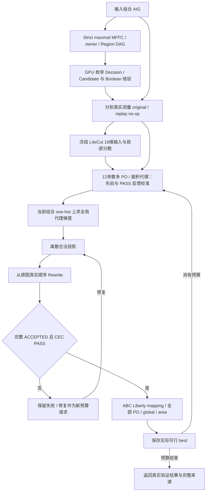

# 梯度优化闭环：实现与实验状态

审查日期：2026-11-14（北京时间）；**完成更新：约12:51，全905正式运行与原始审计、补充成本分析均已完成**。本报告的整理只阅读源码和已有结果，没有为报告执行模型、优化、测试或EDA。下文保留08:55:48的运行中快照，并明确标注其历史截点；当前完整状态见第6.1的完成更新和[正式905结果](BENCHMARK905_RESULTS.md)。不能将早期截点的1563点/1 FAIL当成最终计数。

**当前已实现“冻结 LiteCut 特征 → 多 PO/面积可微代理 → 全局梯度指导离散联合候选 → 真实 Rewrite + CEC + ABC Liberty Timing → 成功测量反馈”的闭环。最新 MFFC 版本已接入完整 GPU DAG 前/反传播，并完成六个开发输入的十八个真实 A/B/Ours 方法点。** c1355 等例有实际改善；但代理下降不保证真实 delay 下降，尚无稳定算法优势或 LiteCut 独立收益的结论。新版完整905的2715点已经完成并审计：A/Ours各905 PASS，B为901 PASS/4 FAIL。相对A有质量收益，但相对B的稳定优势与整体Delay–Runtime目标未成立；不能用开发正例替代这一全量结论。

| 先看这几个问题 | 当前答案 | 详细证据 |
|---|---|---|
| 实际优化谁？ | 每个 `(root, cut_slot)` Decision 的 candidate/no-op 选择；MFFC 是分组和传播单元 | 第3.1、3.4节 |
| 梯度怎样选候选？ | 最新入口对当前 one-hot 求完整代理梯度，以方向导数排序、合法投影，再对联合块执行完整代理评分；没有候选 logits 的 Adam 内循环 | 第3.4节及 `mffc_search.gradient_blocks` |
| LiteCut 做了什么？ | 冻结 Student 提供局部分数，作为四维相对特征之一；不直接预测整条路径，也不参与反传 | 第4节 |
| 真实改善是否存在？ | 最新开发 c1355：360.111877→319.617096 ps，18个rewrite、覆盖18个MFFC，全部接受、CEC PASS；六例中也有回退和劣于B的结果 | 第6.1、7.5、7.6节 |
| 是否证明代理/梯度可靠？ | 没有。div第二轮代理J下降却真实delay上升；旧905和432点随机/关闭内层更新对照未支持稳定优势 | 第6.2～6.4、7.6节 |
| 最新全量是否完成？ | 905×3=2715终态已审计，2711 PASS/4 FAIL/0 TIMEOUT；5750份真实测量，3039成功replay、2个内部失败请求 | 第6.1完成更新；4项方法FAIL均为B，内部2失败为BRAM_SSP共享CUDA分配失败 |

阅读顺序：第2～4节解释当前实现，第6.1及7.5～7.6节给出最新版本真实证据，第6.2～6.4节保存历史对照，第9节明确未实现和未验证项。

## 1. 版本范围与证据口径

首次08:55审查时分支为 `work/mffc-gpu-905`，当次报告修改前 HEAD 为 `4def721b743d5356c3b93c9153808845c20b21ad`，工作区干净。最新正式实验使用冻结源码 `ecc85e6ac82571caf9f1a6004098dbe976536256`，tag 为 `mffc-gpu-905-freeze-20261114`；后续提交补充交付分析与文档，不是该实验运行源码。旧同名报告在 Git 中保留，本报告保留版本边界并更新现有证据，不改写原始实验目录。

| 范围 | 实际源码 / 入口 | 已有证据与边界 |
|---|---|---|
| 旧版完整代理 STE | 主实验 `160b2187eee3b47799e58b658e39f13d40064b61`；后续冻结控制 `5025a6c863f0a7766c41707bcc1828723afce447` | 全 905 输入、两种目标；901 PASS、4 PARTIAL。控制的八个核心 Python 模块与主实验相同 |
| 后续联合/自适应 CPU–CUDA | 正式快照 `22579982d22d741d47600a6406b09f00f4a4b46b` | 16 输入 × 3 seeds × 9 方法 = 432 个真实冷方法点；全部完成并审计 |
| 通道与修复控制 | `db64308d53dcdd37b075d35b0da08f1f5cf9f458` | 4 输入 × 3 seeds × 4 配置 = 48 个真实方法点；全部完成，不与主面板混成独立 20 输入 |
| 当前 MFFC 全局梯度版本 | `mffc_experiment.py`、`mffc_search.py`、`mffc_model.py`、`mffc_gpu.py`、`region_lse.cu`；正式快照 `ecc85e6` | 设备队列完整前/反传播已实现；32项模型/数值/回归与最终41项冻结门槛通过；六开发输入18点全部PASS。三方法905/2715点已完成；65245/65247/65249均COMPLETED/0:0，最终CSV/JSON与原始审计已交付 |

文档时效需注意：`docs/WORK_HISTORY.md` 末尾“未建立通用联合优化器”属于初始导入阶段，不能替代后来的框架/实验状态；旧同名报告中的正式面板 RUNNING/PENDING 与“消融尚无结果”已过时。这里根据终态文件更新解释，原文档和运行证据保持原样。

**入口决定算法。** `python -m global_timing` / `pipeline.Experiment` 仍用旧版 `gradient_proposals`；432点面板由 `profile_single_method.py` 注入 `adaptive_proposals`；最新版本由 `scripts/run_mffc905.py` 的 Ours 子进程显式构造 `MffcExperiment`，不走前两种候选优化器。432点和最新版本均仅验证 `area_constraint`，不能写成两者也已完成 delay–area `joint` 的同规模验证。[旧入口](global_timing/pipeline.py:138)、[自适应入口](global_timing/joint_optimization.py:418)、[MFFC入口](scripts/run_mffc905.py:83)。

本文真实优化结果统一采用 `ABC_SCL_LIBERTY`：相同 ABC、ASAP7、`map; topo; stime -p`，同一 `SC_Man` 输出 global、全部 PO rise/fall 和 area。不要与 Gate3F 的固定 MIO PO arrival、corrected `print_pair_delay`、初始 mapper mode0 arrival 混用。已撤回的旧 `print_delay PO PI` 标签及其校准指标未用于本报告的有效性结论。原始说明见 [KNOWN_LIMITATIONS](docs/KNOWN_LIMITATIONS.md) 与 [标签更正](evidence/path_delay_model/LABEL_CORRECTION_NOTE.md)。

## 2. 从 AIG 到真实 Timing 的完整流程

| 步骤 | 输入与处理 | 输出 / 职责 | 代码入口 |
|---|---|---|---|
| 1 读取 | 组合 AIG、PI/PO 位置顺序、fanin literals | 原图节点及接口；每个组合始终从该原图开始 | `structure.parse_aig` |
| 2 分区 | CPU ref/deref，strict maximal MFFC；检查 AND 全覆盖与不重叠 | root/member、owner、Region DAG、拓扑序、各边界入口到 root 的最长 AND 距离 | `structure.make_partition` |
| 3 枚举 | CULS GPU 导出保留的 3/4-leaf cuts 与正节点增益候选 | Decision 域、library subgraph IDs、cut-bounded removable cones、静态冲突 | `candidates.enumerate_candidates/catalogue_from_raw` |
| 4 函数核验 | cut 真值、必要的原上下文 CEC、候选相位/置换真值检查 | verified catalogue；不能证明的 cut 排除并留审计记录 | `cut_validation.validate_catalogue`、`boolean_candidates`、`litecut.score_catalogue` |
| 5 实际基线 | original 与零选择 replay 分别做 CEC/mapping；original在初始化最先测量 | no-op 的全部 PO、delay、area，作为代理锚点与面积参考；original 分列 | `MffcExperiment.__init__`、`Evaluator.evaluate` |
| 6 局部推理 | 原 cone/no-op 与 replacement DAG 的 19 维特征，冻结 Student | 各选项局部 `predicted_local_abc_delay`，保存 `litecut.json` | `litecut.score_catalogue` |
| 7 初始化/校准 | 以真实no-op锚定；最新版本首轮用12参数先验，有新PASS后才校准 | 12个参数；旧432点大图分支另有八维标量残差，最新版本不使用它 | `MffcGpuSurrogate.fit_observations` / `TimingSurrogate.fit_observations` |
| 8 梯度选候选 | 最新版本固定代理参数，在当前真实incumbent的one-hot上求完整全局梯度 | 方向导数排序→合法联合块→完整DAG重评分；这里开始选择变量优化。旧版本另用logits | `mffc_search.gradient_blocks`；旧版为`gradient_proposals/adaptive_proposals` |
| 9 投影与真实安装 | 合法离散组合→原 root/cut/subgraph；原 root 升序顺序安装 | 完整 AIG、逐请求 trace；全部指定选择必须 ACCEPTED | `Catalogue.project/requested`、`replay/execute_many`、原生 `rewrite.cu` |
| 10 真实验证与反馈 | 完整安装→严格 CEC→统一 Liberty mapping | 实际 delay/area/PO；失败无标签。修复另占请求预算，成功观察反馈校准，返回真实 best | `Evaluator.evaluate`、`repair_rejected`、`rank_actual` |

MFFC **Region** 是严格分组；Rewrite **Decision** 是 `(root, cut_slot)`；Rewrite **Region** 是该 cut 限定的可移除 cone；Replacement **Candidate** 是该 Decision 下的 `subgraph_index`。同一 MFFC 可选多个兼容 Decision。Region ID、原 AIG ID、GPU ID、序列化 replay ID 与 mapped-netlist ID 不可互换。



最新 MFFC 版本没有随机 warmup/探索；旧版905和432点包含这些请求，不能把它们全部叫梯度请求。最新版本先测original，再准备结构/候选和replay no-op，随后推理LiteCut与构造代理；表中按数据依赖组织，原始时序见 [MffcExperiment.__init__](global_timing/mffc_experiment.py:49)。批量 replay 只复用原图枚举上下文，各组合独立恢复原图，再各自 CEC/mapping；不是累计改写。[execution.py](global_timing/execution.py:16)。

## 3. 梯度如何指导候选选择

### 3.1 离散变量与特征

每个 verified Decision 是一个变量：

\[
x_i\in\{0,1,\ldots,K_i\},\quad x_i=0:\text{no-op},\quad
x_i>0\mapsto\texttt{candidate\_subgraph\_indices}[x_i-1].
\]

选择张量为 float64 的 \(v\in\mathbb R^{D\times W}\)，\(W=\max_i(K_i+1)\)，padding 用valid mask排除。最新版本用真实组合的one-hot，求其连续扩展的方向导数；旧版才引入同形状logits \(z\) 和Softmax。`choice_index` 是域内序号，通常不等于 `subgraph_index`。c1355 为91个变量、326个physical candidates，加no-op共417个有效选项，不是62个Region变量。

设 \(\ell_{ik}\) 为局部 LiteCut 分数，\(d_{ik}\) 为原 19D 特征中的 `Weighted_Depth`（索引 8），\(n_{ik}\) 为 `Node_Count`（索引 11）。代理只使用四维相对特征：

\[
f_{i0}=0,\qquad f_{ik}=\operatorname{clip}_{[-5,5]}
\left(\frac{\ell_{ik}-\ell_{i0}}{\max(|\ell_{i0}|,1)},
\frac{d_{ik}-d_{i0}}{\max(|d_{i0}|,1)},
\frac{n_{ik}-n_{i0}}{\max(|n_{i0}|,1)},1\right),\ k>0.
\]

\[
e_i(v)=\sum_k v_{ik}f_{ik},\qquad F_r(v)=\sum_{i:\mathrm{owner}(i)=r}e_i(v).
\]

这里置零的是 no-op 的**相对特征**，不是其原始 LiteCut 预测。实现：[surrogate.py](/home/wushangge/CULS_LiteCut/global_timing/surrogate.py:100)、[候选域](/home/wushangge/CULS_LiteCut/global_timing/candidates.py:12)。

### 3.2 已实现的局部到多 PO 代理

对 Region \(r\) 的入口 \(p\)，\(u(p)\) 是前驱 Region；PI/常量的 arrival 与特征为 0。\(I_{rp}\) 包含从该入口在原 Region 内能到达 decision root 的 Decisions，\(h_{rp}\) 为入口到 root 的结构深度：

\[
B_{rp}=\sum_{i\in I_{rp}}e_i,\quad
b_{rp}=w_\ell^TB_{rp}+w_{int}^T(F_r\odot F_{u(p)}),\quad
c_{rp}=h_{rp}\kappa\exp\bigl(2\tanh(b_{rp}/2)\bigr).
\]

令 \(D_0,A_0,T_o^0\) 为 replay no-op 的真实 global delay、area、各 PO arrival，\(D_{ref}=\max(D_0,10^{-6})\)、\(A_{ref}=\max(A_0,10^{-6})\)。\(\kappa=D_{ref}/\max(H_{max},1)\)，\(H_{max}\) 为原图最大结构深度。拓扑传播为：

\[
a_r=\tau_g\log\sum_{p\in P_r}\exp\left((a_{u(p)}+c_{rp})/\tau_g\right),
\quad\tau_g=\max(0.005D_{ref},10^{-8}).
\]

\[
\widehat T_o(v)=\max(0,T_o^0+q_o(v)-q_o(0)),\qquad
\widehat D(v)=\max_o\widehat T_o(v).
\]

\(q_o\) 取 PO 所属 Region 的传播 arrival；直接 PI/常量 PO 的传播项为 0。面积为：

\[
\bar e=\frac{\sum_i\max(n_{i0},1)e_i}{\max(N_{AND},1)},\qquad
\widehat A=A_0\exp\left(2\tanh(w_A^T\bar e/2)\right).
\]

`w_local`、`w_interaction`、`w_area` 各四维，共 **12 个共享可校准标量**。初值分别为 `(0.08,0.15,0,0)`、全 0、`(0,0,1,0)`。这已是新增的局部→多 PO/面积估计模块，但属于小型经验代理，不是精确的可微技术映射器。no-op 预测精确是锚定公式的结果，不计为预测准确性。

跨 MFFC 作用来自相邻 Region 特征双线性乘积和 DAG 下游传播；同一 Region 内的多个 Decision 也通过聚合耦合。它没有学习完整 candidate-pair 查表，也不在每次实际改写后更新结构 DAG、端口关联或深度。实现：[TimingSurrogate._propagate/forward](/home/wushangge/CULS_LiteCut/global_timing/surrogate.py:330)。

“多路径”在当前代码中是所有结构前驱的平滑传播与全部 PO 聚合，**没有为每条 PI→PO 物理/逻辑路径分别建立目标**。Region path 是原图结构表示，不是 mapped timing path。

### 3.3 优化目标：平滑多 PO 与面积

全部 PO 都参与，实际权重为 1，\(\tau_s=0.02\)：

\[
S_T=\tau_s\log\sum_o\exp\left(\frac{\widehat T_o/D_{ref}}{\tau_s}\right),\quad
S_A=\widehat A/A_{ref}.
\]

\[
J_{area}=S_T+20\,[\max(0,S_A-1.05)]^2.
\]

旧版还实际测试了 delay–area Smooth Tchebycheff，零参考、\(\lambda=0.5\)：

\[
J_{joint}=\tau_s\log\left[
\exp\left((1-\lambda)S_T/\tau_s\right)+\exp\left(\lambda S_A/\tau_s\right)\right].
\]

Tchebycheff 的两个维度是 delay 和 area，不是每条路径一个维度。ADP 保存为评估指标，不是直接优化目标。`path_weights` API 支持 PO 权重，现有主运行没有使用自定义权重。

最终实际排名与代理优化分开：面积模式只在真实 \(A\le1.05A_0\) 的 PASS 点中最小化真实硬最大 delay（代码另有1e−8面积绝对容差）；joint 将真实全部 PO/area 代入联合目标，不额外应用 1.05 硬面积约束。旧实验的 \(\lambda=0.5\) 来自 `SearchConfig.area_weight`，不能用 `scalar_objective` 的函数默认值0.2替代实际配置。[scalar_objective](/home/wushangge/CULS_LiteCut/global_timing/surrogate.py:399)、[rank_actual](/home/wushangge/CULS_LiteCut/global_timing/pipeline.py:125)、[最新实际排名](/home/wushangge/CULS_LiteCut/global_timing/mffc_experiment.py:126)。

### 3.4 最新 MFFC 版本：one-hot 全局方向导数与离散联合块

令当前已真实验证且面积可行的组合为 \(x^t\)，\(v^t=\operatorname{OneHot}(x^t)\)。冻结12个代理参数后，只对选择张量求导：

\[
g_{ik}=\left.\frac{\partial J_{area}(v)}{\partial v_{ik}}\right|_{v=v^t},\qquad
G_{ik}=g_{i,x_i^t}-g_{ik}.
\]

从当前选项换到 \(k\) 的方向是 \(\Delta v_i=e_k-e_{x_i^t}\)，故一阶预测 \(\Delta J\approx-G_{ik}\)。每个Decision选择允许且 \(G_{ik}>0\) 的最佳替换，GPU按收益稳定排序，最多向CPU传 `8 × maximum_edits` 条稀疏编辑。CPU按1/2/4/8/16编辑预算构造合法块：

\[
x_b=\Pi_{feasible}(x^t,\{G_{ik},i,k\},b),\qquad
\text{proposals}=\operatorname{Top}_{2}^{\min}\{J_{area}(\operatorname{OneHot}(x_b))\}.
\]

这些hard组合会再次执行**完整DAG前向**，不是各MFFC独立选局部最小值，也不是冻结二次Q打分。代码没有要求每个重评分都严格小于anchor；最终保留标准由真实测量决定。候选更新没有学习率、Softmax、STE、Gumbel或内层Adam；Adam仅用于反馈校准12个代理参数。实现：[gradient_blocks](global_timing/mffc_search.py:15)、[prepare_selection_mask](global_timing/mffc_search.py:9)。

完整反传链为：\(J\) → 全PO平滑目标/面积 → no-op锚定 → Region DAG LSE → 入口成本/相邻特征乘积 → Decision/Candidate相对特征 → \(v\)。Region入口的LSE导数为：

\[
\frac{\partial a_r}{\partial(a_{u(p)}+c_{rp})}
=\exp\left(\frac{a_{u(p)}+c_{rp}-a_r}{\tau_g}\right).
\]

反向按依赖把所有下游/PO贡献累加到前驱。`MffcGpuSurrogate`在CUDA聚合Candidate→Decision→Region及port incidence；原生`region_forward/region_backward`用每个warp处理一个就绪MFFC、CSR依赖计数和原子队列推进整个DAG，不再由Python逐层发射，也没有CPU DAG adjoint。自定义autograd只支持一阶导数。Student、投影、Rewrite、CEC、ABC仍在反传链外。[mffc_model.py](global_timing/mffc_model.py:24)、[autograd包装](global_timing/mffc_gpu.py:137)、[CUDA前向](framework/mffc_gpu/region_lse.cu:61)、[CUDA反向](framework/mffc_gpu/region_lse.cu:103)。

D<32且R<1024时使用同方程CPU参考；超阈值缺CUDA就失败，不静默CPU回退。没有verified Decision时不加载Student/代理。解析、分区、Boolean证明、局部特征/Student推理和合法投影仍在CPU；CULS的GPU枚举/rewrite是另一部分工作。并行计算代理不表示并行安装所有MFFC。

当前协议最多2轮、每轮最多2提案/16 edits；第二轮可在已改变的incumbent上继续编辑，因此final可多于16个rewrite。预算4包括no-op、失败及显式repair，original另计一次真实测量；因此并非固定做4个有效梯度组合。有至少两个PASS观察时，用此前标签拟合12步，之后重新求完整全局梯度。原图不充当第二个zero-choice校准标签。最终返回面积可行PASS观察中的真实最小delay；只有自己已付费测量的original更好时，才标为`original_fallback`。[MffcExperiment.run](global_timing/mffc_experiment.py:131)。

### 3.5 历史旧版全代理：Softmax + STE + Adam

\[
p_{ik}=\operatorname{Softmax}_k(z_i/T_t),\quad
h=\operatorname{OneHot}(\Pi_{static}(z)),\quad
v=h-\operatorname{stopgrad}(p)+p.
\]

前向使用静态合法 hard 组合，反向采用 Softmax 导数；argmax/投影本身不求导。没有 Gumbel-Softmax。温度线性从 1.0 降至 0.3。对静态冲突对 \(\mathcal C\)，\(\alpha_i=1-p_{i0}\)：

\[
P=|\mathcal C|^{-1}\sum_{(i,j)\in\mathcal C}\alpha_i\alpha_j
\quad(\mathcal C=\varnothing\text{ 时 }P=0),\qquad L=J+0.1P.
\]

\[
\nabla_z L\approx(\partial p/\partial z)^T\nabla_vJ|_{v=h}+0.1\nabla_zP,
\qquad z\leftarrow\operatorname{Adam}_{lr=0.12}(z,\operatorname{clipnorm}_5\nabla_zL).
\]

每次调用重新初始化 logits/Adam；噪声标准差 0.2，第一 restart 给当前真实 incumbent 的 one-hot 加 1，第二 restart 只用噪声。每个内部 step 的未见 hard 点进入 proposal 池，按代理目标排序；送真实工具的可能是中间 step，而非最后 argmax。

真正反传链为：目标→全部 PO/area→DAG LSE→入口成本/交互→相对候选特征→STE/Softmax→logits。DAG 的局部导数是各入口 LSE 的 Softmax 权重，`arrival.py` 按逆拓扑累积 adjoint；`bounded_tape` 只支持一阶导数。**Student、候选物化、离散投影、Rewrite、CEC、ABC 不参与反传。** [optimization.gradient_proposals](/home/wushangge/CULS_LiteCut/global_timing/optimization.py:9)、[arrival.backward](/home/wushangge/CULS_LiteCut/global_timing/arrival.py:76)。

### 3.6 历史432点大图分支：一次 adjoint + 局部二次目标 + 批量连续松弛

`FrozenCriticalityObjective` 在当前实际 incumbent \(v_0\) 上先做一次完整 CPU DAG forward/backward。令 \(g_e=\partial J/\partial c_e\)：

\[
q_e=g_ec_e(v_0)\,[1-\tanh^2(b_e(v_0)/2)].
\]

把入口线性/面积一阶贡献收集为 \(L_i\)，相邻交互收集为 \(C_{rs}\)，得到：

\[
Q(v)=J(v_0)+\sum_i L_i^T(e_i-e_i^0)
+\sum_{(r,s)}C_{rs}^T(F_r\odot F_s-F_r^0\odot F_s^0).
\]

未加入反馈时，Q 在 anchor 匹配原代理的值和一阶导数；只保留显式双线性项，**不是完整 Hessian 展开，也不在远离 anchor 时等价于原目标**。Q 是无量纲排序目标，不是 ps。

该历史大图分支再用此前 PASS 的真实标量目标拟合八维 ridge 残差：\(\phi\) 前四维是 size 加权局部特征均值，后四维是相邻 Region 乘积按双方 Decision 数和边数归一化的均值。以 incumbent 为中心：

\[
X_j=\phi(v_j)-\phi(v_0),\quad
y_j=J_j^{ABC}-[Q(v_j)-Q(v_0)+J_0^{ABC}].
\]

各列 RMS 下限 \(10^{-4}\)，缩放成 Z 后解 \(\beta=(Z^TZ+I)^{-1}Z^Ty\)，换回原尺度为 w：

\[
Q_f(v)=Q(v)-Q(v_0)+J_0^{ABC}+[\phi(v)-\phi(v_0)]^Tw.
\]

系数吸收到线性/双线性项；它提供在线标量排序反馈，不输出一套精确的新 PO 时序。加入残差后不再保证与原代理的一阶导数相同。训练残差下降不是独立验证准确性。[FrozenCriticalityObjective](/home/wushangge/CULS_LiteCut/global_timing/joint_optimization.py:70)、[fit_feedback](/home/wushangge/CULS_LiteCut/global_timing/joint_optimization.py:162)。

内层为 32 条 float64 trajectories × 40 步，**Softmax 连续优化，没有 STE 或每步硬投影**：

\[
m_b=\sum_i(1-\sum_kp_{bik}v_{0ik}),\quad
L_b=Q_f(p_b)+0.05[\max(0,m_b/B_b-1)]^2+0.1P_b.
\]

\(B_b\) 循环取 1/2/4/8/16/32 的合法编辑预算。对 \(\sum_b L_b\) 反传，逐轨迹梯度裁剪为 5；Adam lr=0.15、eps=1e-12，温度 1→0.3。最后 GPU/CPU 批量 argmax，只传正优势稀疏 edits，CPU 按 logit 优势投影、保留未编辑 incumbent；激活、停用、换候选各计一次 edit。合法 hard 点按 Qf 排序，实际请求前还用完整原代理保存 PO/area 预测。[joint_proposals](/home/wushangge/CULS_LiteCut/global_timing/joint_optimization.py:271)。

该历史版本的GPU加速范围是批量候选/轨迹的内层张量计算；Student推理、代理校准、一次原DAG adjoint、最终投影/排序仍在CPU。其432点证据不能用来证明最新原生MFFC GPU DAG；后者有独立的65237～65244验证记录。

### 3.7 历史自适应规则、共同校准与真实可执行性

固定元数据规则：Decision≤128 且 Region≤4096 时用 CPU 全代理 STE，最多 20 步；否则用局部二次分支。auto 模式在 `D × padded_width × 32 ≥ 500000` 且 CUDA 可用时启用 CUDA。小图即便要求 CUDA 仍按规则用 CPU，日志记录真实分支。[select_proposal_engine](/home/wushangge/CULS_LiteCut/global_timing/joint_optimization.py:403)。

代理校准只用此前 PASS 点，拟合 loss 为归一化全部 PO MSE + area MSE + 0.002 参数先验正则，Adam lr=0.025、clip norm=5。校准可更新 12 个参数；候选优化时这些参数冻结。与冻结 Student 是两件事。[fit_observations](/home/wushangge/CULS_LiteCut/global_timing/surrogate.py:365)。

合法性分三层：

1. 候选域和 Boolean 检查；原图 Decision 冲突包括同 root、removable overlap、任一方删除另一方 cut leaf。`Catalogue.project` 按相对 no-op logit 优势贪心投影；不是精确约束求解。
2. 真实顺序安装重新检查 leaf、saved/added gain 和传递引用环。默认仍要求正节点增益；可选允许非正 gain 的固定 probe 与自由搜索单列，未改默认。
3. 必须精确预选并 ACCEPTED 全部请求，再 CEC，再 mapping。任何部分安装都记失败，不能用其电路替换原请求。修复将被拒绝 Decision 清零，从原图重新执行，占新预算，保留 parent index/source。

上述旧版静态冲突不能完整预知结构哈希复用、顺序增益或环依赖，这是旧直接请求失败率高的实际限制。[candidates.py](/home/wushangge/CULS_LiteCut/global_timing/candidates.py:66)、[严格 replay](/home/wushangge/CULS_LiteCut/global_timing/candidates.py:133)、[repair_rejected](/home/wushangge/CULS_LiteCut/global_timing/execution.py:122)、[原生动态检查](/home/wushangge/CULS_LiteCut/projects/culs/src/algorithms/rewrite.cu:1280)。

最新版本另已实现并测试 [CandidateFeasibility](global_timing/feasibility.py:9)：按候选library相位/置换解码，在原AIG结构哈希中找复用的原AND；禁止与删除这些节点的其他Decision共选，原root或传递后继自引用选项预先屏蔽，重复哈希保守保留所有原身份。同root/removable overlap/cut leaf deletion约束继续生效；输入叶共享本身不禁止。投影仍是按收益顺序的保守启发式，不是精确约束求解器，不能完整预判重写后新哈希、动态增益或所有别名环。真实完整ACCEPTED/CEC仍是最终标准。

## 4. LiteCut 实际承担什么

| 问题 | 实际实现 |
|---|---|
| 输入 | 原图固定 context/cut + 按 library truth phase/permutation 物化的候选 DAG；提取 19 个连续特征，三组 8/6/5；没有 mapped netlist、真实 STA 或离散候选梯度作输入 |
| 特征内容 | root/context、leaf fanout/PI 比例、Weighted/Topo Depth、反相统计、Node Count、宽度、链/分叉密度与曲率；`FEATURE_NAMES_25[:19]`；谱特征与 WL hash 不进入 Student |
| 归一化 | checkpoint `x_mu/x_inv_sigma`：`(x_raw-x_mu)*x_inv_sigma`，float32 |
| 输出 | Student 标量回归值；逆标准化后 clamp log 到 [-10,10]、`expm1`，成为局部 `predicted_local_abc_delay` |
| 标签语义 | `Parser.stimeDelayProcess` 在既有 supergate/cone gates 内按 ABC gate delay 累加局部路径，取最大值并检查 external cell；不是 PI→PO 或全电路 global delay |
| 是否冻结 | 是：`model.eval()` + `torch.inference_mode()`；不加入候选优化器，不重训 Student。已有推理入口加载 CPU 模型 |
| 如何影响优化 | 相对 no-op 的局部标量差作为四维代理特征之一；greedy 对照则直接按局部分数选候选 |
| 梯度是否穿过模型 | 否。结果先变为 NumPy/JSON/Python 常量，再组成代理特征；反传只经过这些固定特征的选择权重与代理计算 |
| 新时序模块 | 已实现第3.2节的12参数多PO/area代理，最新版本把完整传播接入GPU；历史432点大图另有八维排序残差，最新版本不使用它。两者都不是已证实可靠的Mapping后时序预测器 |

实际推理变换为：

\[
\widetilde x=(x-\mu_x)\odot\sigma_x^{-1},\qquad
\ell=\operatorname{expm1}\left(\operatorname{clip}_{[-10,10]}
\left(s_{Student}(\widetilde x)/\texttt{y\_inv\_sigma}+\mu_y\right)\right).
\]

归一化统计来自checkpoint，当前闭环没有重新估计训练统计。`eval()`切换推理行为，`inference_mode()`使本次计算不建立反传图；“冻结”指模型不参与任何候选/代理参数优化，并非声称所有参数都显式调用了 `requires_grad_(False)`。

源码：[litecut.score_catalogue](/home/wushangge/CULS_LiteCut/global_timing/litecut.py:35)、[推理/逆变换](/home/wushangge/CULS_LiteCut/global_timing/litecut.py:92)、[LiteCutPredictor](/home/wushangge/CULS_LiteCut/projects/culs/tools/gate3e_run.py:57)、[StudentModel](/home/wushangge/CULS_LiteCut/projects/litecut/src/extract_cutlib_student/modeling.py:79)、[标签生成](/home/wushangge/CULS_LiteCut/projects/litecut/src/subutils/Parser.py:673)。

| 数量 | 单位 / 意义 | 能否当真实结果 |
|---|---|---|
| LiteCut local abc_delay | 原标签尺度的局部预测 | 否，不能相加成路径/global delay |
| 完整代理 \(\widehat T_o,\widehat D,\widehat A\) | 基线锚定的预测 ps / area | 否，只有评估前预测作用 |
| \(J,Q,Q_f,L\) | 无量纲优化/排序/含惩罚 loss；Qf 甚至可以为负 | 否，不能作为 ps |
| ABC delay/area | 真实完整 rewrite、CEC 后，同一 Liberty manager 的测量 | 是，仍属于逻辑映射 timing，不是布线后 signoff |

## 5. 已执行测试：按证据层次区分

以下是当前梯度闭环相关测试的汇总入口；不同版本回归覆盖重叠，**不能把次数相加当独立样本或覆盖率**。完整早期测试历史和未通过项保留在 [TEST_COVERAGE](docs/global_timing/TEST_COVERAGE.md)，新增开发列表在 [GPU RUN_LOG](docs/gpu_joint/RUN_LOG.md)。

| 层次 | 已保存结果 | 能证明什么 / 不能证明什么 |
|---|---|---|
| 模拟/单元 fixture | `tests/test_surrogate.py`、`test_arrival.py`、`test_joint_optimization.py`、`test_candidates.py`；有限差分、anchor 值/梯度、重汇合、非可加项、批量一致、投影/反例 | 验证代理自身数值与合法性逻辑；人工 delay 不计 QoR |
| 原框架真实核心 | 64341.8 的 75/75；64395 CPU 86 项为 74 PASS/12 真实工具 SKIP | 包含真实候选/replay、失败 CEC、常量输出与循环拒绝等；CPU SKIP 不算 GPU 通过 |
| 结构证书 | `T/output/partition_validation/summary.json`：905/905 PASS；80 小图与全-root oracle 对照 | strict coverage/owner/DAG/port 深度；不是 mapped timing 证明 |
| Student 特征/推理回归 | `20261111T132425Z-student-feature-regression-9184e32c`：123286 条一致，其中 c1355 417、div 122869 | 旧/新特征和分数接口一致；不是全局预测准确率 |
| 真实原框架全量 | E/O：905 输入、两目标；Q 执行审计 905 PASS、错误 0 | 成功观察完整安装且 CEC/Liberty；4 native 缺失仍为 PARTIAL |
| 旧测量的独立补充核验 | 13 批、905 设计、13981 份映射、16696 个成功引用；P 最终 905 ANALYZED、错误 0 | 保存实际测量/arrival 链一致性；引用数不是独立电路数或全库全局去重计数 |
| 同参数独立重复 | `20261111T214331Z-consistent-c1355-exact-repeat-0e387139/output/verification.json` PASS | c1355 数值、选择、25 项图结构一致；不宣称 905 搜索全重复 |
| 新版数值/原生回归 | 64957 30/30；64977 51/51；64981 36/36；65004 37/37 | 自适应、自然成本、内层控制、通道开关等限定版本；不累计为独立样本 |
| 新版真实开发 | 64976 三设计 9/9 冷点；64978 五控制×三设计 15/15；64981 两 seeds×四方法 8/8；64982 对 26 开发/基线点、108 成功测量审计 | 真实 rewrite+CEC+mapping；开发例不加入正式 16 设计统计 |
| CPU/CUDA 组件 | K 的 div/hyp/voter：选择/顺序 hash 一致；组件比较 1.70–27.59 倍，`no_eda_executed=true` | 真 GPU 数值/时间测试，不是新 Mapping/QoR 或 E2E 结果 |
| CPU/CUDA 完整开发配对 | 64980 div：327.206/169.602 s，8 请求及指标一致，最终均 no-op | 一个真实完整配对约 1.929 倍；不证明质量改善或普遍加速 |
| 正式新面板 | F 精确 432 点终态；S 审计 1119 成功观察错误 0、10 项分析测试通过 | 完整真实闭环与公平配对；最终性能含负结果 |
| 补充控制 | A 精确 48 点、115 成功观察审计；默认兼容、四配置 smoke 通过 | 通道/修复有限子集贡献；不扩大到全部 905 |
| 当前原生MFFC GPU数值/单元 | 65237原生队列7/7；65238及65239完整32/32、无SKIP；65244最终41/41、无SKIP | 有限差分、逐候选/参数梯度、CPU参考、深链/宽层/重汇合、候选复用、预算/恢复边界；人工fixture不计真实QoR |
| 当前MFFC真实开发 | 65239/65240六输入×A/B/Ours=18/18 PASS；65241只读审计38份真实测量、20个成功replay观察 | 完整安装/CEC/原始GT_META/netlist hash通过；是开发而非完整905结果 |
| 当前MFFC交付分析 | 65241统计测试4/4；65246安装/成本/缺失值测试4/4；65248扩充工具成本测试5/5、无SKIP，并只读处理两开发批次 | 保留失败耗时与缺失时钟，区分真实CUDA工作和无候选；仅补充统计和文件审计，不是新增模型训练、搜索或ABC实验 |
| 保留的失败记录 | 65236原生编译失败；65243新增fixture缺字段而2 ERROR | 后续修复验证通过；失败原日志保留，不计为成功测试，也不误称真实CEC失败 |

全仓库早期矩阵仍有 17 个 import FAIL 与 1 SKIP，主要涉及 DGL/einops/deepgate、历史命令脚本的参数/输入、训练数据权限或 import 外部写入。Student 闭环通过不等于全部历史训练程序都可用；没有行覆盖率或“全源码测试通过”的证据。

## 6. 已完成的真实实验结果

### 6.1 最新 MFFC 全局梯度版本：六个开发输入、十八个真实方法点

以下数值直接读取65239/65240的 `output/records/*.json` 和各 Ours 的 `work/summary.json`，并抽查c1355的原始choices、CEC文本和mapping `GT_META`。A=原图，B=一次 `strash; rewrite` 后用共同Evaluator重读，Ours=本版梯度闭环。全部18点有真实最终CEC/Liberty结果；所有Ours final满足各自no-op面积上限，20个replay观察无失败。**开发集用于实现检查，没有同预算random/greedy控制，不是完整905性能结论。**

| 输入（数据集相对路径） | MFFC / Decision / physical Candidate | A Delay ps | B Delay ps | Ours Delay ps | Ours Area | 冷E2E A / B / Ours s |
|---|---:|---:|---:|---:|---:|---|
| `OpenABC/c1355_orig.aig` | 62 / 91 / 326 | 360.111877 | 359.501831 | 319.617096 | 520.214417 | 0.916 / 0.968 / 7.580 |
| `OpenABC/ss_pcm_orig.aig` | 97 / 11 / 31 | 350.016113 | 319.565643 | 325.867493 | 213.451202 | 1.117 / 1.017 / 5.830 |
| `ACE/DMA_comb.aig` | 1801 / 632 / 1745 | 2463.366460 | 2491.453120 | 2411.792720 | 5180.449220 | 1.819 / 2.119 / 17.153 |
| `ACE/div.aig` | 28306 / 51140 / 71729 | 75831.046900 | 67247.359400 | 75760.148400 | 12654.273400 | 6.476 / 6.576 / 87.328 |
| `ACE/hyp.aig` | 117509 / 2760 / 2840 | 1774327.750000 | 1772861.750000 | 1774327.750000 | 176938.922000 | 16.093 / 20.654 / 149.424 |
| `forgeEDA/mig_7series_v2_1_ecc_merge_enc.aig` | 576 / 0 / 0 | 688.224609 | 688.224609 | 688.224609 | 21071.250000 | 1.968 / 2.220 / 6.337 |

Area为实际库面积，记录未另标物理单位；时间来自外层冷方法wall，不是kernel时间。A/B完整面积也保存在records和开发CSV中；例如div的B面积25400.459，超出该例no-op×1.05界，表中其原始delay照实保留，不把它当面积可行胜出。hyp返回付费原图而非候选改善；mig无Decision，不算梯度贡献。所有例子Ours均比A/B耗时更多，不能由GPU被调用就宣布完整方法加速。

| 输入 | 实际选择梯度轮数 / 请求数（含no-op） | final非零Decision / 原MFFC数 | final来源 / 设备 | 结构DAG层数 / 最大层宽 |
|---|---|---|---|---|
| c1355 | 2 / 4 | 18 / 18 | 直接全局梯度 / CUDA | 6 / 32 |
| ss_pcm | 2 / 3 | 3 / 3 | 直接全局梯度 / CPU小图回退 | 3 / 54 |
| DMA | 2 / 4 | 16 / 16 | 直接全局梯度 / CUDA | 11 / 473 |
| div | 2 / 4 | 16 / 4 | 直接全局梯度 / CUDA | 4183 / 128 |
| hyp | 2 / 4 | 0 / 0 | original_fallback / 搜索阶段CUDA | 16269 / 12991 |
| mig | 0 / 1 | 0 / 0 | replay_noop / 无代理 | 2 / 512 |

ss_pcm第二轮有梯度但没有未见合法块，所以没有第四个请求；mig未使用任何梯度。div有多个Decision在同一MFFC中同时被接受。此处“梯度轮数”是选择变量的全局梯度调用次数，不包含反馈校准的12次反传；没有40步logits内循环。

以下三段保留首次报告的历史观察；最终状态以本节“完成更新”为准。最新完整905作业65245的源码/工具/输入已冻结。**2026-11-14 08:55:48 +08:00只读截点**：逐个读取当时已发布的终态JSON，Slurm仍RUNNING，已保存1563/2715个终态（A/B/Ours各521），521个输入三方法齐全；1562 PASS、1 FAIL。这里“三方法齐全”包含失败终态，不等于三方法都成功。其余点没有用预测补齐。`output/formal_completion.json` 和 `output/benchmark905_delivery/analysis_completion.json`均不存在。**在该历史截点，新版全905比较、最终成功率、总体质量和速度优势均未验证**，不能用部分PASS作总体结论。本次没有启动或干预这个已有作业，也不以预检通过宣告完成。

已观察到的失败为index392 `forgeEDA/codec.aig` 的方法B：`Abc_AigUpdateLevelR_int` / `Abc_ObjIsNode(pNode)`断言，native rewrite退出−6，命令耗时0.214344236s、完整冷方法耗时0.518344442s。B未取得成功CEC/mapping，delay与area缺失，不填零、不用no-op代替。相同输入A/Ours为PASS；Ours为自己付费测量的 `original_fallback`，冷E2E 18.102447693s，不能称为梯度改善。直接证据在Z的 `output/records/0392_{A,B,Ours}.json`、`case_0392_B/work/native_rewrite.{command.json,log}`；说明见 [FAILURE_NOTES](docs/mffc_gpu/FAILURE_NOTES.md)。该方法FAIL与Ours内部候选请求的FAIL不同，当前前缀的内部失败尚未形成完整审计统计。

两个已有后处理65247/65249在截点均为PENDING/Dependency；最新工具成本版本等待上游结果，仅做已有文件审计和汇总。排队不构成完成证据。本报告不等待其产生新的实验标签，也不为整理文档提交任务。

#### 完成更新：当前版本正式905，约12:51 +08:00

Z的`formal_completion.json`与`benchmark905_delivery/analysis_completion.json`已形成；65245为COMPLETED/0:0、34427s。原始审计核对5750份真实CEC/Liberty测量、3039个成功replay观察、2个失败请求。65247/65249补充后处理分别20/18s、COMPLETED/0:0，没有新增EDA；含工具成本的完整交付为65249的`output/final_mffc905_delivery/`。最终23个审计/交付产物hash核对通过、47个运行源码仍与冻结源一致，全部905个成功Ours配置实际存在且输入/模型/工具身份匹配。

| 方法 | 尝试 / PASS / FAIL / TIMEOUT | 冷E2E中位 / P90 s | 全终态时间合计 s | final CEC PASS / 面积可行 |
|---|---|---:|---:|---|
| A 原图 | 905 / 905 / 0 / 0 | 2.322496 / 5.884742 | 3063.317070 | 905 / 898 |
| B 单次ABC rewrite | 905 / 901 / 4 / 0 | 2.821493 / 7.683508 | 4646.054152 | 901 / 828 |
| Ours | 905 / 905 / 0 / 0 | 18.766875 / 49.632672 | 25640.713938 | 905 / 905 |

| Ours相对 | 有效配对 | Delay胜/平/负 | 改善中位% | Delay比几何均值 | 改善算术均值% | 配对baseline/Ours时间比中位 |
|---|---:|---|---:|---:|---:|---:|
| A | 905 | 544/360/1 | 0.355115 | 0.944392（905） | 4.579724 | 0.135011 |
| B | 901 | 354/184/363 | 0 | 0.998084（901） | −2.457263 | 0.166129 |

几何均值不是算术平均；相对B改善均值为负，且负例多于胜例。共同成功且均满足no-op1.05倍面积条件的826例中，相对A“delay更好且不更慢”0例，相对B为1例；相对A/B“更慢但delay改善”479/328例。**工程闭环与全量评价完成，当前整体Delay–Runtime性能目标未达到。** A/B的超面积原始结果未剔除；其余4项B断言保持空缺，不把缺失当胜出。

905例Ours中94例无候选，0例候选数量未知；806例实际CUDA、5例CPU小图、94例不构造代理。final来源为直接梯度415、no-op359、付费original回退131；366例final同时选中多个MFFC，最终接受5872个rewrite，单例最多32个（两轮累积），不把联合安装自动解释为协同收益。总replay请求3041、完整安装3039 PASS/2 FAIL/0 UNKNOWN，其中2134个非空完整组合、0个部分失败接受、0次repair。

2个内部失败均在index104 `forgeEDA/BRAM_SSP.aig`：两个选择向量共享一次gpuls batch调用，设置2GiB CUDA heap时报告out of memory/返回1；两请求metrics为空，没有CEC/mapping标签。inclusive请求为3.272750/3.272956s，共享实际命令3.269543s，不相加当独占wall。final回退no-op，4243.653320ps、area22461.130900、CEC PASS，完整cold25.109973s。这说明“905个final PASS”不等于所有候选请求可执行或资源零失败；分配失败深层原因未进一步验证。

实际调用：Ours CEC4284、Mapping3944、replay命令2312（batch命令可对应多个请求）；A为905/905，B为901/901且native命令905。Ours每点Mapping inclusive中位7.942801s、总11307.993805s；CEC中位1.086510s、总2735.911334s；replay命令中位1.046844s、总1431.609777s。LiteCut准备/推理（811点）中位1.470547s、合计4388.534673s；梯度与联合块（811点）中位0.052158s。806个实际CUDA点的原生前/反向事件合计逐点中位70.086656ms，含校准和搜索调用；不含其他Torch聚合/传输/初始化，不能与完整wall等同。分项存在重叠，不能据此宣称独占占比或纯GPU因果加速。

证据：[根报告](BENCHMARK905_RESULTS.md)、[完整2715点CSV](BENCHMARK905_RESULTS.csv)、[统计/分母JSON](BENCHMARK905_SUMMARY.json)、[复制来源/hash](provenance/mffc905_delivery.json)、[逐项验收](docs/mffc_gpu/DELIVERY_AUDIT.md)、[失败说明](docs/mffc_gpu/FAILURE_NOTES.md)。来源/AND/DAG分组、真实cold与3组PNG/PDF均见根报告；本轮没有额外跑random/greedy/旧版或独立CPU全量组，旧比较不冒充当前版本消融。

### 6.2 历史旧版：905 输入、两种目标

输入清单来自 I，905 个 hash 唯一：ACE 40、OpenABC 47、forgeEDA 805、iwls2022 5、iwls2024 8。种子 20261111；每模式最多 8 请求，warmup 参数 2，20 步×2 restarts，校准 30 步，batch 4。全部905并非都进行了非平凡梯度：两模式各 799 设计有非零梯度轨迹，106 设计无此类轨迹。

| 方法 | 有指标 / 缺失 | 相对 original Delay 胜/平/负 | 相对 replay no-op Delay 胜/平/负 |
|---|---:|---|---|
| 原图 | 905 / 0 | 0 / 905 / 0 | 266 / 319 / 320 |
| replay no-op | 905 / 0 | 320 / 319 / 266 | 0 / 905 / 0 |
| native ABC rewrite | 901 / 4 | 471 / 210 / 220 | 483 / 167 / 251 |
| 面积约束梯度 | 905 / 0 | 658 / 158 / 89 | 608 / 297 / 0 |
| joint 梯度 | 905 / 0 | 656 / 150 / 99 | 583 / 304 / 18 |
| LiteCut greedy | 905 / 0 | 510 / 139 / 256 | 481 / 185 / 239 |
| 独立 Region | 905 / 0 | 499 / 167 / 239 | 453 / 213 / 239 |
| random（area 排名） | 905 / 0 | 658 / 161 / 86 | 585 / 320 / 0 |
| random（joint 排名） | 905 / 0 | 647 / 158 / 100 | 568 / 319 / 18 |

相对原图逐设计改善中位数：area 3.6586%、joint 3.8708%；但 no-op 本身就因序列化产生大量变化。相同**已消耗请求预算**的随机对照：area 梯度 179 胜/464 平/262 负，joint 按真实联合目标 252/379/274；两者中位目标改善为 0%。不能据相对原图改善将收益归因于梯度。

| 预测 / 来源指标 | area | joint |
|---|---:|---:|
| 评估前预测样本 / 涉及设计 | 3128 / 811 | 3197 / 811 |
| 按设计平均 global-delta 归一化 MAE | 0.117150 | 0.121337 |
| 实际变化样本的按设计平均方向正确率 | 0.436117 | 0.450463 |
| 直接梯度请求成功 / 总数 | 1567 / 3339 | 1685 / 3390 |
| 最终来源：直接 / repair / no-op / warmup / 探索 | 153 / 397 / 297 / 57 / 1 | 207 / 388 / 243 / 66 / 1 |

MAE 定义为 `abs(predicted_delta-actual_delta)/measured_noop_delay`，先设计内平均再设计等权；不是逐 delta 相对误差。锚点和失败不计准确性，评估前预测仅用更早成功标签；这些仍是在线反馈结果，不是固定模型的未见集泛化。

901 PASS / 4 PARTIAL 对应 `forgeEDA/codec.aig`、`loco_top.aig`、`mrc3.aig`、`mrc4.aig` 的 native ABC 断言退出，缺 native CEC/mapping。其他方法结果保留，未填入 no-op 冒充缺失对照。完整数值与面积/ADP/时间见 Q 的 `comparison_all.csv`；原图与 no-op 分列。[完整905报告](docs/global_timing/FULL905_SEARCH_RESULTS.md)。

### 6.3 历史联合/自适应正式面板：16 输入 × 3 seeds × 9 方法

F/S 已完成，方法点 432/432 PASS；这里的 PASS 是方法运行完成并有实际验证 final，不代表每个内部请求都成功。16 输入取自已经分析过的 905 集合，非未见集；三个种子不能当三倍独立电路。以下为各自三个 seeds 的**中位数**，由 S 的 `method_points.csv` 只读汇总；Delay/Area/时间中位数可能属于不同 seed，不能拼成一个候选组合。各新版 final 均真实 CEC PASS、满足 no-op 面积 1.05 倍。

| 索引 / 输入（完整相对路径） | MFFC / Decision / Candidate | 新版 Delay ps | 新版 Area | 新版 E2E s | 旧版 / random Delay ps |
|---|---:|---:|---:|---:|---|
| 1 / `ACE/DSP_comb.aig` | 8206 / 4708 / 9830 | 4122.693850 | 21228.246100 | 48.423 | 4122.693850 / 3635.907960 |
| 28 / `ACE/s35932_comb.aig` | 1794 / 543 / 1819 | 2153.951900 | 6147.394530 | 13.553 | 2169.109860 / 2174.471440 |
| 36 / `ACE/usb_funct_comb.aig` | 3113 / 1660 / 3402 | 1375.961060 | 7449.563480 | 25.017 | 1375.961060 / 1375.961060 |
| 51 / `OpenABC/dalu_orig.aig` | 196 / 1180 / 2428 | 847.443665 | 700.773132 | 11.639 | 847.443665 / 675.635315 |
| 65 / `OpenABC/k2_orig.aig` | 366 / 559 / 1369 | 399.364594 | 1287.705570 | 11.038 | 399.364594 / 395.401672 |
| 68 / `OpenABC/max_orig.aig` | 391 / 3 / 3 | 4424.030760 | 1431.406130 | 18.700 | 4424.030760 / 4424.030760 |
| 73 / `OpenABC/sasc_orig.aig` | 160 / 27 / 61 | 272.676666 | 335.923218 | 10.133 | 272.676666 / 272.676666 |
| 96 / `forgeEDA/ALU_mod.aig` | 2674 / 5694 / 12408 | 1556.381230 | 7420.403320 | 20.349 | 1585.052730 / 1585.315190 |
| 587 / `forgeEDA/mig_7series_v2_1_ecc_merge_enc.aig` | 576 / 0 / 0 | 688.224609 | 21071.250000 | 9.335 | 688.224609 / 688.224609 |
| 592 / `forgeEDA/mig_7series_v4_0_ecc_dec_fix.aig` | 64 / 0 / 0 | 262.528473 | 19477.947300 | 7.808 | 262.528473 / 262.528473 |
| 625 / `forgeEDA/multiplier_33x33_partial.aig` | 3769 / 6317 / 13193 | 930.648376 | 10884.144500 | 23.460 | 916.267090 / 934.710999 |
| 892 / `iwls2022/ex27.aig` | 949 / 3103 / 5026 | 1254.321410 | 2417.014160 | 22.762 | 1180.348390 / 1171.958620 |
| 894 / `iwls2022/ex63.aig` | 204 / 3455 / 7334 | 1085.162230 | 2973.386960 | 23.810 | 1116.562870 / 1008.903260 |
| 900 / `iwls2024/ex33.aig` | 966 / 10205 / 23207 | 1438.099370 | 4488.773930 | 34.581 | 1438.099370 / 1374.047610 |
| 902 / `iwls2024/ex79.aig` | 1874 / 10298 / 19996 | 2843.548580 | 4250.361820 | 31.478 | 2901.244380 / 2843.321780 |
| 904 / `iwls2024/ex96.aig` | 733 / 3804 / 7670 | 905.624756 | 2404.416990 | 19.499 | 906.196472 / 859.366943 |

R/D/C 是全部 verified 域，不是 final 实际启用数；c1355/ss_pcm/DMA 属开发族，未列入该正式16输入。两个 mig 输入无可执行 Decision，返回 no-op，不能计为梯度发挥作用。

| 方法 | 面积可行 final /48 | 中位完整 E2E s | 达到预定质量 /48 |
|---|---:|---:|---:|
| 冻结旧 STE CPU | 48 | 19.3666 | 32 |
| 新联合 CPU | 48 | 24.9616 | 32 |
| 新联合 auto（主方法） | 48 | 19.7258 | 32 |
| 关闭内层更新 | 48 | 21.1864 | 39 |
| 自然成本 random batch | 48 | 10.3085 | 36 |
| LiteCut greedy | 48 | 11.1881 | 30 |
| original | 48 | 1.9175 | 21 |
| native ABC rewrite | 42 | 2.4945 | 39 |
| native CULS rewrite | 45 | 2.6483 | 36 |

九方法均有48个终态；native 不可行表示真实测量超面积界，并非删除/失败。预定质量为面积可行 no-op/native ABC 中较低 delay 的 1.01 倍；只比较成功者的 time-to-quality 中位数会改变分母，不据此宣布普遍加速。random/native 按自然成本运行，不承担不使用的 ML 准备。

| 核心比较 | 实际值 | 可支持的结论 |
|---|---|---|
| 新/旧 Delay 比几何均值，48 对 | 0.999398；P90 1.007710；17胜/24平/7负 | 满足预定 QoR 非劣门槛，不是稳定质量优势 |
| 旧/新 E2E 比中位数 | 1.0355 | 未达预定 ≥1.5 倍；这是逐对比值的中位数，不是两列中位数相除 |
| 新/random Delay 比 | 1.026663；12胜/19平/17负 | 梯度未稳定胜出 |
| 新/关闭内层更新 Delay 比 | 1.043888；7胜/17平/24负 | 内层更新价值未成立；该控制仍有校准/大图 adjoint，不是全无梯度 |
| 新 CPU/新 CUDA E2E 比 | 9设计27实际CUDA配对，中位 1.326246 | 同分配、算法/精度/请求序列/实际指标一致，限定配对有 GPU 收益；其余21对不计 CUDA 贡献 |
| 直接梯度请求 | 45/161 成功，其中22个可行且优于 no-op | 不把最终 PASS 当全部提案可执行 |
| 主方法48 final 来源 | 直接6、修复28、warmup1、no-op12、探索1 | 多数 final 依赖 repair；28 repair 的父请求17来自梯度、11来自warmup |

30/120/600 s 曲线只使用已完成真实验证点。它们是最多8请求运行的时间截点，不是在600秒内继续搜索到耗尽时间的实验，也不证明收敛。[FINAL_RESULTS](docs/gpu_joint/FINAL_RESULTS.md)、[修复祖先审计](provenance/gpu_joint_repair_ancestry.json)。

### 6.4 历史四输入通道 / 修复控制

A 使用索引65/96/625/587，各三种子、默认与三个开关，共48点、115成功测量。选择发生于正式面板运行期间，不称未见集或完全预结果设计。

| 移除项 | 配对数 | 默认胜/平/负 | 默认 / 移除后 Delay 比几何均值 | 判断 |
|---|---:|---|---:|---|
| LiteCut 标量 delta | 12 | 2/7/3 | 1.002822 | 未支持独立收益 |
| 显式相邻 Region pair | 12 | 2/7/3 | 1.002929 | 未支持独立收益；仍保留 DAG 传播耦合 |
| 可执行性修复 | 12 | 9/3/0 | 0.952208 | 在该子集有实际质量价值 |

no-score 仍执行 Student/19D 准备，只屏蔽局部标量差；no-pairs 在校准/反馈中禁显式pair；no-repair 会改变后续请求，不能当相同组合的纯速度比较。每配置含3个无 Decision 的 mig/no-op 点，因此有变量的只有9点。默认36个直接梯度请求全部失败，9个final为repair、3个no-op，不能称该控制证明了直接梯度的成功。A在A40、F在RTX4090，不跨两作业比较 runtime。[CHANNEL_ABLATIONS](docs/gpu_joint/CHANNEL_ABLATIONS.md)。

## 7. 候选、Loss 与真实测量的逐项案例

### 7.1 历史旧版c1355：Loss下降不保证真实Delay下降

旧 O 的 `output/suite/case_0047/`：输入 `OpenABC/c1355_orig.aig`，41 PI/32 PO/512 AND、62 MFFC、128条Region边、91 Decisions、326 candidates；原图 SHA256 为 `2602b10f131a6ba5996521036ba130aab128a4aa15e3ab49ce44f2f02047f0b0`。初始/最终都为91个0；两目标最后均返回 no-op，CEC PASS，Delay=360.111877 ps、Area=513.216003。

| 请求 | 来源 / 启用 Decision 数 | 评估前预测 Delay ps | 真实 Delay ps | Area / 状态 |
|---|---|---:|---:|---|
| 0 | no-op /0 | — | 360.111877 | 513.216003 / PASS |
| 1 | warmup /24 | 364.436318 | 374.295197 | 510.883209 / PASS |
| 2 | warmup /27 | 357.776104 | — | FAIL，无实际标签 |
| 3 | repair /26 | 357.776104 | 414.142517 | 505.051208 / PASS |
| 4 | 直接梯度 /10 | 314.593493 | 411.157806 | 542.609253 / PASS，面积不可行 |
| 5 | 直接梯度 /8 | 317.969741 | 411.157806 | 542.609253 / PASS，面积不可行 |
| 6 | 直接梯度 /7 | 318.281110 | 413.100433 | 533.744629 / PASS |
| 7 | 直接梯度 /7 | 341.158647 | 405.519714 | 531.178589 / PASS |

`gradient_area_constraint/gradients_0003.json` 的 restart1，20步中的采样如下。Loss 由日志 J/P 和源码公式重建，不是新增优化：

| step | J | P | Loss=J+0.1P | 梯度范数 | hard 选择数 |
|---|---:|---:|---:|---:|---:|
| 0 | 1.096369790 | 0.606305909 | 1.157000381 | 0.038162954 | 35 |
| 10 | 1.015178284 | 0.109438750 | 1.026122159 | 0.024719854 | 8 |
| 19 | 0.937058787 | 0.053249351 | 0.942383722 | 0.002417918 | 10 |

同期30步校准用成功观察 `[0,1,3]`，loss 0.007882506→0.002957139。真实梯度候选有变化，但预测改善与实际相反。原图/no-op=360.111877、native ABC=359.501831、greedy=359.873505、独立Region=399.386475、同预算random=360.111877 ps。总比较运行含准备28.649s；area/joint exclusive记账7.739/8.410s，不是独立冷 E2E。后续 seed12 小预算入口确有337.477661ps的实际点，不能把本例负结果扩大成该设计永远不能改善；它不属于上述905运行或正式16面板。

### 7.2 历史旧版ss_pcm：跨两个MFFC的真实候选组合

旧 E 的 `output/suite/case_0080/`：`OpenABC/ss_pcm_orig.aig`，104 PI/90 PO/403 AND、97 MFFC、11 Decisions、31 candidates，3个MFFC有机会。初始均11个0；两模式各8请求，无失败，final均来自直接梯度 `eval_0003`：

```text
area final  = [0,0,0,0,3,3,0,0,0,0,0]
joint final = [0,0,0,0,3,0,0,4,0,0,0]
```

| 模式 | Decision index / MFFC | 原 root / cut_slot / subgraph_index | trace |
|---|---|---|---|
| area | 4 / R48；5 / R52 | (279,3,2)；(293,2,3) | 两项 ACCEPTED |
| joint | 4 / R48；7 / R52 | (279,3,2)；(294,3,3) | 两项 ACCEPTED |

| 方法 | 实际 Delay ps | 实际 Area | Rewrite数 | CEC |
|---|---:|---:|---:|---|
| original / no-op | 350.016113 | 213.217926 | 0 | PASS |
| 梯度 area | 323.908447 | 211.351685 | 2 | PASS |
| 梯度 joint | 323.937927 | 208.785599 | 2 | PASS |
| LiteCut greedy / 独立Region | 338.486664 | 215.550720 | 3 | PASS |
| random（两种排名均同一点） | 319.488068 | 211.584961 | 3 | PASS |
| native ABC | 319.565643 | 212.051514 | 未单列 | PASS |

原始 `choices.txt`、`rewrite/replay.json`、`raw/traces/choice.jsonl` 与 `evaluation/cec.log` 对应这些组合；mapping 的 `GT_META` 分别是 `211.351685 323.908447 90 299` 与 `208.785599 323.937927 90 297`。这是真实跨MFFC安装改善，但random/native delay更低。

两目标第一轮30步拟合 loss 均为0.004104818→0.001765475；joint restart1 step0/10/19的J为0.516347280/0.515995544/0.515995544，hard向量发生变化。该例成功梯度请求的预测 global delay始终350.016113ps，因此没有准确预测出实际约26ps的global变化。area best来自restart1/step19，joint best来自step8，不能用最后一条采样取代选中proposal。总比较38.308s；area/joint exclusive9.863/10.963s，口径同上。

### 7.3 DMA 与后续版本：跨多 MFFC 安装及保留的负结果

`ACE/DMA_comb.aig`（index0）：2227 PI/1084 PO/11249 AND、1801 MFFC、632 Decisions、1745 candidates。旧 E 原图2463.366460ps/5162.719730，replay no-op2450.765380ps/5154.321780。旧area final2380.250980ps/5196.078610，23 rewrites跨13MFFC；joint2322.102780ps/5156.887700，72跨56MFFC；均完整接受/CEC PASS，但旧random2287.624760ps更低。

后续64976自适应正增益搜索得到2301.566650ps，28 rewrites的显式修复点；同轮非正增益自由搜索2396.672360ps更差。虽然固定配置probe曾得2288.404300ps，不能把固定probe最佳点当自由搜索结果或宣布安装政策优越。该轮c1355仍no-op，ss_pcm恢复323.908447ps。详见 [INSTALL_POLICY](docs/gpu_joint/INSTALL_POLICY.md)、GPU RUN_LOG；这些开发结果未混入正式16设计。

### 7.4 历史432点大图轨迹：有梯度与真实结果，不等于可靠全局预测

F 的 `output/seed_20261111/adaptive_batch_auto/case_0096/gradient_area_constraint/`（ALU_mod）：5694 Decisions/12408 candidates。`gradients_0002.json` 为32轨迹×40步、CUDA、proposal seed=20261113；trajectory0的记录：

| step | Qf | trust | conflict | Loss=Qf+0.05trust+0.1conflict | 梯度范数 |
|---|---:|---:|---:|---:|---:|
| 0 | 0.963944741 | 0 | 0.000002247 | 0.963944966 | 0.000001682 |
| 10 | 0.963856248 | 0 | 0.000004733 | 0.963856721 | 0.000005786 |
| 39 | 0.960559590 | 0 | 0.000019589 | 0.960561549 | 0.005099356 |

该seed最终为 `eval_0007`：484 rewrites跨441MFFC，来自失败梯度 `eval_0003` 的新修复请求；真实1583.211670ps/7502.984380，CEC PASS。三seed中位数1556.381230ps不是这个seed的数值。完整5694维向量与原root/cut/subgraph在该eval的 `observation.json`、`rewrite/choices.txt`；不能凭中位数虚构一个“代表组合”。

另一正式例 ex27：seed11直接梯度587 rewrites跨226MFFC，CEC PASS、1254.321410ps/2223.391600；但三seed旧版中位1180.348390、random1171.958620、native ABC1087.577390ps，均更低。其局部 trajectory0 的Qf在step39降到−1.217123596，含惩罚loss为−0.769527368，说明局部排序近似可为负，绝不能解释为负delay或精确global预测。trace未保存每步完整logits/hard组合，不能编造全部候选变化序列。

### 7.5 最新 MFFC c1355：完整全局梯度、选择变化与真实改善

65239的 `output/case_0047_Ours/work/`。从91维全0开始，final是 `optimization/eval_0003`，非零项如下；未列出的Decision仍为0：

```text
decision_index:choice_index =
13:3, 18:1, 22:1, 28:3, 33:1, 36:1, 46:2, 49:1, 58:2,
62:1, 65:1, 66:1, 68:1, 78:1, 79:1, 80:1, 81:1, 85:1
```

这是候选域序号；真实 `(root,cut_slot,subgraph)` 在该eval的 `rewrite/choices.txt`，例如 `13:3→(160,4,2)`、`18:1→(197,2,0)`，不能将choice直接当subgraph。

| 观察 | 启用Decision数 | 评估前预测global ps | 真实global ps | 代理J（本轮anchor → hard组合） |
|---|---:|---:|---:|---|
| no-op eval0 | 0 | — | 360.111877 | — |
| 第1轮 eval1 | 16 | 347.709794 | 320.165070 | 1.067185055 → 1.030441716 |
| 第1轮 eval2 | 8 | 347.709794 | 320.165070 | 1.067185055 → 1.032286322 |
| 第2轮 eval3 | 18 | 317.036766 | 319.617096 | 0.970528291 → 0.957485565 |

两轮梯度范数为0.055311159和0.318594856；每轮对417个有效候选/no-op坐标求导。第二轮之前，用已PASS观察 `[0,1,2]` 校准12步，训练loss为0.007359337→0.000982436。参数已变化，因此不同轮anchor J不可当作同一固定目标的连续收敛曲线。final的18个rewrite选择均精确ACCEPTED；CEC原文为 `Networks are equivalent.`，Liberty原始摘要为 `GT_META 520.214417 319.617096 32 398`。这是有真实收益的跨18个MFFC联合组合，不证明18者的协同收益大于分别优化之和，也没有本版本的去梯度对照。

对应文件：`optimization/gradient_{00,01}.json`、`calibration_01.json`、`eval_0003/observation.json`、`eval_0003/rewrite/{choices.txt,replay.json,raw/traces/choice.jsonl}`、`eval_0003/evaluation/{cec.log,mapping.log}`。完整绝对run前缀见第8.3节N。

### 7.6 最新版本的边界：代理与真实时序仍可不一致

- **ss_pcm**：初始11维全0，final为 `[0,0,0,0,4,1,0,0,0,0,2]`，对应 `(279,3,3)`、`(293,2,0)`、`(504,3,12)`；3项完整接受/CEC PASS，真实350.016113→325.867493ps，但评估前预测global仍为350.016113ps。目标由全部PO平滑聚合，其他端点可驱动改动，不能把J下降等同于硬最大预测下降。12步校准loss 0.009355256→0.005974000，第二轮没有新合法组合。最终仍劣于B的319.565643ps。
- **div**：no-op为76414.9844ps。第1轮16项联合块预测76412.4707，真实75760.1484ps；第2轮32项组合预测76410.9563、J为1.082940413→1.082905410，却真实恶化到79586.7656ps。所有项ACCEPTED/CEC PASS；因此这不是失败安装产生的伪反例。final保留第1轮，不能据best-so-far不升证明梯度方向可靠。
- **hyp**：original1774327.75ps，序列化no-op1855694.62ps；候选best1855683.12ps仍不如原图，返回 `original_fallback`。GPU完整传播已运行，但没有最终delay收益。其12步校准loss从约6.92e−9升到1.08e−7，并非每次拟合都下降；训练loss本身也不代表预测泛化。
- **DMA**：final为16项跨16MFFC，真实no-op2450.76538→2411.79272ps；此前预测global约2450.76529ps，主要没有预测出真实global变化幅度。final完整632维向量在65239的 `case_0000_Ours/work/summary.json:selected.choices`，准确tuple在 `optimization/eval_0001/rewrite/choices.txt`。

最新六例的每个原始选择向量、被弃组合、预测及真实指标都在N/H各case的 `work/summary.json:observations`。hyp final是原图，choices为null；不能伪造一个等价的“原图候选向量”。mig final为空向量，表示根本没有可执行Decision。

### 7.7 已有正式方法点的成本观察：不能把GPU阶段当作完整耗时

Z的index375 `forgeEDA/cb_dct.aig` 已形成Ours的PASS终态，四个含no-op请求均PASS、无失败，final来自直接全局梯度。该例冷E2E为172.311129s；`work/summary.json:stages`记录：

| 已有阶段记录 | inclusive时间 s | 解释 |
|---|---:|---|
| 候选枚举 | 17.340900 | CULS候选准备，不是代理CUDA内核 |
| 候选复用预检 | 4.245547 | CPU保守合法性分析 |
| LiteCut准备与推理 | 70.841368 | 合并物化、特征、加载、推理；没有隔离Student前向时间 |
| 全局模型准备 | 4.380727 | 包括结构/张量和设备初始化 |
| 第1/2轮梯度与联合块 | 0.528647 / 0.572126 | 包括完整代理计算、传输和CPU投影，不是纯kernel时间 |
| 12步代理校准 | 0.796447 | 更新12个代理参数，不是训练LiteCut |

这些记录含嵌套阶段和并发请求，不能相加推导wall或独占占比。此例说明CPU局部准备也可占较大成本；它不代表完整905的成本分布。原始文件为Z的 `output/records/0375_Ours.json`、`output/case_0375_Ours/{child_result.json,work/summary.json}`；该例是正式运行中的已完成方法点，未作为独立新实验或最终905统计使用。

## 8. 代码、命令、配置与原始证据索引

### 8.1 主要源码入口

| 路径 / 函数 | 职责 |
|---|---|
| [structure.py](/home/wushangge/CULS_LiteCut/global_timing/structure.py:90) `make_partition` | CPU strict maximal MFFC、owner、DAG、port depth；不是直接沿用有限cut GPU discovery |
| [candidates.py](/home/wushangge/CULS_LiteCut/global_timing/candidates.py:12) `Catalogue/enumerate_candidates/replay` | 候选身份、静态冲突、离散投影、严格接受条件 |
| [cut_validation.py](global_timing/cut_validation.py)、[boolean_candidates.py](global_timing/boolean_candidates.py) | cut/context/候选函数证明与排除 |
| [litecut.py](/home/wushangge/CULS_LiteCut/global_timing/litecut.py:35) `score_catalogue` | 冻结19D Student推理、no-op/候选分数与内容hash缓存 |
| [surrogate.py](/home/wushangge/CULS_LiteCut/global_timing/surrogate.py:100)、[arrival.py](/home/wushangge/CULS_LiteCut/global_timing/arrival.py:52) | 完整12参数代理、在线校准、多PO/area目标、一阶DAG反传 |
| [optimization.py](/home/wushangge/CULS_LiteCut/global_timing/optimization.py:9) `gradient_proposals` | 旧全代理STE/Adam与梯度记录 |
| [joint_optimization.py](/home/wushangge/CULS_LiteCut/global_timing/joint_optimization.py:70) | 局部二次、八维反馈、批量Softmax/Adam、自适应选择与CPU投影 |
| [pipeline.py](/home/wushangge/CULS_LiteCut/global_timing/pipeline.py:51) `Experiment/gradient_search/rank_actual` | 默认完整流程、预算、warmup/探索、反馈与真实best |
| [execution.py](global_timing/execution.py)、[batch_execution.py](global_timing/batch_execution.py) | 共用实际单/批量安装、拒绝部分结果、独立CEC/mapping、修复 |
| [evaluation.py](/home/wushangge/CULS_LiteCut/global_timing/evaluation.py:95)、[endpoint_report.c.inc](framework/abc/endpoint_report.c.inc) | 严格CEC与同一Liberty manager的global/全部PO/area一致性 |
| [rewrite.cu](/home/wushangge/CULS_LiteCut/projects/culs/src/algorithms/rewrite.cu:2389)、[gate3e.h](projects/culs/src/algorithms/gate3e.h) | 原生候选/顺序安装/增益与环检查、prepared多配置replay |
| [controls.py](global_timing/controls.py)、[ablations.py](global_timing/ablations.py) | 自然成本baseline、score/pair/repair开关 |
| [profile_single_method.py](scripts/profile_single_method.py)、[run_final_joint_panel.py](scripts/run_final_joint_panel.py) | 显式新版入口、独立冷child、正式输入/协议与方法记录 |
| [run_benchmark_suite.py](scripts/run_benchmark_suite.py)、[summarize_final_joint.py](scripts/summarize_final_joint.py)、[run_joint_ablations.py](scripts/run_joint_ablations.py) | 原905分片、正式统计/审计、补充控制；本次均未执行 |
| [mffc_experiment.py](global_timing/mffc_experiment.py:48)、[mffc_search.py](global_timing/mffc_search.py:15) | 最新Ours闭环、预算/真实best/校准；完整全局梯度与离散联合块，无logits内循环 |
| [mffc_model.py](global_timing/mffc_model.py:12)、[mffc_gpu.py](global_timing/mffc_gpu.py:61)、[region_lse.cu](framework/mffc_gpu/region_lse.cu:61) | 12参数模型的CUDA张量聚合、原生依赖队列与一阶autograd |
| [feasibility.py](global_timing/feasibility.py:9) | 候选级原结构复用/自引用预检、保守合法联合投影 |
| [run_mffc905.py](scripts/run_mffc905.py:134)、[validate_mffc_loop.py](scripts/validate_mffc_loop.py:12) | 最新冷方法运行与开发核验；方法A/B/Ours、终态发布、原始命令/成本留存 |
| [analyze_mffc905.py](scripts/analyze_mffc905.py)、[finalize_mffc905.py](scripts/finalize_mffc905.py) | 只读证据审计、汇总/绘图及安装/成本补充；不是优化器，也不产生新的EDA标签 |

### 8.2 实际运行配置与命令

| 参数 | 旧905 | 新正式432 / 补充48 |
|---|---|---|
| seed | 20261111 | 20261111、20261112、20261113 |
| 目标 | area + joint，各自搜索 | 只有area_constraint |
| 逻辑请求预算 | 每模式8，含no-op/失败/repair | 每搜索8，含no-op/失败/repair |
| warmup / feedback batch / calibration | 2 /4 /30步 | 相同；warmup不是保证2次成功 |
| logits优化 | 20步×2restarts；STE lr0.12 | 小图同左；大图40步×32轨迹、lr0.15、最大32edits、feedback ridge1 |
| 面积上限 | area为no-op×1.05，joint无硬界 | no-op×1.05 |
| timeout | 工具900s /整例7200s | 工具900s /冷child1800s |
| 资源与硬件 | 两分片各8CPU/64GiB/1GPU；E为A40、O为RTX4090；各4case workers | F为2CPU/32GiB/1GPU、RTX4090；A为A40；各2validation workers |
| 精度与线程 | 代理/选择float64，Student float32 | 同左；Torch/OMP/OpenBLAS/MKL各1线程 |

注意 `SearchConfig` 当前默认24请求/warmup6/gradient60/calibration80，不等于实际主实验参数。每轮proposal seed使用外层seed+iteration。随机/反馈/修复及重启可能使同seed不同算法走不同测量序列。

最新MFFC使用独立的 `MffcSearchConfig` / [mffc905_protocol.json](config/mffc905_protocol.json)，不能继承上表的8请求、随机warmup或40步内循环：seed=20261114、4 replay请求含no-op/失败/repair、最多2轮×2提案、每轮最多16 edits、12步校准、area≤1.05×no-op、tool timeout900s、冷方法timeout1800s。候选方向更新本身没有随机采样；seed是运行配置记录，不能由单seed宣称统计稳定性。正式65245为4CPU/64GiB/1×RTX4090，固定eda，时限48h；计算float64、冻结Student float32，Torch/OMP/OpenBLAS/MKL各1线程、2个validation workers。A/B没有加载它们不使用的ML。

校准损失（共同形式）为：

\[
L_{fit}=\operatorname{MSE}\left(\frac{\widehat T-T^{ABC}}{D_{ref}}\right)
+\operatorname{MSE}\left(\frac{\widehat A-A^{ABC}}{A_{ref}}\right)
+0.002\left[\operatorname{mean}\bigl((w_\ell-w_\ell^0)^2\bigr)+
\operatorname{mean}(w_{int}^2)+\operatorname{mean}\bigl((w_A-w_A^0)^2\bigr)\right].
\]

Adam lr0.025、clip norm5；最新仅12步。这里只拟合更早PASS观察，不包含失败/部分安装标签或Student参数。[GPU校准](global_timing/mffc_model.py:37)、[CPU校准](global_timing/surrogate.py:365)。

以下仅抄录已执行命令的变量化形式，**本次没有执行；旧输出目录不可用于重新运行**。完整展开argv在各run的 `input/command.json`、`job.slurm` 与子进程记录。

```bash
# 旧 E 分片；O 使用自身 RUN 与 --shard-index 1
RUN=/data/wushangge/CULS_LiteCut/runs/20261111T184752Z-consistent-full-shard0-1568c1b9
TOOLS=/data/wushangge/CULS_LiteCut/runs/20261111T173355Z-acyclic-replay-tool-build-64cf764e
INVENTORY=/data/wushangge/CULS_LiteCut/runs/20261111T105821Z-benchmark-inventory-114a3573/output/benchmark_manifest.json
/home/share/process/anaconda3/bin/python -B "$RUN/src/scripts/run_benchmark_suite.py" \
  --run "$RUN" --tool-run "$TOOLS" --manifest "$INVENTORY" \
  --shard-count 2 --shard-index 0 --workers 4 --evaluations 8 --warmup 2 \
  --gradient-steps 20 --calibration-steps 30 --case-timeout 7200 --tool-timeout 900

# 历史432点正式 F，读自身冻结的 config/gpu_joint_final_protocol.json 与 gpu_joint_panel.json
RUN=/data/wushangge/CULS_LiteCut/runs/20261113T062048Z-frozen-joint-final-panel-b9c390b3
NEWTOOLS=/data/wushangge/CULS_LiteCut/runs/20261113T050552Z-replay-gain-policy-probe-1d5e6f0a
LEGACY=/data/wushangge/CULS_LiteCut/runs/20261113T031523Z-gpu-joint-cold-baseline-934606e2/src
/home/share/process/anaconda3/bin/python -B "$RUN/src/scripts/run_final_joint_panel.py" \
  --run "$RUN" --tool-run "$NEWTOOLS" --legacy-tool-run "$TOOLS" --legacy-source "$LEGACY"

# 最新正式65245中已经执行的主命令；仅供定位，不要对活run再次执行
RUN=/data/wushangge/CULS_LiteCut/runs/20261113T191340Z-mffc-full905-frozen-6a45b8db
NATIVE=/data/wushangge/CULS_LiteCut/runs/20261113T182919Z-mffc-native-loop-validation-d928356f
/home/share/process/anaconda3/bin/python -B "$RUN/src/scripts/run_mffc905.py" \
  --run "$RUN" --manifest "$RUN/src/benchmark905_manifest.json" \
  --tool-run "$NEWTOOLS" --native-build-run "$NATIVE" \
  --protocol "$RUN/src/config/mffc905_protocol.json" --case-timeout 1800
```

最新正式完整展开命令保存在Z的 `input/formal-command.json` 与 `run.json:command`；同一作业在全部方法点后才调用 `analyze_mffc905.py`，完成更新已核对该后处理终态与hash，详见第6.1。65239的开发命令为 `validate_mffc_loop.py --run N --tool-run NEWTOOLS --manifest I/output/benchmark_manifest.json`，内部限定indices47,80,0；65240使用相同runner加 `--indices 20,22,587`，native build引用N。两者实际argv在各自 `run.json:command`，本次没有执行这些命令。

原生真实验证固定为 `cec -n original.aig candidate.aig`（PI/PO位置契约），再 `read_lib asap7.lib; read_aiger candidate.aig; map; topo; stime -p; write_verilog mapped.v`，启用 `CULS_GLOBAL_TIMING_REPORT=1`。完整 `mapping.command.json/cec.command.json`、运行时间、错误与hash随各请求保存。

正式完整E2E包含冷解释器/导入、所需结构/候选/推理、代理拟合/优化、初始化/传输、失败/repair、真实工具调用、保存及一次input staging；不含Slurm排队、一次性源码归档或构建。系统页缓存未清空。inclusive阶段时间重叠，不能相加；旧905共享准备/exclusive时间与新冷E2E不作直接加速配对。

### 8.3 实际存在的证据目录

下表所有目录的**共同绝对前缀为 `/data/wushangge/CULS_LiteCut/runs/`**；字母在正文只作路径别名。旧控制run的A与最新三方法中的方法A是不同含义，不能混淆。

| 别名 / 已有运行 | 实际目录名 | 关键文件 |
|---|---|---|
| I 输入清单 | `20261111T105821Z-benchmark-inventory-114a3573` | `output/benchmark_manifest.json`、`input/benchmarks/NNNN.aig` |
| E 旧偶分片，64399 | `20261111T184752Z-consistent-full-shard0-1568c1b9` | `output/suite/case_NNNN/{summary.json,config.json,partition/,candidates/,cut_validation/,gradient_*/}` |
| O 旧奇分片，64397 | `20261111T184753Z-consistent-full-shard1-175169c2` | 同E；c1355在case_0047，ss_pcm在E/case_0080 |
| Q 搜索/安装审计，64854 | `20261112T103045Z-final905-search-analysis-v2-32c72d46` | `output/comparison/{comparison_all.csv,paired_statistics.json}`、`search_quality/`、`execution_audit/`、`cohort/cohort.json` |
| T 结构/程序矩阵，64395 | `20261111T191749Z-full905-partition-certificates-f9e48d3a` | `output/tests.json`、`partition_validation/summary.json`、`repository_tests/test_matrix.json` |
| P 最终时序路径分析，64905 | `20261112T122920Z-final905-path-analysis-61f92cbb` | `output/final_validation.json`、`performance_overview/`、`path_changes/` |
| 新版开发，64976 | `20261113T054320Z-adaptive-gain-search-dev-2896af18` | `output/adaptive_batch_auto/case_NNNN/gradient_area_constraint/`及非正gain控制 |
| K GPU组件，64932 | `20261113T035708Z-joint-sparse-cpu-cuda-a65c4ca7` | `output/kernel_summary.json`、`kernel_case_{0020,0022,0038}.json` |
| F 正式面板，64983 | `20261113T062048Z-frozen-joint-final-panel-b9c390b3` | `output/final_panel_completion.json`、`profile_summary.json`、`panel_analysis/`、`seed_SEED/VARIANT/case_NNNN/` |
| S 正式独立后处理，64984 | `20261113T070050Z-frozen-joint-final-synthesis-f895a375` | `output/post_tests.json`、`final_synthesis/{statistics.json,method_points.csv,methods.csv,pairs.csv,audited_records.json,analysis_completion.json}` |
| A 补充控制，65004 | `20261113T073402Z-channel-repair-ablation-c9634975` | `output/{ablation_tests.json,default_compatibility.json,smoke_audit.json,ablation_analysis/}` |
| D 最终来源/阶段/图，65009 | `20261113T081810Z-joint-final-delivery-d22ea3ab` | `output/delivery/{source_groups.json,stage_summary.json,accounting.json,completion.json,figures/}` |
| N 最新小中图开发，65239 | `20261113T182919Z-mffc-native-loop-validation-d928356f` | `output/mffc_gpu_tests.json`、`mffc_loop_validation.json`、`records/*.json`、`case_NNNN_METHOD/work/`；`build/mffc_gpu/build_report.json` |
| H 最新深/宽/空域开发，65240 | `20261113T183438Z-mffc-deep-empty-validation-0eb1e760` | `output/records/`、`case_{0020,0022,0587}_Ours/work/{summary.json,optimization/}` |
| V 最新开发独立审计，65241 | `20261113T184502Z-mffc-development-evidence-audit-b33d3b0f` | `output/result_tests.json`；两个 `development_<N或H目录名>/`，各有 `DEVELOPMENT_RESULTS.csv`、`DEVELOPMENT_SUMMARY.json`、`audited_records.json`、`analysis_completion.json`及PNG/PDF |
| C 最新冻结门槛，65244 | `20261113T190558Z-mffc-freeze-gate-validation-8e9a544c` | `output/final_regressions.json`、`preflight_check.json`；41/41 PASS，905输入检查、methods_launched=0 |
| Z 最新完整905，65245 | `20261113T191340Z-mffc-full905-frozen-6a45b8db` | `input/formal-command.json`、`run.json`、`logs/slurm-65245.{out,err}`、`output/records/`；**COMPLETED/0:0；2715终态及5750测量原始审计完成** |
| W 最新交付分析验证，65246 | `20261113T193807Z-mffc-delivery-validation-906a915b` | 4项统计测试及 `output/supplement_<N或H目录名>/delivery_completion.json`；formal=false，不是新EDA实验 |
| W2 工具成本分析验证，65248 | `20261113T200701Z-mffc-tool-cost-validation-31baef17` | `output/tool_cost_tests.json`为5/5；`output/supplement_<N或H目录名>/`为已有开发数据补充，formal=false |
| 首次正式后处理，65247 | `20261113T194518Z-mffc-final905-delivery-d3bb36f0` | 最终COMPLETED/0:0、20s；`output/final_mffc905_delivery/delivery_completion.json`，不计新方法点 |
| 完整成本后处理，65249 | `20261113T200926Z-mffc-final905-tool-cost-delivery-67ebf285` | 最终COMPLETED/0:0、18s；含工具成本的`output/final_mffc905_delivery/`，905/2715且原统计不变 |

每个 `gradient_*/` 内：`calibration_*.json` 为训练loss，`gradients_*.json` 为优化轨迹，`summary.json`/`progress_*.json` 为真实best；`eval_NNNN/observation.json` 保留选择和评估前预测，`rewrite/choices.txt`/`replay.json`/`raw/traces/choice.jsonl` 保留精确安装证据，`evaluation/{cec.log,mapping.log,result.json,mapped.v}` 是真实标签。批量AIG/trace可能是指向同run共享原始输出的链接，不能删除共享目标。

**同名目录的范围差异：** F 的 `output/panel_analysis/summary.json` 为432点/1119成功测量；S 的同名文件为26点/108成功开发测量，因为其 `run.json` 另行列出三个开发run的审计命令。正式后处理使用S的 `output/final_synthesis/`，其 `provenance.json:experiment_run` 明确指向F；不能将S的26点摘要当成正式432点审计。

历史部分沿用同名报告已留证据的数值及Q/S/A/D审计；本次读取旧c1355、ss_pcm原始summary、Q配对统计、S正式统计以及F/S/A/D完成状态。第7节保留前次报告从旧梯度文件提取的采样值，没有把它们当成当前版本轨迹。全覆盖数量引用已保存的审计终态，并未本次重跑13981份映射。F completion 为 `EXECUTED_AND_AUDITED`，S为 `ANALYSIS_COMPLETE`，A为 `EXECUTED_AND_AUDITED`，D为完成交付。

最新部分逐项读取N/H的18个终态和六份Ours summary/梯度/校准记录，并核对V、C、W2的既存测试/审计状态，抽查c1355最终逐项ACCEPTED trace、CEC与GT_META；没有重新执行这些测试或测量。正式Z保留08:55截点观察，完成更新另核对全2715覆盖、原始审计/交付hash及三作业终态；全部905个成功Ours配置实际存在且身份一致。B四项失败、BRAM_SSP内部CUDA失败与cb_dct成本分别读取原始记录。原有报告保留的历史抽查与最新直接读取分开解释，不能把本次生成文档当作再次全库复现实验。

### 8.4 输入、模型、库与二进制身份

数据集：`/home/wushangge/CULS_LiteCut/open-sourceDataset`（938文件，905 AIG/AAG，不进入Git）；默认核心输入 `OpenABC/c1355_orig.aig`。实际运行使用I下冻结的 `/data` 输入副本。

| 资产 | 实际路径 | SHA256 |
|---|---|---|
| Student checkpoint | `/data/wushangge/CULS_LiteCut/assets/models/litecut_student_best.pt` | `b3f499d2973bdb36fb42690794e9838d4c8359f05d6e141aa8cbe2b9fe3ae64d` |
| ASAP7 | `/data/wushangge/CULS_LiteCut/assets/libraries/asap7.lib` | `819ecfc2609a1f53b9d298bf0cba75af0f1a8c737f33d4bbc5c9fb1156e8fa55` |
| ABC | `20261111T173355Z-acyclic-replay-tool-build-64cf764e/build/framework_tools/abc/abc`（runs前缀） | `5327dacd8df3b98caf6cea3ab4f01134413c0a8dc8dcda6a181a59e2c83f2bbb` |
| 旧gpuls | 同工具目录 `culs/gpuls` | `741990f3e8a9f270c0a9b3fa3a8889296f5c153749ad09bb91c83aeda59dda2e` |
| 新gpuls | `20261113T050552Z-replay-gain-policy-probe-1d5e6f0a/build/framework_tools/culs/gpuls`（runs前缀） | `83d22440e2846054ea80e5c1cced97fefe8a25d51a499380d76225a9bb936776` |
| 最新MFFC原生库 | `20261113T182919Z-mffc-native-loop-validation-d928356f/build/mffc_gpu/libmffc_region.so`（runs前缀） | `0e53c03c0d473a2d083e3db6f3062e837b408c0991a6b992a63e004bc9a771fa` |

来源身份与实际引用匹配的已有核对：正式432点3120模块引用、两快照65个包/Student等文件；补充48点420模块引用、12个默认完整请求轨迹/成功指标。见 `provenance/gpu_joint_source_audit.json` 与 `gpu_joint_ablation_source_audit.json`。不同Python源码、原生工具和外层profiler的commit分别记录，不只报告当前HEAD。

最新冻结的输入清单是 [benchmark905_manifest.json](benchmark905_manifest.json)，905个唯一输入，SHA256 `8c93bf7988c1707efd4b392663062eef651e9e679329f0056e802250671cf935`；附加的是既有结构/域元数据，不是供Ours免费读取的旧timing标签。`provenance/mffc_gpu_freeze_audit.json`记录47个运行源码与65244通过快照的逐字节一致性。原生库CUDA11.8/GCC11.4，`-O3`、sm80/86/89与compute80 PTX；C++源码SHA256为 `5003ca9f7133f4d27f230f1421cd2bdbccede8c436f0862e6c698a15e434d588`。源码/构建身份见N的 `build/mffc_gpu/build_report.json` 和Z的 `input/freeze_identity.json`。ABC实际构建默认OPTFLAGS是`-g -O`，不误写成原生CUDA库的`-O3`。

## 9. 当前有效性判断与距离研究目标的差距

| 问题 | 按已有证据的判断 |
|---|---|
| 梯度能否正常计算、更新？ | **已实现且已验证**代理的一阶梯度与候选变化；最新CUDA队列有数值/参考证据，候选使用方向导数，Adam仅校准代理。无Decision输入不执行非平凡更新 |
| 是否联合多个MFFC？ | **已验证**最新c1355跨18个、DMA跨16个，div同MFFC内有多个Decision；均完整ACCEPTED/CEC。不能由联合安装自动推出超加性协同收益 |
| Loss下降是否对应真实delay下降？ | **未建立，已有明确反例**；最新div第二轮J下降而实际恶化，ss_pcm预测global不变而实际改善；旧905方向正确率约0.44–0.45。最新c1355正例不抵消反例 |
| 梯度是否优于随机/贪心/native？ | **稳定优势未成立**；旧905和432点均保留较强random/native结果；最新905对B为354胜/184平/363负、整体明显慢于A/B；当前版本去梯度/random/greedy比较未验证 |
| 跨MFFC交互是否被准确学到？ | 有结构耦合实现、历史Gate3F有真实interaction；**模型独立有效性未建立**。旧四设计去pair未支持默认收益，不能当最新版本的消融结果；初始交互权重为0，首次方向没有学得显式pair项 |
| LiteCut是否确实提供收益？ | 推理接入与特征一致性已验证；旧四设计标量通道收益未成立，最新版本的独立贡献**未验证**。接入冻结模型不等于得到可靠global梯度 |
| 修复有无作用？ | 旧四设计控制支持实际质量收益，且父请求并非全来自梯度。最新保留显式repair实现，正式905记录2个内部CUDA启动失败、0 repair；不能据final全PASS证明新版修复贡献或通用零失败 |
| GPU是否有效？ | 最新完整DAG前/反传播**已实现并验证可运行**，完整905配对A/Ours、B/Ours时间比中位为0.135011/0.166129，未实现整体成本优势；最新同算法CPU/GPU完整因果加速**未验证**。旧432点的27个配对中位1.326246倍、相对旧STE整体1.0355倍，仅适用于其自身版本 |
| 是否收敛/泛化/论文性能已成立？ | **未验证**；best-so-far单调来自保留最优；不同轮代理参数会变化。单种子905/三seed16设计、相关输入和有限预算不足以证明这些主张 |

**尚未实现**：精确可微mapper或对真实ABC链求导；每次实际改写后重建/更新代理DAG、端口与深度；全部独立PI→PO路径各自的优化目标；完整动态引用/顺序增益/新哈希冲突预测；跨网表唯一内部逻辑路径身份；AGD论文算法的严格复现。已实现的Smooth Tchebycheff是旧版delay–area标量化，最新实验使用面积约束模式，不能据此宣称全部研究路线均完成。

**尚未验证或没有成立结论**：现有代理能可靠预测remapping后的全部PO/global及criticality变化；最新版本稳定优于B的质量/时间取舍（本轮未成立）、梯度/LiteCut/显式交互的独立贡献；未见设计泛化。布局布线后signoff没有测量记录，不属于已实现的ABC验证闭环。上述是证据缺口，不是本次拟定的新框架或新实验计划。

现有测量还显示序列化影响：旧905的original→no-op已有237设计改变代表PI/PO对，两种梯度final各430设计相对no-op改变代表对；这不等价于证明唯一逻辑critical path switching。Student精确历史训练数据/Teacher环境未恢复。正式整闭环GPU显存峰值未记录；K仅记录Torch组件活跃分配（例如div约1.10GB），Slurm MaxRSS不是显存，缺失不得填0。

因此当前应被理解为：**已经可执行、可审计的“局部特征＋经验全局代理＋候选梯度提案＋真实工具反馈”研究闭环，有真实正例和完整负结果；尚无证据把它表述为可靠的Mapping后全局时序梯度优化方法或有稳定竞争优势的论文算法。** 本报告仅记录实现与证据边界，不启动或规划新的实验。
