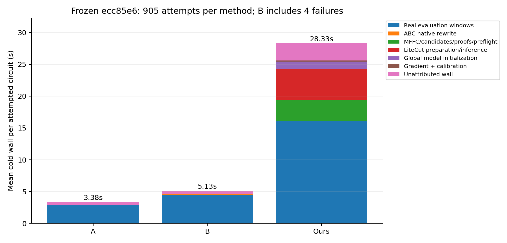

# 最新 905 实验 Runtime 分析

正式算法冻结 `ecc85e6ac82571caf9f1a6004098dbe976536256`。仅分析已存 CSV/JSON，没有执行新 CULS、ABC、CEC、Mapping、LiteCut 或优化器。
A=原图 CEC+Mapping；B=一次 CPU ABC rewrite 后 CEC+Mapping；Ours=候选全量准备、局部打分、GPU 全局梯度及多次真实验证。

**主要结论：逐电路配对的 Ours 耗时中位为 A 的 7.41 倍、B 的 6.02 倍。去除嵌套计时后，真实 Replay/CEC/Mapping 区间占 Ours 总 wall 的 56.99%，LiteCut 管线占 17.12%，MFFC/候选/证明/预检占 11.41%；梯度与代理校准合计仅 0.72%。**

Ours 全905平均28.33s。若保持同样真实评估记录，只把其他部分理想化为零，仍有平均16.15s的真实评估相关区间；A/B平均完整耗时为3.38/5.13s。该核算不是新性能实测，说明仅优化代理计算不足以抵消现有工作量差。

## 端到端结果

| 方法 | PASS/FAIL | 中位 s | 平均 s | P90 s | 合计 s |
|---|---:|---:|---:|---:|---:|
| A | 905/0 | 2.3225 | 3.3849 | 5.8847 | 3063.3171 |
| B | 901/4 | 2.8215 | 5.1338 | 7.6835 | 4646.0542 |
| Ours | 905/0 | 18.7669 | 28.3323 | 49.6327 | 25640.7139 |

相对 A：905 个成功配对，逐电路 Ours/A 耗时比中位 7.4068；耗时差中位 16.4412s。超出协议容差的更快电路 0 个。

相对 B：901 个成功配对，逐电路 Ours/B 耗时比中位 6.0194；耗时差中位 15.9439s。超出协议容差的更快电路 1 个。

## 去重后的 Ours 顶层计时区间

| 阶段 | 有执行电路 | 执行者中位 s | 全905平均 s | 总 wall 占比 |
|---|---:|---:|---:|---:|
| 原图 CEC+Mapping | 905 | 1.8467 | 2.9204 | 10.31% |
| MFFC 分区 | 905 | 0.0661 | 0.1544 | 0.54% |
| 候选枚举及目录准备 | 905 | 1.3981 | 2.3075 | 8.14% |
| Boolean/上下文证明 | 905 | 0.0727 | 0.5514 | 1.95% |
| 候选复用预检 | 811 | 0.0974 | 0.2202 | 0.78% |
| LiteCut 准备、特征、推理及缓存写入 | 811 | 1.4705 | 4.8492 | 17.12% |
| 全局代理构建及设备初始化 | 811 | 1.1659 | 1.1952 | 4.22% |
| 联合梯度与候选块评分 | 811 | 0.0522 | 0.0874 | 0.31% |
| 代理反馈校准 | 777 | 0.0671 | 0.1170 | 0.41% |
| 付费 no-op Replay+CEC+Mapping | 905 | 2.6601 | 3.9982 | 14.11% |
| 搜索提案 Replay+CEC+Mapping（外层） | 778 | 6.5294 | 9.2279 | 32.57% |
| 未单独计时部分 | 905 | 2.4388 | 2.7037 | 9.54% |

原始阶段表中 678 个单请求 replay 窗口被外层 batch 包含，合计重复 3566.1687s。只保留初始化的 no-op `real_replay_cec_mapping` 和所有 `real_batch_replay_cec_mapping`；其余嵌套单请求不再累加。源码保证这些保留的顶层区间顺序执行，内部两路验证的并发只计外层 wall。
其余顶层阶段按源码顺序保留；剩余量=cold E2E−这些互不重叠阶段。所有905电路剩余量非负、逐项相加严格回到E2E。该剩余量包含未单独计时的导入/启动、哈希、图/目录保存、日志扫描、序列化、同步间隙等；没有独立测量，不能全部归因给 Torch 或传输。
阶段占比按总秒数/总E2E计算；中位数不可直接相加。原始工具/request inclusive 时间仍不可相加作wall占比。

## 对 A/B 耗时差的可加分解

| 差值来源 | 相对A平均增量 s（905对） | 相对B平均增量 s（901对） |
|---|---:|---:|
| 真实评估相关区间增量（含 Ours replay） | 13.2085 | 11.7231 |
| 分区、枚举、Boolean证明与预检 | 3.2334 | 3.2392 |
| LiteCut管线 | 4.8492 | 4.8517 |
| 全局模型构建 | 1.1952 | 1.1951 |
| 梯度+校准 | 0.2043 | 0.2046 |
| 未单独计时部分的差值 | 2.2567 | 2.2452 |
| 扣除基线原生ABC rewrite | 0.0000 | -0.2387 |

A/B 的验证按顺序工具命令窗口统计，Ours 按包含结果保存等工作的顶层评估窗口统计；粒度差进入剩余量。此分解用于完整核算，不声称独立测出了 Ours mapping/CEC 各自的独占wall。B的4个失败保留在全方法表中，成功配对分解排除它们。

## 工具调用与 inclusive 成本

| 方法/工具 | 调用数 | 每电路有调用者中位 s | 调用总 inclusive s | 总秒数/调用数 s |
|---|---:|---:|---:|---:|
| A/mapping | 905 | 1.8172 | 2569.3783 | 2.8391 |
| A/cec | 905 | 0.0641 | 89.4409 | 0.0988 |
| B/mapping | 901 | 1.7165 | 2320.2538 | 2.5752 |
| B/cec | 901 | 0.4647 | 1694.6541 | 1.8809 |
| B/native_rewrite | 905 | 0.1642 | 215.8255 | 0.2385 |
| Ours/mapping | 3944 | 7.9428 | 11307.9938 | 2.8671 |
| Ours/cec | 4284 | 1.0865 | 2735.9113 | 0.6386 |
| Ours/rewrite | 2312 | 1.0468 | 1431.6098 | 0.6192 |
| Ours/enumeration | 905 | 0.3660 | 462.6679 | 0.5112 |

Mapping 计时覆盖 `read_lib; read_aiger; map; topo; stime -p; write_verilog` 整个ABC命令，包含进程、库读入及结果写出；不是单独mapper内核时间。Ours两路验证可能并发，工具总inclusive秒数不能解释为独占wall或直接相加。

## GPU为什么没有使整体更快

1. A没有候选搜索，B只有一次原生rewrite；三种方法做的总工作量不同。Ours额外付费测原图和serialized no-op，再评估提案；不能用这两种基线测出同一算法的GPU加速率。
2. `global_timing/litecut.py:score_catalogue`逐decision/choice构造子图、验证truth、提取特征、生成JSON；`projects/culs/tools/gate3e_run.py:LiteCutPredictor.__init__`明确以CPU加载Student。128批次推理不意味着使用GPU。没有独立CPU特征/Student/缓存写入子时钟，无法进一步精确拆分本阶段。
3. 整体对全部 no-op和候选共 12,698,529 行打分，物理候选 8,402,256，decision 4,296,273。随后每电路总请求预算仅4；前端全候选准备工作量远大于最终提交组合数。
4. `scripts/run_mffc905.py:child/main`每个电路/方法启动独立子进程；Ours在判定有无候选之前就导入Torch，CUDA全局模型逐电路构建。初始化与导入成本不能跨电路摊销。811个有候选设计的局部分数缓存命中状态：{'False': 811}。
5. 实际设备分布：CUDA806、CPU5、无候选94。GPU负责候选聚合与全Region DAG前反传播；最终改图顺序受控，CEC与ABC mapping不由这个GPU代理加速。

806个CUDA设计原生DAG内核合计中位 70.0867ms；逐电路kernel/E2E比例中位 0.3515%，按该子集总秒数加权为 0.4894%。这只是原生内核事件，不能代表全部GPU/Torch耗时。即使把这部分记录时间完全消掉，账面收益仍有限；这不是CPU/GPU因果对照。

## 设备分组（描述性，不能比较成CPU/GPU加速率）

| 设备 | 电路数 | E2E中位s | E2E平均s | Ours/A中位 |
|---|---:|---:|---:|---:|
| cuda | 806 | 19.9186 | 30.7709 | 7.7891 |
| cpu | 5 | 7.1869 | 8.1138 | 5.0351 |
| none | 94 | 6.8577 | 8.4980 | 3.3926 |

## 耗时最长的10个电路

| ID/输入 | Ours s | LiteCut s | 原图+no-op+搜索真实区间 s | GPU原生内核 s |
|---|---:|---:|---:|---:|
| 108: forgeEDA/Back_End_With_Decode.aig | 562.3107 | 21.1131 | 485.5286 | 0.9262703647613525 |
| 827: forgeEDA/sd_controller_test_driver.aig | 537.2458 | 3.8184 | 493.0114 | 0.08596479988098145 |
| 147: forgeEDA/Division.aig | 498.2102 | 15.3457 | 466.1875 | 0.476563458442688 |
| 578: forgeEDA/mem_sim.aig | 246.4846 | 2.6226 | 202.5665 | 1.3160621147155762 |
| 471: forgeEDA/execute.aig | 243.9611 | 114.7782 | 67.6128 | 1.7775134658813476 |
| 511: forgeEDA/halfBandFirst.aig | 240.7869 | 103.9992 | 72.6761 | 1.098621940612793 |
| 541: forgeEDA/inv_key_gen.aig | 223.0924 | 126.7881 | 69.2832 | 0.7980953197479248 |
| 885: forgeEDA/y_dct.aig | 186.5452 | 80.7862 | 59.0844 | 1.0742241134643555 |
| 375: forgeEDA/cb_dct.aig | 172.3111 | 70.8414 | 56.9324 | 0.9215426559448242 |
| 556: forgeEDA/levinson_durbin.aig | 172.0004 | 53.7791 | 78.6515 | 0.8757084159851074 |

## 结论与证据边界

现有数据支持：整体慢主要由额外真实验证和CPU候选/LiteCut准备造成，GPU原生梯度传播本身已是小成本。优先检查真实验证次数/复用，以及全候选的CPU特征与数据准备；单纯继续优化原生GPU内核不能解释或弥补现有端到端差距。这里只定位既有成本，没有修改算法。
未验证：同一905算法、同一请求组合和预算下CPU/GPU的因果加速；Student GPU推理收益；独立H2D/D2H/特征/推理/JSON写入耗时；省略验证或跨电路共享初始化后的速度和质量。现有记录不支持给这些项编造精确收益。
原生GPU核函数及Torch聚合的阶段界限不同；阶段计时同步只给出已有执行的wall，不是设备利用率。固定方法顺序、未清系统页缓存、单seed、小预算保持原协议。

## 代码核查位置

| 已核查行为 | 冻结实现位置 |
|---|---|
| original/no-op分别付费、阶段同步和搜索外层计时 | [mffc_experiment.py](../../global_timing/mffc_experiment.py#L62) 的 `MffcExperiment.__init__/stage/run` |
| 单请求嵌套外层batch，两请求验证并行 | [execution.py](../../global_timing/execution.py#L137) 的 `execute_many` |
| 每个候选CPU构图、特征、批量推理和JSON写入 | [litecut.py](../../global_timing/litecut.py#L35) 的 `score_catalogue` |
| Student明确加载到CPU | [gate3e_run.py](../../projects/culs/tools/gate3e_run.py#L66) 的 `LiteCutPredictor.__init__` |
| 各电路独立冷子进程、Ours独立导入Torch | [run_mffc905.py](../../scripts/run_mffc905.py#L83) 的 `child/main` |

811个有候选设计的候选数量与LiteCut阶段耗时 Spearman 相关为0.9592，是描述性关联，不能据此分离特征提取、推理、序列化各自耗时。候选枚举阶段全905平均2.3075s，其中gpuls命令平均0.5112s，其余命令外准备平均1.7962s；源码对应解析目录、建立冲突与保存数据。

两个典型尾部：`Back_End_With_Decode`总562.31s，真实评估区间485.53s，原生GPU内核0.93s；`inv_key_gen`总223.09s，LiteCut阶段126.79s，真实评估区间69.28s，原生GPU内核0.80s。不同电路的主要成本确实不同，逐电路分解已完整保留。

## 文件与复现

原数据：`/data/wushangge/CULS_LiteCut/runs/20261115T124356Z-mffc905-compact-analysis-bundle-ae7c3327/output/bundle`；输出：`/data/wushangge/CULS_LiteCut/runs/20261116T023042Z-mffc905-runtime-analysis-c7af31f2/output`；分析Slurm作业：`65472`。
`runtime_summary.json`保存全部统计和分母；`runtime_per_circuit.csv`保存905个电路的去重分解与A/B对照；`runtime_stage_summary.csv`为阶段汇总；`INPUT_CHECKSUMS.sha256`记录输入哈希。
`scripts/analyze_mffc905_runtime.py --run <prepared-run> --bundle <existing-bundle>`只读已存结果。所有解释依赖的5个计时源码文件已逐字节核对与冻结正式src一致。

